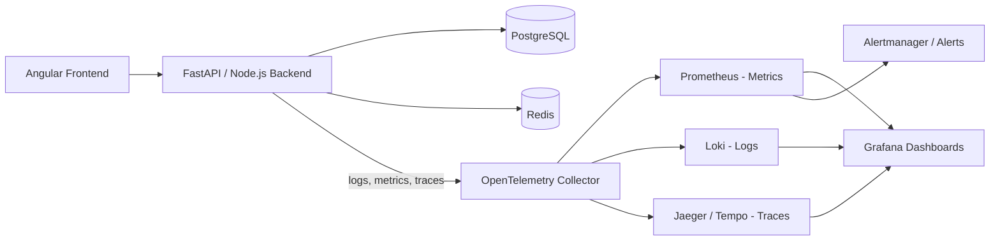
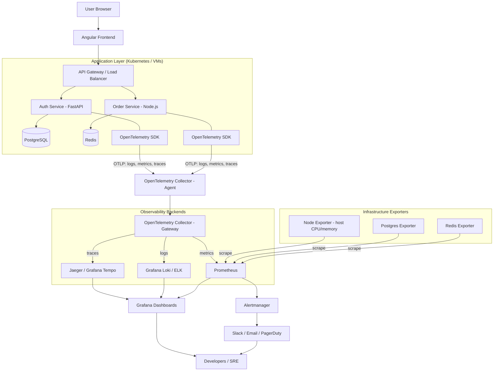
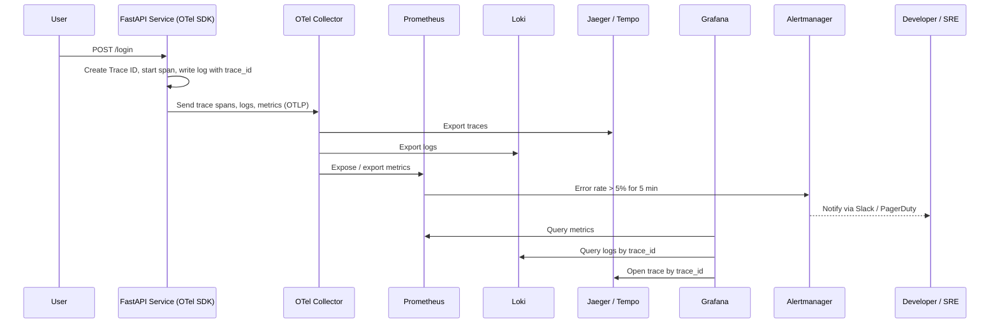

# The Three Pillars of Observability

In simple terms, Observability helps us understand what is happening inside an application, why it is happening, and where a problem is occurring.

Imagine you have an enterprise application with:

- Angular Frontend
- FastAPI / Node.js Backend
- PostgreSQL Database
- Redis Cache
- Multiple microservices

Suppose a user clicks the Login button, but the application takes 8 seconds to respond.

How do we identify the problem?

This is where the three pillars of observability help us.

---

## 1. Logs — What happened?

**Definition:** Logs are timestamped records of individual events occurring inside an application.

They tell us what happened at a particular moment.

**Example:**

```text
10:02:01 INFO  User clicked Login
10:02:02 INFO  Login API called
10:02:03 INFO  Database connection established
10:02:04 ERROR Invalid password
10:02:04 INFO  Login request completed
```

**Real-world example:**

A user reports that login is failing.

You check application logs and discover:

```text
ERROR: Database connection timeout
```

Now you know the backend could not connect to the database.

**Tools:**

- Splunk
- ELK Stack
- Grafana Loki

---

## 2. Metrics — How much / How often?

**Definition:** Metrics are numerical measurements collected over time to understand application and infrastructure performance.

They help us identify trends, performance degradation and abnormal behavior.

**Example:**

| Metric              | Value       |
|---------------------|-------------|
| CPU Usage           | 85%         |
| Memory Usage        | 75%         |
| API Response Time   | 2.5 seconds |
| Requests per second | 1,200       |
| Error Rate          | 8%          |

**Real-world example:**

Your application suddenly becomes slow.

You check metrics and discover:

- CPU usage = 95%
- Memory usage = 90%
- API response time = 5 seconds

This suggests the server may be overloaded.

**Tools:**

- Prometheus
- Grafana
- Datadog

---

## 3. Distributed Traces — Where did the request go?

**Definition:** Distributed tracing tracks the complete journey of a single request across multiple services.

It helps identify exactly which service or operation is consuming time.

Imagine this request: a user clicks Login.

```text
Angular Frontend
    User clicks Login
        |
        v
API Gateway
    Request routing — 20 ms
        |
        v
Authentication Service
    Authentication — 30 ms
        |
        v
PostgreSQL Database
    Slow operation — 2,000 ms
    User record lookup
        |
        v
Response returned
    Total request duration: approximately 2,050 ms
```

The distributed trace tells us:

- API Gateway took 20 ms.
- Authentication Service took 30 ms.
- Database query took 2,000 ms.

**Conclusion:** The database query is the bottleneck, not Angular or the API Gateway.

**Tools:**

- Jaeger
- Grafana Tempo
- OpenTelemetry

---

## 4. Difference between the three pillars

| Concept | Question answered   | Example                    |
|---------|---------------------|----------------------------|
| Logs    | What happened?      | Database connection failed |
| Metrics | How much / How often? | CPU usage is 95%         |
| Traces  | Where did it happen? | Database query took 2 seconds |

---

## 5. How they work together in a production application

Let's say your users report that the application is slow.

### Production troubleshooting workflow

1. **Metrics identify the problem**

   API response time increased from 200 ms to 3 seconds.

2. **Traces identify the bottleneck**

   Database query is taking 2.5 seconds.

3. **Logs explain the error**

   Database logs show a slow query caused by a missing index.

4. **Developer fixes the issue**

   Add an appropriate database index and verify the improvement.

---

## 6. Important tools to understand

One important concept is that OpenTelemetry is not the same as Prometheus, Grafana or Jaeger.

| Tool          | Responsibility                           |
|---------------|------------------------------------------|
| OpenTelemetry | Collects and exports telemetry data      |
| Prometheus    | Collects and stores metrics              |
| Grafana       | Visualizes metrics and dashboards        |
| Loki          | Stores and queries logs                  |
| Jaeger        | Visualizes distributed traces            |
| Splunk        | Log management and analysis              |

---

## 7. Interview-ready answer

**Question:** What are the three pillars of observability?

**Answer:**

"The three pillars of observability are Logs, Metrics, and Distributed Traces.

1. Logs help us understand what happened inside an application.
2. Metrics help us measure application performance and identify abnormal behavior over time.
3. Distributed Traces help us track a request across multiple microservices and identify performance bottlenecks.

Together, they help developers monitor, troubleshoot, and maintain distributed applications in production."

---

## 8. Important concepts to make your understanding production-ready

### 8.1 Correlation ID / Trace ID

A unique identifier that helps connect logs and traces belonging to the same request across multiple microservices.

```text
10:02:01 INFO  trace_id=abc123 API Gateway received /login
10:02:02 INFO  trace_id=abc123 Auth Service validating user
10:02:03 ERROR trace_id=abc123 Database connection timeout
```

Searching for `abc123` returns every log line and trace span for that one request.

### 8.2 Alerting

Automatically notify developers when metrics cross predefined thresholds, such as API error rate exceeding 5%.

### 8.3 OpenTelemetry Collector

Receives, processes, and exports telemetry data to observability backends.

### Complete observability architecture



### One important distinction

| Concept       | Purpose                                         |
|---------------|-------------------------------------------------|
| Monitoring    | Tells you whether something is wrong            |
| Observability | Helps you investigate why it is wrong           |
| Alerting      | Notifies you when something needs attention     |

### Remember this for interviews

- Logs = What happened?
- Metrics = How much / How often?
- Traces = Where did the request spend its time?
- Trace ID = Which logs and operations belong to the same request?

---

## 9. How to set up observability tools in production

### 9.1 Production architecture



### 9.2 Step-by-step setup

| Step | What to do | Tools |
|------|------------|-------|
| 1 | Instrument the application code (auto + manual) so it emits logs, metrics and traces | OpenTelemetry SDK for Python / Node.js / Angular (browser) |
| 2 | Add a Trace ID to every log line and propagate it in HTTP headers (`traceparent`) between services | OpenTelemetry context propagation |
| 3 | Run an OpenTelemetry Collector next to each app (agent) and a central one (gateway) | OpenTelemetry Collector |
| 4 | Expose infrastructure metrics (host, database, cache) | Node Exporter, Postgres Exporter, Redis Exporter |
| 5 | Store each signal in a specialised backend | Prometheus (metrics), Loki / ELK (logs), Jaeger / Tempo (traces) |
| 6 | Build dashboards that combine all three signals | Grafana |
| 7 | Define alert rules and routing | Prometheus rules + Alertmanager → Slack / PagerDuty |
| 8 | Secure, size and tune (retention, sampling, access control) | See 9.4 |

### 9.3 Request flow with observability



### 9.4 Production best practices

- **Sampling:** do not store 100% of traces at high traffic. Use head or tail sampling (for example keep all error traces and 5-10% of normal ones).
- **Retention:** keep metrics longer (weeks/months), logs and traces shorter (days/weeks) to control cost.
- **Structured logs:** write JSON logs with `trace_id`, `service`, `level` and `timestamp` so they can be searched and correlated.
- **Low-cardinality labels:** avoid labels such as `user_id` or `request_id` on metrics; they explode Prometheus storage.
- **High availability:** run Prometheus, Alertmanager and the Collector gateway with replicas; use long-term storage (Thanos, Mimir or object storage) for metrics, logs and traces.
- **Security:** never log passwords, tokens or personal data; protect Grafana with SSO and role-based access; use TLS between components.
- **Alert on symptoms, not causes:** alert on error rate, latency and saturation that users feel, and keep alerts actionable to avoid alert fatigue.
- **Runbooks:** link every alert to a runbook that tells the on-call engineer what to check first.

### 9.5 Example alert rule (Prometheus)

```yaml
groups:
  - name: api-alerts
    rules:
      - alert: HighErrorRate
        expr: |
          sum(rate(http_server_requests_total{status=~"5.."}[5m]))
            / sum(rate(http_server_requests_total[5m])) > 0.05
        for: 5m
        labels:
          severity: critical
        annotations:
          summary: "API error rate is above 5% for 5 minutes"
```

### 9.6 Typical deployment options

| Option | Description | When to use |
|--------|-------------|-------------|
| Self-hosted open source | Prometheus + Grafana + Loki + Tempo/Jaeger + OTel Collector on Kubernetes (Helm charts) | Full control, lower licence cost, team can operate it |
| Managed open source | Grafana Cloud, Amazon Managed Prometheus / Grafana | Less operational work, pay per usage |
| Commercial SaaS | Datadog, Splunk, New Relic | Fastest start, single vendor, higher cost |

Because applications only talk to the OpenTelemetry Collector, you can switch backends (for example from Jaeger to Datadog) without changing application code.


---

## Recommendation

For your system design and full-stack learning: build a small Angular + FastAPI + PostgreSQL application and integrate OpenTelemetry, Prometheus, Grafana, and Jaeger. You will understand observability much better by seeing a real API request travel through the system and examining its logs, metrics, and trace.

For practical learning, your next step should be integrating OpenTelemetry into your Angular + FastAPI + PostgreSQL application.
