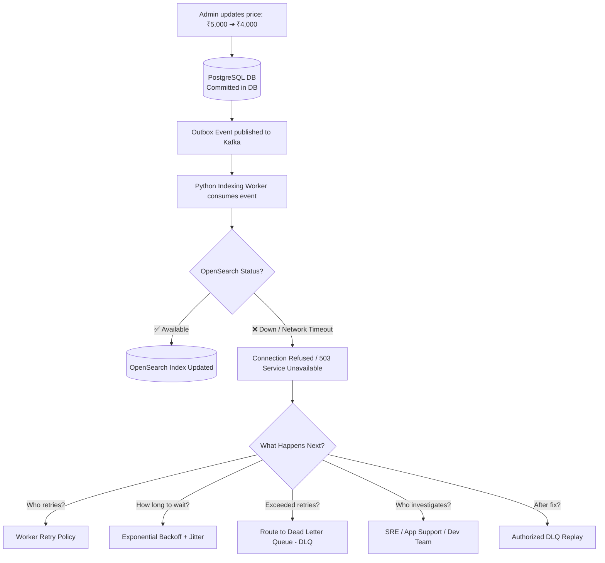
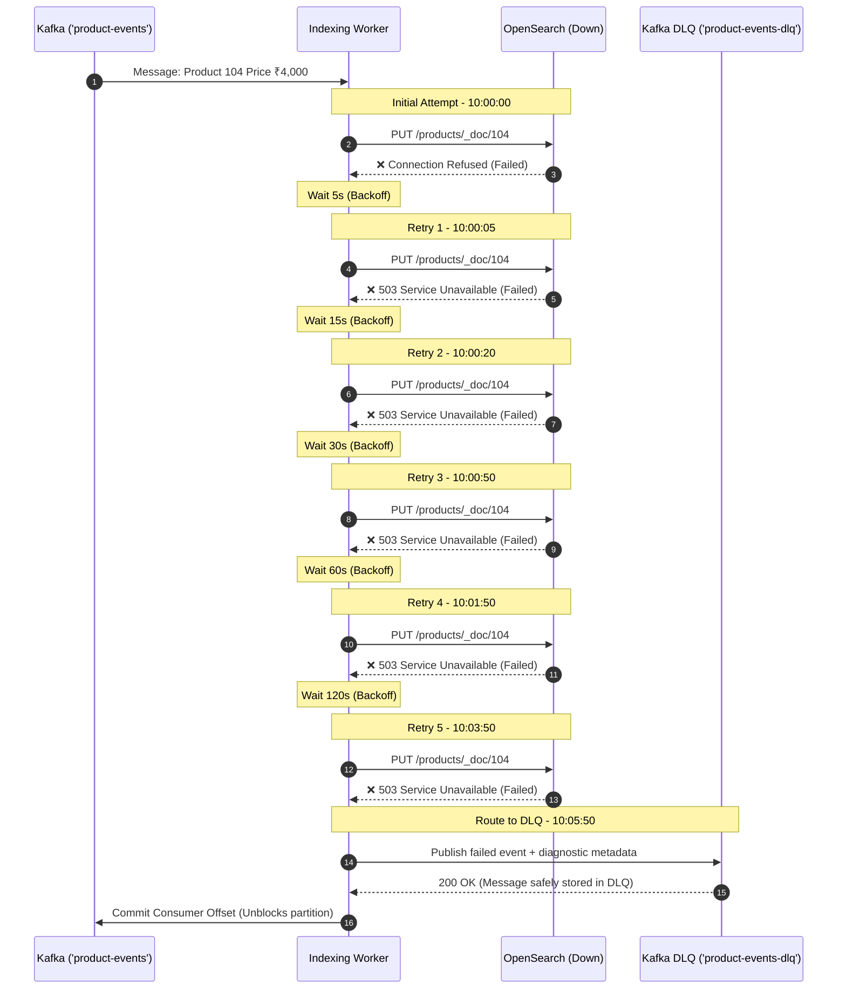
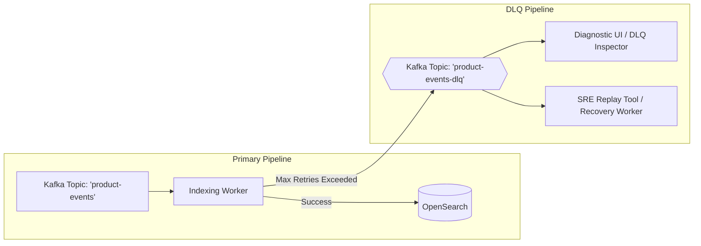
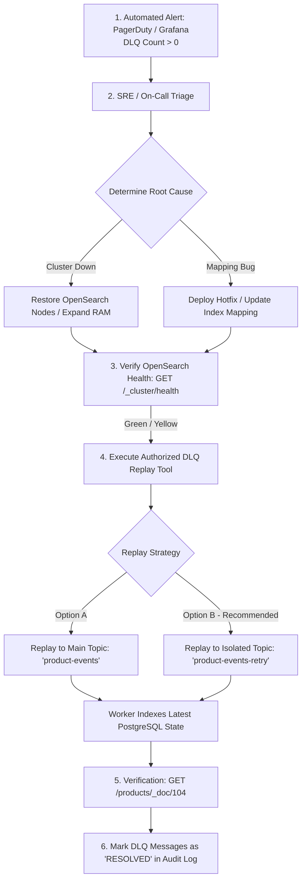
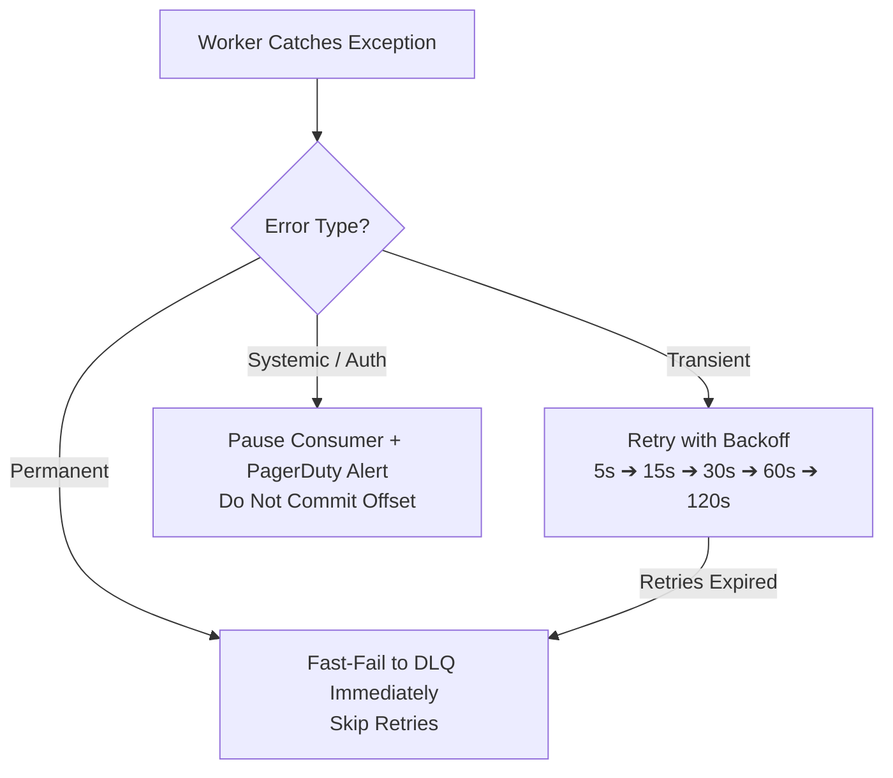
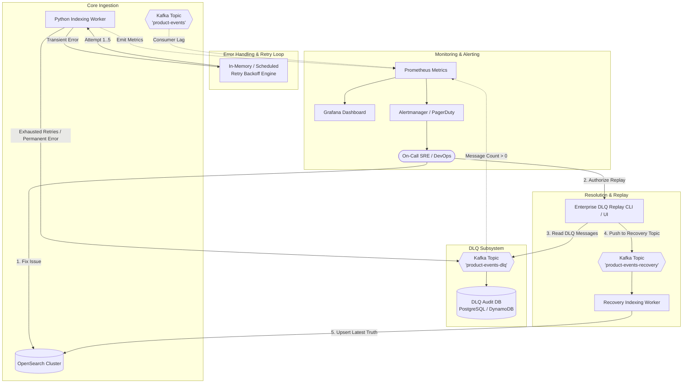

# Kafka Retry & Dead Letter Queue (DLQ) – Enterprise Architecture & Operational Lifecycle

## Table of Contents
1. [Overview & The Problem Statement](#1-overview--the-problem-statement)
2. [Who Decides Retry Interval and Retry Count?](#2-who-decides-retry-interval-and-retry-count)
3. [Real-Time Retry Execution Timeline](#3-real-time-retry-execution-timeline)
4. [What Exactly is a Dead Letter Queue (DLQ)?](#4-what-exactly-is-a-dead-letter-queue-dlq)
5. [Who Investigates Failed Events? (Team Responsibility Matrix)](#5-who-investigates-failed-events-team-responsibility-matrix)
6. [Step-by-Step Incident Resolution & DLQ Replay Workflow](#6-step-by-step-incident-resolution--dlq-replay-workflow)
7. [Transient vs. Permanent Error Classification](#7-transient-vs-permanent-error-classification)
8. [Complete Enterprise Failure, Retry & Recovery Architecture](#8-complete-enterprise-failure-retry--recovery-architecture)
9. [Five Golden Rules for Production Reliability](#9-five-golden-rules-for-production-reliability)
10. [Test Your Understanding](#10-test-your-understanding)

---

## 1. Overview & The Problem Statement

In an enterprise e-commerce search pipeline, data changes flow asynchronously from the primary transactional database to the search engine:

$$\text{PostgreSQL} \xrightarrow{\text{Outbox}} \text{Apache Kafka} \xrightarrow{\text{Consumer}} \text{Python Indexing Worker} \xrightarrow{\text{REST API}} \text{OpenSearch}$$

### The Failure Scenario
Suppose an admin updates a product price from **₹5,000 $\to$ ₹4,000**. The update commits in PostgreSQL and is published to Kafka. However, when the indexing worker tries to update OpenSearch, the search cluster is **temporarily unavailable** (e.g., node reboot, garbage collection pause, network partition, or cluster resource exhaustion).



---

## 2. Who Decides Retry Interval and Retry Count?

> 📌 **Key Architectural Rule:** **The application and platform engineering teams decide the retry policy.** Kafka itself does not automatically decide business retry counts or retry intervals.

You configure the retry strategy within the **consumer application (indexing worker)** or through a **retry-topic orchestrator**.

### Why Not Retry Constantly Every Second?
If 10,000 indexing events fail simultaneously and all retry every second, they create a **"Retry Storm" (Thundering Herd Problem)**. When OpenSearch recovers, it will immediately crash again under the avalanche of simultaneous retries.

### Exponential Backoff with Jitter Formula
To protect downstream services, enterprise workers use **Exponential Backoff with Random Jitter**:

$$\text{Delay}(n) = \min\left(\text{Initial Delay} \times 2^{n-1},\, \text{Max Delay}\right) \pm \text{Random Jitter}$$

* $n$: Attempt number $(1, 2, 3, \dots)$
* $\text{Initial Delay}$: 5 seconds
* $\text{Multiplier}$: 2
* $\text{Max Delay}$: 120 seconds
* $\text{Jitter}$: Random variance ($\pm 10\% - 20\%$) to de-synchronize concurrent retries.

### Standard Enterprise Retry Schedule

| Attempt | Wait Duration | Cumulative Elapsed Time | Action If Failed |
| :--- | :---: | :---: | :--- |
| **Initial Try** | Immediate ($0\text{ s}$) | $0\text{ s}$ | Trigger Retry 1 |
| **Retry 1** | $5\text{ seconds}$ | $5\text{ s}$ | Trigger Retry 2 |
| **Retry 2** | $15\text{ seconds}$ | $20\text{ s}$ | Trigger Retry 3 |
| **Retry 3** | $30\text{ seconds}$ | $50\text{ s}$ | Trigger Retry 4 |
| **Retry 4** | $60\text{ seconds}$ | $110\text{ s}$ ($1\text{m } 50\text{s}$) | Trigger Retry 5 |
| **Retry 5** | $120\text{ seconds}$ | $230\text{ s}$ ($3\text{m } 50\text{s}$) | Max retries exceeded $\to$ **Send to DLQ** |

---

## 3. Real-Time Retry Execution Timeline

Here is the exact step-by-step execution timeline when OpenSearch is down for 6 minutes:



---

## 4. What Exactly is a Dead Letter Queue (DLQ)?

A **Dead Letter Queue (DLQ)** is a dedicated Kafka topic (e.g., `product-events-dlq`) used as a holding area for messages that cannot be processed after exhausting all retry attempts or encountering unrecoverable errors.



### Production DLQ Message Schema

A production DLQ message wraps the **original event payload** with rich **diagnostic metadata**:

```json
{
  "dlq_id": "dlq-msg-994182",
  "original_topic": "product-events",
  "original_partition": 2,
  "original_offset": 849102,
  "original_event_id": "evt-1002",
  "event_type": "PRODUCT_UPDATED",
  "aggregate_id": "104",
  "failure_reason": {
    "error_class": "OpenSearchConnectionError",
    "error_message": "ConnectionRefusedError: [Errno 111] Connection refused on opensearch-cluster:9200",
    "http_status": 503,
    "failed_endpoint": "PUT /products/_doc/104",
    "retry_count": 5,
    "first_attempt_at": "2026-11-22T10:00:00.000Z",
    "final_failure_at": "2026-11-22T10:05:50.000Z"
  },
  "service_context": {
    "service_name": "product-indexing-worker",
    "host_ip": "10.0.4.18",
    "worker_version": "v2.4.1"
  },
  "original_payload": {
    "product_id": 104,
    "name": "OnePlus 13",
    "category": "Mobile",
    "price": 60000,
    "stock": 20
  }
}
```

### Why DLQ Metadata Matters
1. **Root Cause Analysis:** Tells engineers *why* it failed without searching through gigabytes of logs.
2. **Impact Radius:** Identifies which specific product IDs (`104`) are out of sync.
3. **Audit Trail:** Proves how many retries occurred before escalation.

---

## 5. Who Investigates Failed Events? (Team Responsibility Matrix)

| Team / Role | Primary Responsibilities | Typical Scenarios Handled |
| :--- | :--- | :--- |
| **DevOps / SRE Team** | Infrastructure health, network partitions, cluster capacity, disk/RAM alerts | OpenSearch node crash, Kafka broker downtime, out-of-memory errors |
| **Application Dev Team** | Indexing worker code, schema mapping definitions, query formatting | Field type mismatch (e.g., text passed to integer field), Lucene parsing errors |
| **Backend API Team** | Producer logic, event serialization, database outbox table | Outbox table locking, missing required payload attributes |
| **L2 / L3 Production Support** | Alert triaging, incident coordination, DLQ backlog monitoring | PagerDuty incident triage, running authorized recovery replay scripts |
| **Data Engineering Team** | Pipeline schema evolution, historical backfills | Index mapping migrations, bulk index re-sync |

---

## 6. Step-by-Step Incident Resolution & DLQ Replay Workflow

When an incident occurs, **nobody needs to manually edit individual database rows or JSON files**. The workflow follows a disciplined operational sequence:



### Step 1: Root Cause Remediation
The SRE or DevOps team restores the OpenSearch cluster or fixes the infrastructure issue:
```bash
# Check cluster health
curl -X GET "https://opensearch-cluster:9200/_cluster/health?pretty"
# Response must be "status": "green" or "yellow"
```

### Step 2: Verification of Indexing APIs
Ensure the indexing worker can authenticate and index test documents:
```bash
curl -X GET "https://opensearch-cluster:9200/products/_count"
```

### Step 3: Replaying DLQ Messages

#### Replay Option A vs. Option B Comparison

```mermaid
graph TD
    subgraph Option A: Replay to Main Topic
        DLQ_A[(DLQ)] -->|Re-inject| MainTopic{{'product-events'}}
        MainTopic --> Worker_A[Live Indexing Worker]
    end

    subgraph Option B: Replay to Recovery Topic (Recommended)
        DLQ_B[(DLQ)] -->|Re-inject| RetryTopic{{'product-events-recovery'}}
        RetryTopic --> RecoveryWorker[Recovery Indexing Worker]
    end
```

* **Option A (Main Topic Re-injection):** Re-publishes messages directly into `product-events`. Simple, but can cause head-of-line blocking or delay fresh live user mutations.
* **Option B (Dedicated Recovery Topic - Best Practice):** Re-publishes to `product-events-recovery`. Processed by a dedicated recovery consumer pool without affecting live customer search traffic.

### Step 4: Indexing Worker Re-Processing
When the worker receives the replayed event, it retrieves the **latest authoritative product state from PostgreSQL** rather than blindly overwriting with stale snapshot data:

```python
# Worker Replay Logic (Python Example)
def process_dlq_replay_message(event):
    product_id = event["payload"]["product_id"]
    
    # Always fetch latest truth from PostgreSQL to prevent stale overwrite
    latest_product = db.query(Product).filter(Product.id == product_id).first()
    
    if latest_product and latest_product.is_active:
        opensearch_client.index(
            index="products",
            id=str(product_id),
            body=transform_to_search_doc(latest_product)
        )
    elif not latest_product or not latest_product.is_active:
        opensearch_client.delete(index="products", id=str(product_id), ignore=[404])
```

### Step 5: Mark DLQ Events as Recovered
The recovery tool marks the records as `RESOLVED` in the incident audit tracking database. DLQ messages in Kafka are retained according to the topic's retention policy (typically **14 to 30 days**) for compliance and auditing.

---

## 7. Transient vs. Permanent Error Classification

Not all errors should be retried 5 times. An intelligent worker classifies errors immediately:



### Error Classification Table

| Error Category | Specific Error Example | Action / Retry Strategy | Rationale |
| :--- | :--- | :--- | :--- |
| **Transient** | Connection Timeout, Socket Timeout | **Retry 5x with exponential backoff** | Network hiccup; likely to recover quickly. |
| **Transient** | OpenSearch `503 Service Unavailable` | **Retry 5x with exponential backoff** | Node reboot or rolling deployment in progress. |
| **Transient** | OpenSearch `429 Too Many Requests` | **Retry with backoff + increase jitter** | Index thread pool queue full; backoff lets queue drain. |
| **Permanent** | Malformed JSON payload | **Send to DLQ immediately (0 retries)** | Retrying bad JSON will never succeed. |
| **Permanent** | Missing required primary key (`product_id`) | **Send to DLQ immediately (0 retries)** | Data corruption at source; retries are wasteful. |
| **Permanent** | OpenSearch `400 MapperParsingException` | **Send to DLQ immediately (0 retries)** | Field type conflict (e.g., string in float field). |
| **Systemic** | OpenSearch `401 Unauthorized / 403 Forbidden` | **Pause consumer & alert SRE** | Expired API key/SSL cert; affects all messages. |

---

## 8. Complete Enterprise Failure, Retry & Recovery Architecture



---

## 9. Five Golden Rules for Production Reliability

### 1. Manual Consumer Offset Commits
> 🔴 **Rule:** Never enable `enable.auto.commit = true` in mission-critical indexing consumers.
>
> Commit the Kafka consumer offset **only after**:
> 1. The document is successfully indexed into OpenSearch (`200/201 OK`), **OR**
> 2. The failed message is successfully written to the Dead Letter Queue topic.

### 2. Idempotent Ingestion
> 🔴 **Rule:** Every indexing write must use the PostgreSQL Primary Key as the document `_id` (`PUT /products/_doc/{id}`).
>
> Kafka guarantees **at-least-once delivery**. If a network glitch causes duplicate event consumption, idempotent `PUT` updates the document in place without creating duplicate records.

### 3. Kafka Partitioning by Product ID
> 🔴 **Rule:** Always use `product_id` as the Kafka message partition key.
>
> All price updates and inventory changes for product `104` will always land on the **same Kafka partition**, guaranteeing strict in-order sequential processing per product.

### 4. Fetch-on-Replay (Preventing Stale Overwrites)
> 🔴 **Rule:** When replaying messages from the DLQ that failed hours ago, do not blindly index the stale event snapshot.
>
> The worker should query PostgreSQL for the **current state** of the product before indexing into OpenSearch to avoid overwriting newer updates that occurred in the meantime.

### 5. Multi-Layer Monitoring & Alerts
> 🔴 **Rule:** Set automated alerts for:
> * `dlq_message_count > 0` (Immediate PagerDuty notification).
> * `indexing_worker_error_rate > 1%` over a 5-minute window.
> * `kafka_consumer_lag > 5000` messages.
> * OpenSearch cluster status $\neq$ `green`.

---

## 10. Test Your Understanding

1. **Why does Kafka not automatically handle retry intervals and dead-letter queues by default?**
   * *Answer:* Kafka is a dumb-broker/smart-consumer distributed log. It is agnostic to business logic, HTTP timeouts, and downstream system semantics. Retry intervals and error classification must be governed by the consumer application layer.
2. **What is the risk of retrying immediately without exponential backoff when OpenSearch goes down?**
   * *Answer:* It triggers a thundering herd (retry storm) where thousands of queued requests overwhelm OpenSearch the moment it attempts to restart, leading to cascading failures.
3. **Why should you commit the Kafka offset when a message is routed to the DLQ?**
   * *Answer:* If you do not commit the offset, the consumer will remain blocked on that failed message forever (head-of-line blocking), halting processing for all subsequent valid messages on that partition.
4. **How do you ensure that replaying an old event from the DLQ does not overwrite a newer price change?**
   * *Answer:* By using either version-aware indexing (`version_type=external_gte` with timestamps) or having the worker query the latest record directly from PostgreSQL during replay.
5. **What is the difference between a transient error and a permanent error in the indexing pipeline?**
   * *Answer:* A transient error (e.g., 503 cluster unavailable, network timeout) is temporary and will succeed upon retry. A permanent error (e.g., malformed JSON, schema parsing error) will never succeed on retry and should be routed immediately to the DLQ.
