# OpenSearch – Advanced Product Search & Enterprise Architecture

## Table of Contents
1. [History & Evolution: Was OpenSearch Invented Before or After AI?](#1-history--evolution-was-opensearch-invented-before-or-after-ai)
2. [The Core Problem in Product Catalogs](#2-the-core-problem-in-product-catalogs)
3. [PostgreSQL vs. OpenSearch: Role Separation](#3-postgresql-vs-opensearch-role-separation)
4. [Enterprise Architecture & Database Integration](#4-enterprise-architecture--database-integration)
5. [The Two Primary Operational Flows](#5-the-two-primary-operational-flows)
6. [Data Synchronization Strategies (PostgreSQL $\to$ OpenSearch)](#6-data-synchronization-strategies-postgresql--opensearch)
7. [Handling Updates, Price Changes, and Deletions](#7-handling-updates-price-changes-and-deletions)
8. [How Fuzzy Matching & Typo Tolerance Work](#8-how-fuzzy-matching--typo-tolerance-work)
9. [Core Enterprise Search Features](#9-core-enterprise-search-features)
10. [Enterprise Example: Banking Application (Transaction Search)](#10-enterprise-example-banking-application-transaction-search)
11. [The Three-Tier Enterprise Data Stack: PostgreSQL vs. OpenSearch vs. Redis](#11-the-three-tier-enterprise-data-stack-postgresql-vs-opensearch-vs-redis)
12. [Production Reliability & Edge Cases](#12-production-reliability--edge-cases)
13. [Eventual Consistency & The Checkout Validation Trap](#13-eventual-consistency--the-checkout-validation-trap)
14. [Decision Matrix: When to Use What](#14-decision-matrix-when-to-use-what)
15. [Enterprise Technology Stack](#15-recommended-enterprise-technology-stack)
16. [Enterprise OpenSearch Learning Roadmap](#16-enterprise-opensearch-learning-roadmap)
17. [Test Your Understanding](#17-test-your-understanding)
18. [Companion Guide 1: Real-Time Enterprise Test Cases (CRUD & Search)](./Realtime_Enterprise_Test_Cases_CRUD_and_Search.md)
19. [Companion Guide 2: Kafka Retry & Dead Letter Queue (DLQ) Architecture](./Kafka_Retry_and_Dead_Letter_Queue_DLQ_Architecture.md)

---

## 1. History & Evolution: Was OpenSearch Invented Before or After AI?

**OpenSearch existed before the modern generative AI boom. It was not invented for AI.**

OpenSearch is fundamentally a traditional **distributed search and analytics engine** built on top of Apache Lucene.

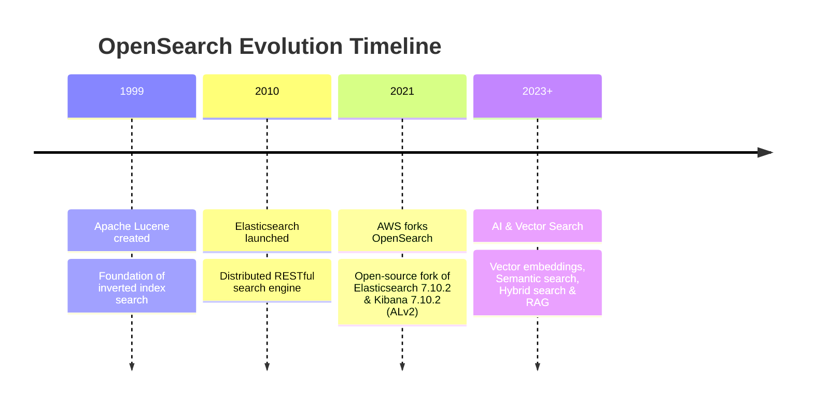

### Historical Timeline

| Year | Technology / Milestone | Description |
| :--- | :--- | :--- |
| **1999** | **Apache Lucene** | High-performance full-text search library in Java using inverted indexes. |
| **2010** | **Elasticsearch** | Built distributed clustering, JSON REST APIs, and horizontal scaling on Lucene. |
| **2021** | **OpenSearch Created** | AWS created an open-source, community-driven fork of Elasticsearch 7.10.2 and Kibana 7.10.2 under the Apache 2.0 license. |
| **2023+** | **AI & Vector Capabilities** | Added k-NN (k-nearest neighbors) vector search, neural search, semantic search, and RAG support. |

### Traditional vs. Modern AI Workloads

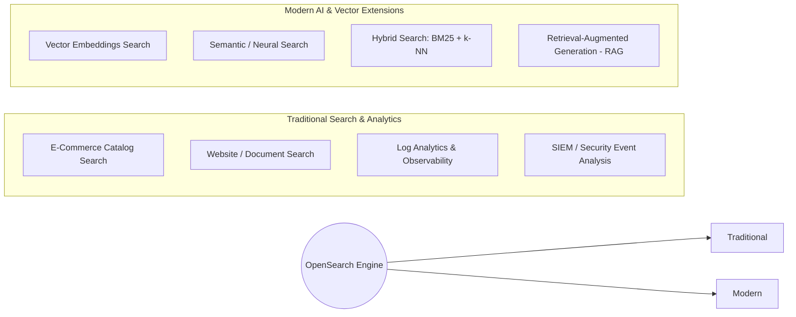

* **Traditional Search Roots:** Inverted index tokenization, BM25 text relevance, fuzzy matching, faceted navigation, log aggregation.
* **Modern AI Additions:** Vector search (k-NN plugin), semantic search with dense embedding models, hybrid search (combining keyword BM25 + dense vector cosine similarity), and context retrieval for LLMs (RAG).

> 📌 **Key Takeaway:** OpenSearch is not an "AI product". It is an enterprise search engine that has evolved to support AI workloads alongside traditional text search.

---

## 2. The Core Problem in Product Catalogs

In an e-commerce catalog with **10 million products**, customers frequently make typos when searching:

```text
Customer Input:  "wirless headfone"
Intended Target: "Wireless Headphones"
```

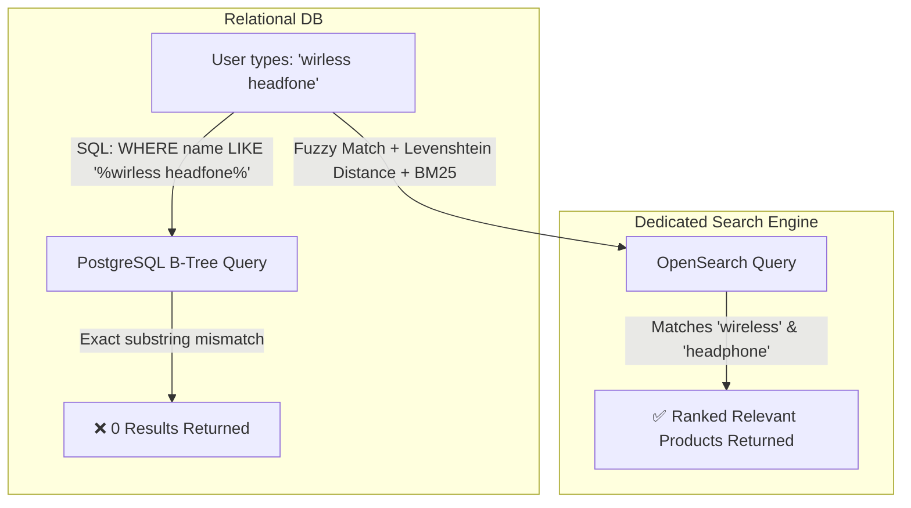

### Why Relational Databases Struggle at Scale
1. **Typo Tolerance:** Exact matching (`LIKE` / `=`) fails on misspelled words.
2. **Relevance Scoring:** Relational databases return boolean matches without sophisticated scoring (e.g., BM25 term frequency / inverse document frequency).
3. **Faceted Navigation:** Running multiple `COUNT(DISTINCT)` or `GROUP BY` aggregations across millions of rows causes table locks and high latency.
4. **Throughput Bottlenecks:** Thousands of concurrent search queries can exhaust database connection pools.

---

## 3. PostgreSQL vs. OpenSearch: Role Separation

> ⚠️ **Core Architecture Principle:** OpenSearch is **never** a replacement for PostgreSQL. PostgreSQL remains the **single source of truth** (ACID transactions, relational integrity). OpenSearch is a **derived, read-optimized search index**.

| Capability | PostgreSQL (Authoritative DB) | OpenSearch (Search Engine) |
| :--- | :--- | :--- |
| **Primary Role** | Main transactional database | Distributed search & analytics index |
| **Data Nature** | Authoritative source of truth | Derived, searchable JSON documents |
| **Transactions & ACID** | Strict ACID compliance | No multi-document ACID transactions |
| **Relationships & Joins** | Excellent (Foreign keys, complex SQL joins) | Flat or nested documents (Joins are expensive) |
| **Exact Match Search** | Yes (B-Tree indexed lookups) | Yes (Keyword term filters) |
| **Fuzzy / Typo Search** | Limited (Requires custom pg_trgm extensions) | Built-in, high-performance Levenshtein fuzzy queries |
| **Relevance Ranking** | Basic text ranking | Advanced BM25 scoring with field boosting (`^3`) |
| **Faceted Aggregations** | Possible with `GROUP BY` (slow at scale) | Native, sub-second bucket aggregations |
| **Data Consistency** | Immediate / Strong consistency | Eventual consistency (Index pipeline lag) |
| **Scaling Model** | Vertical scaling, Read Replicas | Horizontal sharding & distributed replica nodes |

---

## 4. Enterprise Architecture & Database Integration

An enterprise architecture cleanly decouples the **Search Query Path (Read Path)** from the **Data Ingestion Pipeline (Write/CDC Path)**.

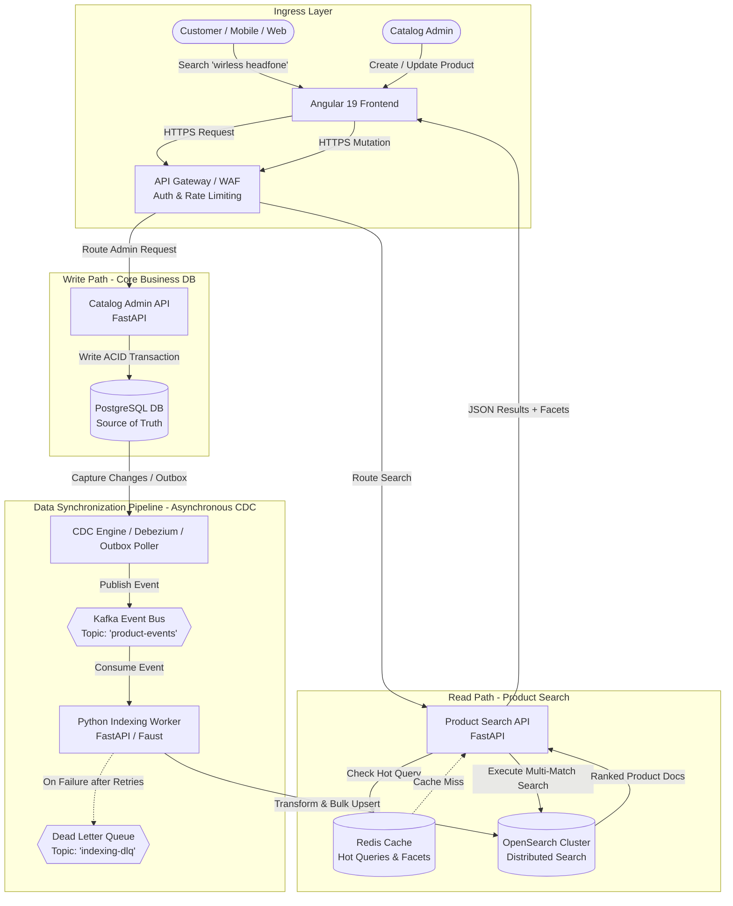

---

## 5. The Two Primary Operational Flows

### Flow 1: When an Admin Creates or Updates a Product (Write Flow)

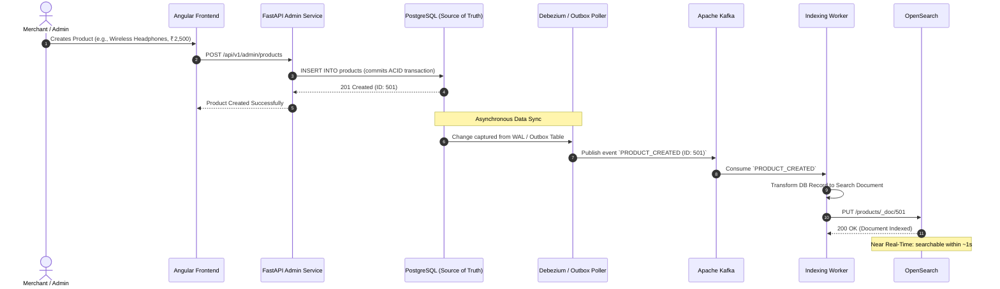

#### Comparison: PostgreSQL Record vs. OpenSearch Document

OpenSearch does not need every internal database column (e.g., supplier ID, cost price, internal audit logs). Only index fields required for searching, filtering, and summary display:

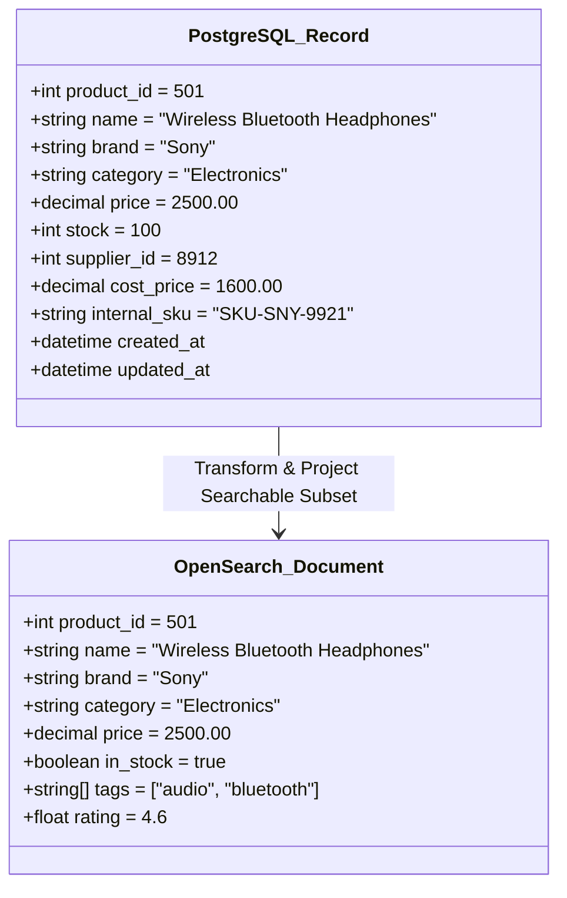

### Flow 2: When a Customer Searches for a Product (Read Flow)

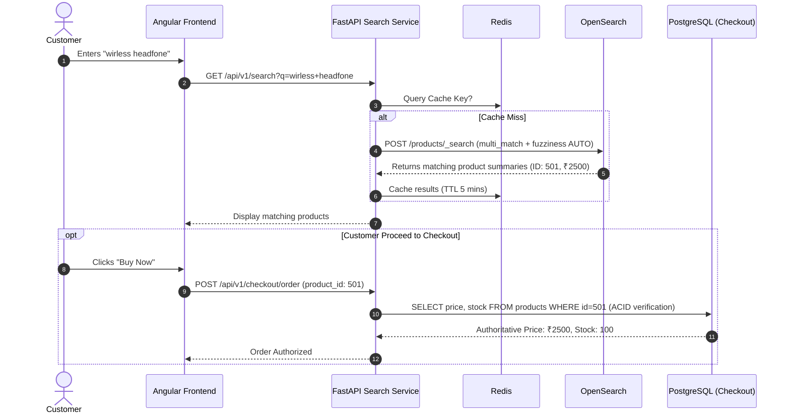

---

## 6. Data Synchronization Strategies (PostgreSQL $\to$ OpenSearch)

OpenSearch **does not automatically synchronize** with PostgreSQL. An enterprise architecture must select the appropriate synchronization pattern:

```mermaid
graph TD
    subgraph Approach 1: Dual Writing
        A1[FastAPI Service] -->|1. Write| A2[(PostgreSQL)]
        A1 -->|2. Write| A3[(OpenSearch)]
    end

    subgraph Approach 2: Transactional Outbox + Kafka (Recommended)
        B1[FastAPI Service] -->|Atomic ACID Write| B2[(PostgreSQL\nProduct + Outbox Table)]
        B2 -->|Poll Outbox| B3[Outbox Publisher]
        B3 -->|Publish| B4{{Kafka}}
        B4 -->|Consume| B5[Indexing Worker]
        B5 -->|Upsert Document| B6[(OpenSearch)]
    end

    subgraph Approach 3: Change Data Capture CDC
        C1[(PostgreSQL WAL Logs)] -->|Stream Logs| C2[Debezium Connector]
        C2 -->|Publish| C3{{Kafka}}
        C3 -->|Stream| C4[OpenSearch Sink]
        C4 -->|Index| C5[(OpenSearch)]
    end
```

### Strategy Tradeoff Analysis

| Pattern | How It Works | Advantages | Disadvantages / Risks | Recommendation |
| :--- | :--- | :--- | :--- | :--- |
| **1. Application Dual-Writing** | API service writes to PostgreSQL, then directly calls OpenSearch REST API. | Simplest to implement; no message broker needed. | **Dual-write trap:** If OpenSearch fails, DB succeeds $\to$ data drift. No retry ordering. | ❌ Avoid for production enterprise systems. |
| **2. Transactional Outbox + Kafka** | DB commits product data and outbox event in the same transaction. Worker reads Kafka and updates OpenSearch. | Guaranteed event delivery, message retry, loose coupling, handles backpressure. | Requires outbox poller/worker and message broker infrastructure. | ✅ **Recommended** for business-driven domain event pipelines. |
| **3. CDC via Debezium / WAL** | Debezium monitors PostgreSQL Write-Ahead Log (WAL) and streams all row mutations to Kafka. | Captures all DB changes without app code; handles bulk updates & hard deletes. | Requires Kafka Connect and WAL configuration; tight coupling to DB schema. | ✅ **Recommended** for high-volume database change streaming. |

---

## 7. Handling Updates, Price Changes, and Deletions

In production, database records are constantly updated or deleted. The indexing worker must handle each operation idempotently:

| Operation | PostgreSQL Action | CDC / Outbox Event | OpenSearch Action | Example OpenSearch Request |
| :--- | :--- | :--- | :--- | :--- |
| **Create Product** | `INSERT INTO products` | `PRODUCT_CREATED` | Index new document | `PUT /products/_doc/501` |
| **Update Details** | `UPDATE products SET ...` | `PRODUCT_UPDATED` | Partial or full doc update | `POST /products/_update/501` |
| **Price Change** | `UPDATE products SET price = 2000` | `PRICE_CHANGED` | Update price field | `POST /products/_update/501 { "doc": { "price": 2000 } }` |
| **Out of Stock** | `UPDATE products SET stock = 0` | `STOCK_DEPLETED` | Update `in_stock: false` | `POST /products/_update/501 { "doc": { "in_stock": false } }` |
| **Soft Delete** | `UPDATE products SET is_deleted = true` | `PRODUCT_DELETED` | Remove document from index | `DELETE /products/_doc/501` |
| **Hard Delete** | `DELETE FROM products WHERE id = 501` | `PRODUCT_DELETED` | Remove document from index | `DELETE /products/_doc/501` |

### Key Design Principles for Data Integrity
1. **Deterministic Document IDs:** Always use the PostgreSQL Primary Key as the OpenSearch `_id` (`/products/_doc/501`). This ensures idempotent updates and prevents duplicate documents upon event replays.
2. **Version Tracking:** Use PostgreSQL's `updated_at` timestamp or version number as OpenSearch's `version` parameter to prevent out-of-order race conditions.

---

## 8. How Fuzzy Matching & Typo Tolerance Work

Fuzzy matching in OpenSearch is powered by the **Levenshtein Distance** algorithm (calculating the number of single-character insertions, deletions, or substitutions required to match words).

### Typo Matching Table

| User Input | Target Indexed Term | Levenshtein Distance | Matched? |
| :--- | :--- | :---: | :---: |
| `wirless` | `wireless` | 1 (insert 'e') | ✅ Yes |
| `headfone` | `headphone` | 2 (substitute 'f' $\to$ 'ph') | ✅ Yes |
| `bluetoth` | `bluetooth` | 1 (insert 'o') | ✅ Yes |
| `samsng` | `samsung` | 1 (insert 'u') | ✅ Yes |
| `iphnoe` | `iphone` | 1 (transpose 'no' $\to$ 'on') | ✅ Yes |

### Production Multi-Match Query Example

```json
GET products/_search
{
  "query": {
    "bool": {
      "must": [
        {
          "multi_match": {
            "query": "wirless headfone",
            "fields": [
              "name^3",
              "tags^2",
              "brand^2",
              "category",
              "description"
            ],
            "fuzziness": "AUTO",
            "prefix_length": 2,
            "max_expansions": 50
          }
        }
      ],
      "filter": [
        { "term": { "in_stock": true } },
        { "range": { "price": { "gte": 1000, "lte": 5000 } } }
      ]
    }
  },
  "aggs": {
    "brands": {
      "terms": { "field": "brand.keyword", "size": 10 }
    },
    "categories": {
      "terms": { "field": "category.keyword", "size": 5 }
    },
    "price_ranges": {
      "range": {
        "field": "price",
        "ranges": [
          { "to": 1500 },
          { "from": 1500, "to": 3000 },
          { "from": 3000 }
        ]
      }
    }
  }
}
```

### Query Parameter Breakdown
* `multi_match`: Executes search simultaneously across multiple fields.
* `name^3`: Gives matches in the `name` field $3\times$ higher weight in BM25 scoring.
* `fuzziness: "AUTO"`:
  * 0..2 chars: 0 edits permitted.
  * 3..5 chars: 1 edit permitted.
  * $>5$ chars: 2 edits permitted.
* `prefix_length: 2`: Prevents fuzzy matching on the first two characters to significantly improve query execution speed.
* `aggs`: Dynamically calculates real-time filter counts for faceted search.

---

## 9. Core Enterprise Search Features

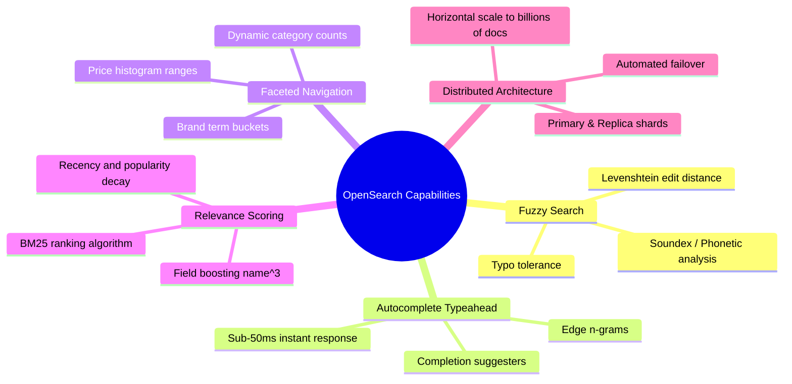

1. **Fuzzy Search:** Recovers misspelled queries (`iphnoe` $\to$ `iPhone`).
2. **Autocomplete (Typeahead):** Suggests terms and matching products as the customer types (`wire` $\to$ `Wireless headphones`, `Wireless mouse`).
3. **Filtering & Sorting:** Filters by category, price range, brand, and rating without table scans.
4. **Faceted Search:** Displays dynamic counts next to filter options based on the current search context (*Sony (120), JBL (85), Samsung (60)*).
5. **Relevance Ranking:** Prioritizes exact title matches over description matches using BM25 and field boosting.

---

## 10. Enterprise Example: Banking Application (Transaction Search)

OpenSearch is widely utilized across industries beyond e-commerce, such as **enterprise banking** for transaction search and audit retrieval across hundreds of millions of records.

### Banking Transaction Search Architecture

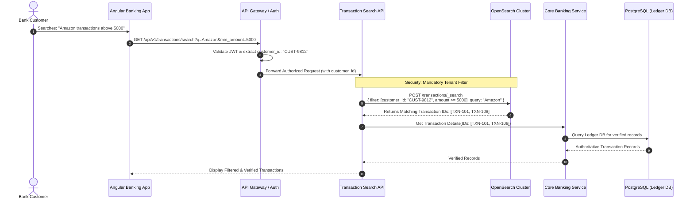

### 🔒 Critical Banking Security Rule: Tenant Isolation
> 🚨 **Security Warning:** Never expose one customer's indexed transactions to another. OpenSearch must **never** be accessed directly from the client. The backend service **must enforce customer authorization** by appending a strict `term: { customer_id: authenticated_user_id }` filter to every query to prevent authorization bypass.

---

## 11. The Three-Tier Enterprise Data Stack: PostgreSQL vs. OpenSearch vs. Redis

Enterprise architectures frequently combine **PostgreSQL**, **OpenSearch**, and **Redis** to serve complementary roles:

```mermaid
graph TD
    Client([Client Request]) --> GW[API Gateway]
    GW --> API[FastAPI Backend]

    subgraph Data Tier
        Redis[(Redis\nIn-Memory Cache)]
        OS[(OpenSearch\nDistributed Search)]
        PG[(PostgreSQL\nACID Source of Truth)]
    end

    API -->|1. Hot Key Lookup (<2ms)| Redis
    API -->|2. Fuzzy / Facet Query (<25ms)| OS
    API -->|3. ACID Write / Checkout Read| PG
```

### Role Comparison Matrix

| Technology | Primary Responsibility | Read Latency | Use Case in E-Commerce |
| :--- | :--- | :---: | :--- |
| **PostgreSQL** | Authoritative business data, ACID transactions, relational integrity | $\approx 5 - 20\text{ ms}$ | User accounts, orders, checkout pricing, ledger records |
| **OpenSearch** | Full-text search, typo tolerance, multi-facet filtering | $\approx 10 - 50\text{ ms}$ | Product discovery, typeahead autocomplete, log analytics |
| **Redis** | High-speed in-memory caching, rate limiting, session storage | $< 2\text{ ms}$ | Caching popular search query results, user sessions, cart state |

---

## 12. Production Reliability & Edge Cases

| Production Challenge | Root Cause | Architectural Solution |
| :--- | :--- | :--- |
| **Data Inconsistency** | Direct API dual-writing fails when search cluster is slow/down | Use **Change Data Capture (CDC)** or **Transactional Outbox Pattern** with Kafka |
| **Duplicate Indexing Events** | Network retries from Kafka consumer | **Idempotent document upserts** using PostgreSQL Primary Key as OpenSearch `_id` |
| **Indexing Worker Failures** | Schema mapping errors or cluster load | **Exponential backoff retry** + **Dead Letter Queue (DLQ)** with PagerDuty alerts |
| **Index Lagging / Outdated Data** | Heavy write load or slow consumer workers | Monitor Kafka consumer lag metrics in Prometheus/Grafana; auto-scale index workers |
| **Product Deletions** | Hard or soft deletes in primary database | Propagate `PRODUCT_DELETED` events to execute OpenSearch Delete API calls |
| **Search Cluster Outages** | Node failure or network partition | Multi-AZ deployment with **Primary + Replica Shards** and automated master failover |
| **Search Traffic Spikes** | Flash sales, bots, or DDoS | **Redis query cache** + Token bucket rate limiting at API Gateway |

---

## 13. Eventual Consistency & The Checkout Validation Trap

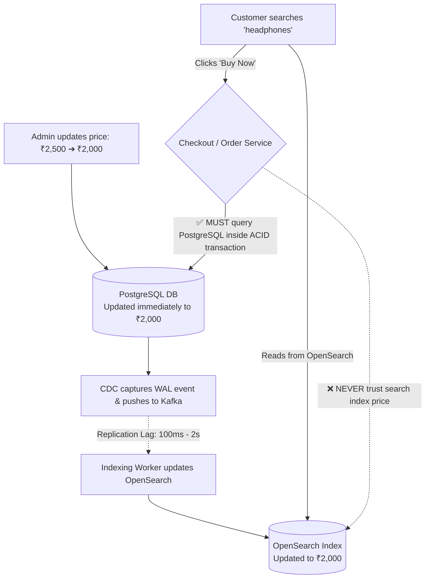

### The Production Golden Rule
> 🔴 **NEVER rely on OpenSearch for pricing, inventory confirmation, or checkout authorization.**
>
> OpenSearch is **eventually consistent**. While discovery and search read from OpenSearch, the **Checkout Service** must read the authoritative price and stock directly from **PostgreSQL** inside an ACID transaction to prevent undercharging or overselling.

---

## 14. Decision Matrix: When to Use What

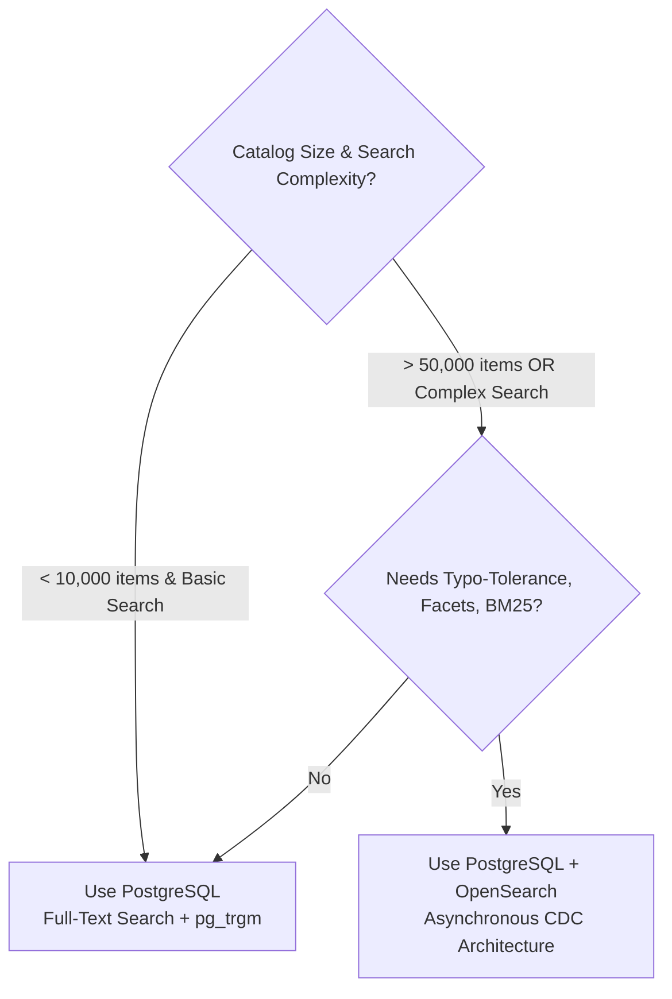

* **Scenario A — Use PostgreSQL Alone:**
  * Small catalog ($< 10,000$ products).
  * Basic substring search and simple categorical filters.
  * Single database simplicity with minimal infrastructure overhead.
* **Scenario B — Adopt OpenSearch alongside PostgreSQL:**
  * Catalog with hundreds of thousands to millions of products.
  * Requirement for sub-50ms search latency under high QPS.
  * Real-time faceted navigation, typo tolerance, autocomplete, and relevance boosting.

---

## 15. Recommended Enterprise Technology Stack

| Layer | Recommended Technology | Responsibility |
| :--- | :--- | :--- |
| **Frontend** | Angular 19 | Client application, search UI, typeahead autocomplete, faceted navigation |
| **API Gateway / WAF** | Kong / Cloudflare / OCI WAF | Rate limiting, authentication, SSL termination, DDoS protection |
| **Search API** | FastAPI (Python) | High-throughput asynchronous query orchestration |
| **Authoritative DB** | PostgreSQL | Transactional single source of truth (ACID, inventory, pricing) |
| **Search Engine** | OpenSearch 2.x | Distributed full-text search, fuzzy queries, aggregations |
| **Event Streaming** | Apache Kafka | Decoupled, durable event bus for CDC data synchronization |
| **Indexing Worker** | Python (FastAPI / Faust / Celery) | Consumes CDC events and executes bulk indexing into OpenSearch |
| **Cache Layer** | Redis | Caches popular search queries and autocomplete terms |
| **Infrastructure** | Docker / Kubernetes | Containerized microservices deployment and auto-scaling |
| **Observability** | Prometheus + Grafana + OpenSearch Dashboards | Query latency (p95/p99), consumer lag, and cluster health monitoring |

---

## 16. Enterprise OpenSearch Learning Roadmap


1. **Phase 1 – Basic Integration:**
   * Run OpenSearch and OpenSearch Dashboards locally using Docker Compose.
   * Connect FastAPI to OpenSearch using `opensearch-py`.
   * Create product index schemas and mappings.
   * Implement basic keyword search APIs.
2. **Phase 2 – Advanced Search Capabilities:**
   * Configure fuzzy matching and analyzers.
   * Implement edge n-gram autocomplete (typeahead).
   * Build multi-attribute filtering and sorting.
   * Implement faceted search bucket aggregations (`aggs`).
   * Tune BM25 relevance scoring and field boosting (`name^3`).
3. **Phase 3 – Database Synchronization:**
   * Connect PostgreSQL with the Transactional Outbox Pattern.
   * Stream events via Kafka topics.
   * Build Python indexing workers to consume change events.
   * Implement update, soft-delete, and hard-delete event handlers with idempotent upserts.
4. **Phase 4 – Enterprise Readiness:**
   * Configure index aliases and zero-downtime reindexing strategies.
   * Size primary shards and replica distribution across availability zones.
   * Implement multi-tenant security and RBAC access controls.
   * Set up Prometheus metrics for search latency (p95/p99) and Kafka consumer lag monitoring.

---

## 17. Test Your Understanding

1. **Was OpenSearch invented for AI?**
   * *Answer:* No. OpenSearch originated as an open-source fork of Elasticsearch 7.10.2 (which is built on Apache Lucene, created in 1999). It was built for distributed full-text search and log analytics, and later expanded to support vector/semantic search and AI workloads.
2. **Why shouldn't you write data to OpenSearch directly from the Admin API in the same request as PostgreSQL?**
   * *Answer:* Dual-writing without an asynchronous transactional outbox creates distributed state inconsistency if OpenSearch fails or encounters network timeouts after PostgreSQL commits.
3. **How does `fuzziness: "AUTO"` prevent performance penalties on short search terms?**
   * *Answer:* It enforces 0 edit distance for terms $\le 2$ characters and 1 edit distance for terms between 3 and 5 characters, preventing massive index expansion on tiny tokens.
4. **What is the purpose of field boosting (`name^3`) in multi-match search?**
   * *Answer:* It weights matches found in the product `name` three times higher in the BM25 scoring calculation than matches found in the generic `description` or `category`.
5. **Why must the checkout service query PostgreSQL instead of OpenSearch during order placement?**
   * *Answer:* OpenSearch is an eventually consistent index. A temporary consumer lag could display an outdated price or stale stock count, leading to undercharging or overselling.
6. **How should multi-tenant security (e.g., in banking transaction search) be enforced in OpenSearch?**
   * *Answer:* OpenSearch must never be directly queried by the client. The backend service validates the customer's identity (e.g., via JWT) and strictly injects a `term: { customer_id: authenticated_id }` filter into every OpenSearch query.
