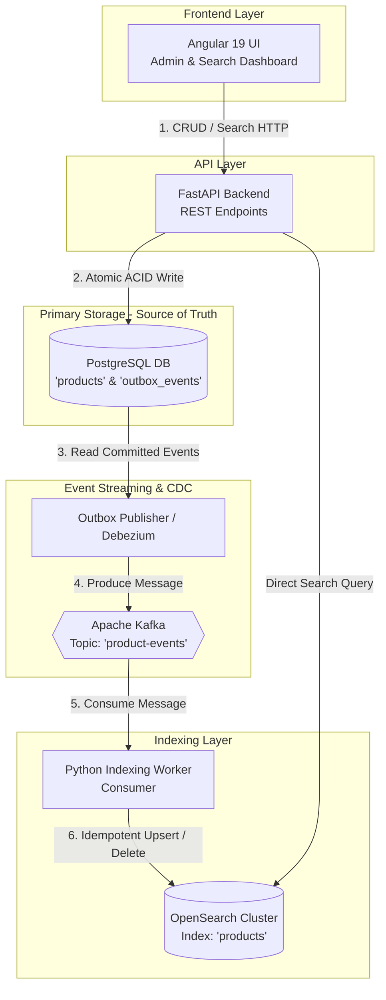
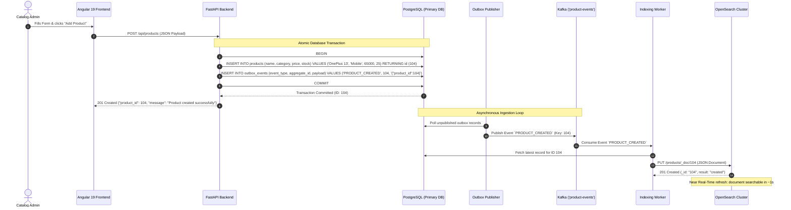
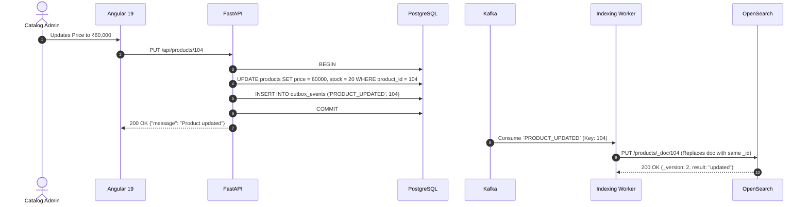
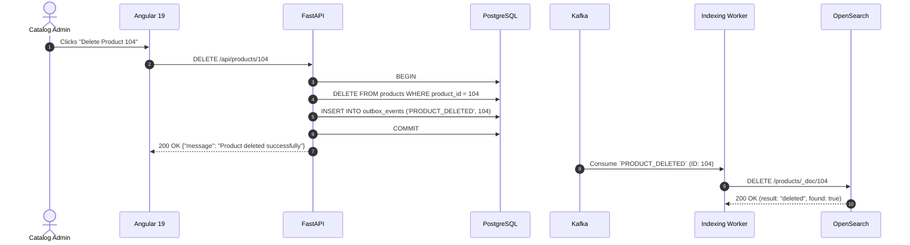
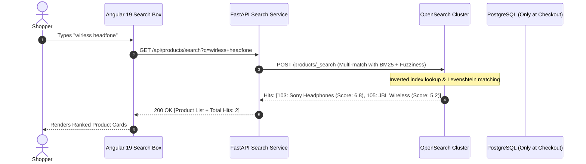
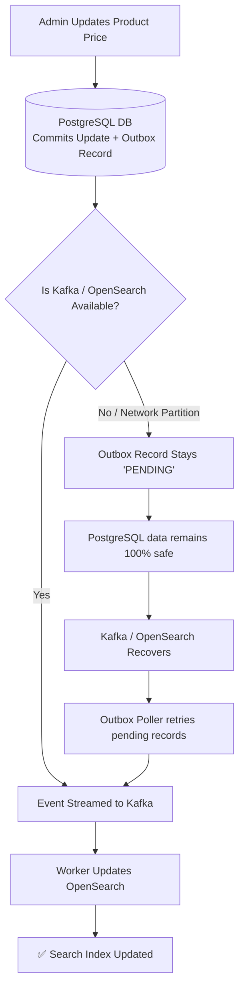

# OpenSearch – Real-Time Enterprise Test Cases (CRUD & Search Synchronization)

## Table of Contents
1. [Architecture Overview & Technology Stack](#1-architecture-overview--technology-stack)
2. [Initial Data State](#2-initial-data-state)
3. [Test Case 1 – Insert a New Product (POST / CREATE)](#3-test-case-1--insert-a-new-product-post--create)
4. [Test Case 2 – Update an Existing Product (PUT / UPDATE)](#4-test-case-2--update-an-existing-product-put--update)
5. [Test Case 3 – Delete an Existing Product (DELETE)](#5-test-case-3--delete-an-existing-product-delete)
6. [Test Case 4 – Search for Any Product (GET / FUZZY SEARCH)](#6-test-case-4--search-for-any-product-get--fuzzy-search)
7. [Comprehensive Test Case Summary Matrix](#7-comprehensive-test-case-summary-matrix)
8. [Latency Breakdown: How Fast Does OpenSearch Update?](#8-latency-breakdown-how-fast-does-opensearch-update)
9. [Failure Modes: What Happens When Kafka or OpenSearch Goes Down?](#9-failure-modes-what-happens-when-kafka-or-opensearch-goes-down)
10. [Critical Enterprise Edge Cases & Test Matrix](#10-critical-enterprise-edge-cases--test-matrix)

---

## 1. Architecture Overview & Technology Stack

In a modern enterprise system, data changes in the authoritative SQL database are synchronized asynchronously into OpenSearch via an event-driven **Transactional Outbox + Kafka** pipeline.



### Components
* **Angular 19:** Frontend UI for catalog management and customer search.
* **FastAPI:** High-performance asynchronous backend exposing REST endpoints.
* **PostgreSQL:** ACID transactional source of truth containing `products` and `outbox_events` tables.
* **Apache Kafka:** Distributed streaming broker ensuring durable event transport (`product-events` topic).
* **Python Indexing Worker:** Background worker consuming Kafka events and syncing OpenSearch documents.
* **OpenSearch:** Distributed search cluster maintaining the read-optimized `products` index.

---

## 2. Initial Data State

### PostgreSQL `products` Table
| `product_id` | `name` | `category` | `price` | `stock` | `is_active` |
| :---: | :--- | :--- | :---: | :---: | :---: |
| **101** | iPhone 16 | Mobile | ₹75,000 | 20 | `true` |
| **102** | Samsung S25 | Mobile | ₹80,000 | 15 | `true` |
| **103** | Sony Headphones | Audio | ₹5,000 | 30 | `true` |

### OpenSearch `products` Index State
OpenSearch contains corresponding documents where **OpenSearch `_id` $\equiv$ PostgreSQL `product_id`**:

```json
// GET products/_doc/101
{
  "_index": "products",
  "_id": "101",
  "_source": {
    "product_id": 101,
    "name": "iPhone 16",
    "category": "Mobile",
    "price": 75000,
    "stock": 20,
    "in_stock": true
  }
}
```

---

## 3. Test Case 1 – Insert a New Product (POST / CREATE)

### Scenario
An admin inserts a new mobile phone: **OnePlus 13** priced at **₹65,000** with **25 units** in stock.



### Step 1: Angular Client Request
```http
POST /api/products HTTP/1.1
Host: api.store.com
Content-Type: application/json

{
  "name": "OnePlus 13",
  "category": "Mobile",
  "price": 65000,
  "stock": 25
}
```

### Step 2: FastAPI PostgreSQL Atomic Transaction
```sql
BEGIN;

INSERT INTO products (name, category, price, stock, is_active, created_at)
VALUES ('OnePlus 13', 'Mobile', 65000, 25, TRUE, NOW())
RETURNING product_id; -- returns 104

INSERT INTO outbox_events (event_type, aggregate_type, aggregate_id, payload, status, created_at)
VALUES (
  'PRODUCT_CREATED',
  'PRODUCT',
  104,
  '{"product_id": 104, "name": "OnePlus 13", "category": "Mobile", "price": 65000, "stock": 25}',
  'PENDING',
  NOW()
);

COMMIT;
```

### Step 3: Kafka Message on `product-events` Topic
```json
{
  "event_id": "evt-1001",
  "event_type": "PRODUCT_CREATED",
  "aggregate_id": "104",
  "timestamp": "2026-11-22T10:00:00.100Z",
  "payload": {
    "product_id": 104,
    "name": "OnePlus 13",
    "category": "Mobile",
    "price": 65000,
    "stock": 25
  }
}
```

### Step 4: Python Worker OpenSearch Upsert
```http
PUT /products/_doc/104 HTTP/1.1
Host: opensearch-cluster:9200
Content-Type: application/json

{
  "product_id": 104,
  "name": "OnePlus 13",
  "category": "Mobile",
  "price": 65000,
  "stock": 25,
  "in_stock": true,
  "updated_at": "2026-11-22T10:00:00.200Z"
}
```

### Step 5: Verification
```http
GET /products/_doc/104 HTTP/1.1
```
**Response (`200 OK`):**
```json
{
  "_index": "products",
  "_id": "104",
  "_version": 1,
  "_seq_no": 482,
  "_primary_term": 1,
  "found": true,
  "_source": {
    "product_id": 104,
    "name": "OnePlus 13",
    "category": "Mobile",
    "price": 65000,
    "stock": 25,
    "in_stock": true,
    "updated_at": "2026-11-22T10:00:00.200Z"
  }
}
```

---

## 4. Test Case 2 – Update an Existing Product (PUT / UPDATE)

### Scenario
Admin discounts **OnePlus 13** (ID: 104) from **₹65,000 $\to$ ₹60,000** and updates stock to **20**.



### Step 1: Angular Client Request
```http
PUT /api/products/104 HTTP/1.1
Host: api.store.com
Content-Type: application/json

{
  "name": "OnePlus 13",
  "category": "Mobile",
  "price": 60000,
  "stock": 20
}
```

### Step 2: PostgreSQL Update Transaction
```sql
BEGIN;

UPDATE products
SET price = 60000,
    stock = 20,
    updated_at = NOW()
WHERE product_id = 104;

INSERT INTO outbox_events (event_type, aggregate_type, aggregate_id, payload, status, created_at)
VALUES (
  'PRODUCT_UPDATED',
  'PRODUCT',
  104,
  '{"product_id": 104, "price": 60000, "stock": 20}',
  'PENDING',
  NOW()
);

COMMIT;
```

### Step 3: Kafka Message
```json
{
  "event_id": "evt-1002",
  "event_type": "PRODUCT_UPDATED",
  "aggregate_id": "104",
  "timestamp": "2026-11-22T10:15:00.000Z",
  "payload": {
    "product_id": 104,
    "price": 60000,
    "stock": 20
  }
}
```

### Step 4: OpenSearch Document Replacement
```http
PUT /products/_doc/104 HTTP/1.1
Host: opensearch-cluster:9200
Content-Type: application/json

{
  "product_id": 104,
  "name": "OnePlus 13",
  "category": "Mobile",
  "price": 60000,
  "stock": 20,
  "in_stock": true,
  "updated_at": "2026-11-22T10:15:00.100Z"
}
```
> 💡 **Why this is idempotent:** Because we specify `_doc/104`, OpenSearch executes an in-place document replacement. It will **never create a duplicate product document** even if the Kafka message is processed multiple times.

### Step 5: Verification
```http
GET /products/_doc/104 HTTP/1.1
```
**Response (`200 OK`):**
```json
{
  "_index": "products",
  "_id": "104",
  "_version": 2,
  "found": true,
  "_source": {
    "product_id": 104,
    "name": "OnePlus 13",
    "category": "Mobile",
    "price": 60000,
    "stock": 20,
    "in_stock": true
  }
}
```

---

## 5. Test Case 3 – Delete an Existing Product (DELETE)

### Scenario
Admin removes **OnePlus 13** (ID: 104) from the store catalog.



### Step 1: Angular Client Request
```http
DELETE /api/products/104 HTTP/1.1
Host: api.store.com
```

### Step 2: PostgreSQL Delete Transaction
```sql
BEGIN;

DELETE FROM products WHERE product_id = 104;

INSERT INTO outbox_events (event_type, aggregate_type, aggregate_id, payload, status, created_at)
VALUES (
  'PRODUCT_DELETED',
  'PRODUCT',
  104,
  '{"product_id": 104}',
  'PENDING',
  NOW()
);

COMMIT;
```

### Step 3: OpenSearch Document Deletion
```http
DELETE /products/_doc/104 HTTP/1.1
Host: opensearch-cluster:9200
```

### Step 4: Verification
```http
GET /products/_doc/104 HTTP/1.1
```
**Response (`404 Not Found`):**
```json
{
  "_index": "products",
  "_id": "104",
  "found": false
}
```

> ⚠️ **Soft-Deletes Alternative:** If your business requires soft-deletes (`is_active = FALSE`), the worker can either execute `DELETE /products/_doc/104` to purge it from the customer search index, or update the document with `{"doc": {"is_active": false}}` and configure all search queries to enforce `filter: [{"term": {"is_active": true}}]`.

---

## 6. Test Case 4 – Search for Any Product (GET / FUZZY SEARCH)

### Scenario
A customer searches with typos: **`"wirless headfone"`**. Notice that this operation **only queries OpenSearch** and does not hit PostgreSQL.



### Step 1: Customer HTTP Search Request
```http
GET /api/products/search?q=wirless%20headfone HTTP/1.1
Host: api.store.com
```

### Step 2: FastAPI OpenSearch Query
```http
POST /products/_search HTTP/1.1
Host: opensearch-cluster:9200
Content-Type: application/json

{
  "query": {
    "multi_match": {
      "query": "wirless headfone",
      "fields": [
        "name^3",
        "category",
        "description"
      ],
      "fuzziness": "AUTO",
      "prefix_length": 2
    }
  }
}
```

### Step 3: OpenSearch Ranked Hits Response
```json
{
  "took": 12,
  "timed_out": false,
  "_shards": {
    "total": 3,
    "successful": 3,
    "skipped": 0,
    "failed": 0
  },
  "hits": {
    "total": {
      "value": 2,
      "relation": "eq"
    },
    "max_score": 6.842,
    "hits": [
      {
        "_index": "products",
        "_id": "103",
        "_score": 6.842,
        "_source": {
          "product_id": 103,
          "name": "Sony Headphones",
          "category": "Audio",
          "price": 5000,
          "stock": 30
        }
      },
      {
        "_index": "products",
        "_id": "105",
        "_score": 5.219,
        "_source": {
          "product_id": 105,
          "name": "JBL Wireless Headphones",
          "category": "Audio",
          "price": 3500,
          "stock": 18
        }
      }
    ]
  }
}
```

---

## 7. Comprehensive Test Case Summary Matrix

| Test Scenario | Client HTTP | PostgreSQL Operation | Outbox / Kafka Event | OpenSearch Operation | Primary Target |
| :--- | :--- | :--- | :--- | :--- | :--- |
| **1. Insert Product** | `POST /api/products` | `INSERT INTO products` + `INSERT INTO outbox_events` | `PRODUCT_CREATED` | `PUT /products/_doc/{id}` | PostgreSQL $\to$ OpenSearch |
| **2. Update Product** | `PUT /api/products/{id}` | `UPDATE products` + `INSERT INTO outbox_events` | `PRODUCT_UPDATED` | `PUT /products/_doc/{id}` | PostgreSQL $\to$ OpenSearch |
| **3. Delete Product** | `DELETE /api/products/{id}` | `DELETE FROM products` + `INSERT INTO outbox_events` | `PRODUCT_DELETED` | `DELETE /products/_doc/{id}` | PostgreSQL $\to$ OpenSearch |
| **4. Search Catalog** | `GET /api/products/search` | **None** (Bypassed) | **None** | `POST /products/_search` | OpenSearch Only |

---

## 8. Latency Breakdown: How Fast Does OpenSearch Update?

OpenSearch operates on a **Near-Real-Time (NRT)** model. Changes committed to PostgreSQL are visible in search within **$\approx 200\text{ ms} - 1.2\text{ s}$**.

```mermaid
gantt
    title Near-Real-Time Synchronization Timeline (Milliseconds)
    dateFormat X
    axisFormat %s ms
    section Ingestion Flow
    Angular HTTP POST        :0, 50
    PostgreSQL Commit (ACID) :50, 100
    Outbox Poller -> Kafka   :100, 150
    Worker Consumes Event    :150, 180
    OpenSearch Ingest / Index:180, 220
    OpenSearch Lucene Refresh:crit, 220, 1000
    Searchable by Customers  :milestone, 1000, 0
```



### Timeline Breakdown
| Timestamp | Event | Latency |
| :--- | :--- | :---: |
| `T + 000 ms` | Angular sends HTTP POST/PUT/DELETE request | Baseline |
| `T + 050 ms` | PostgreSQL commits product and outbox record | +50 ms |
| `T + 100 ms` | Outbox publisher pushes message to Kafka | +50 ms |
| `T + 150 ms` | Python worker consumes event from Kafka | +50 ms |
| `T + 200 ms` | Worker sends `PUT /_doc/{id}` to OpenSearch | +50 ms |
| `T + 200 ms $\to$ 1000 ms` | Background Lucene segment refresh (`refresh_interval = 1s`) | +800 ms |
| `T + 1000 ms` | Document is fully searchable across all cluster shards | **$\approx 1\text{ s}$ Total** |

> 🧪 **Testing Tip:** In automated test suites (e.g., PyTest / Cypress), pass `?refresh=wait_for` during ingestion (`PUT /products/_doc/104?refresh=wait_for`). This blocks until the index segment refreshes, allowing immediate verification without artificial `sleep()` statements.

---

## 9. Failure Modes: What Happens When Kafka or OpenSearch Goes Down?



### Resilience Guarantees
1. **Zero Data Loss:** If OpenSearch crashes, the transactional outbox table retains all unpublished events.
2. **Guaranteed Delivery:** The outbox publisher and Kafka consumer employ exponential backoff retries until the search cluster recovers.
3. **Dead Letter Queue (DLQ):** Messages with malformed JSON or schema mapping conflicts are routed to `indexing-dlq` after 5 failed retries to avoid blocking the partition.

---

## 10. Critical Enterprise Edge Cases & Test Matrix

| # | Edge Case Scenario | Potential Hazard | Production Solution | Expected Test Result |
| :---: | :--- | :--- | :--- | :--- |
| **1** | **Duplicate Event Replay** | Multiple identical Kafka messages delivered due to consumer retry. | **Idempotent document writes** (`PUT /products/_doc/{id}`). | Document updated in place; no duplicate entries created. |
| **2** | **Out-of-Order Price Updates** | Event for ₹5,000 arrives *after* event for ₹3,000 due to network jitter. | Kafka **partitioning by `product_id`** + OpenSearch `version` checks. | Stale price update rejected; latest valid version wins. |
| **3** | **Search Immediately After Insert** | User searches within 50ms of creation before segment refresh. | Accept NRT latency or use `refresh=wait_for` for critical flows. | Document appears after $\le 1\text{ s}$ refresh cycle. |
| **4** | **Delete While Update In-Flight** | Delete event arrives while a heavy update job is indexing. | Timestamp-based versioning (`external_gte`). | Product is permanently deleted; deleted doc never resurrected. |
| **5** | **Update Non-Existent Product** | Worker tries to update a product not yet created. | Worker creates document via upsert or queries DB before write. | Document created cleanly with latest state. |
| **6** | **Search Cluster Down During Checkout** | Customer clicks "Buy Now" while OpenSearch is offline. | Checkout queries **PostgreSQL directly** for price & stock. | Orders process successfully without search cluster dependency. |
| **7** | **Full Index Rebuild (Disaster Recovery)** | OpenSearch index is corrupted or deleted. | Run batch extraction script from PostgreSQL to bulk-load OpenSearch. | Index repopulated to 100% consistency within minutes. |

---

## Related Deep-Dive Architecture Guides
* [Kafka Retry & Dead Letter Queue (DLQ) Architecture](./Kafka_Retry_and_Dead_Letter_Queue_DLQ_Architecture.md)
* [OpenSearch Core Architecture & Design Patterns](./README.md)
