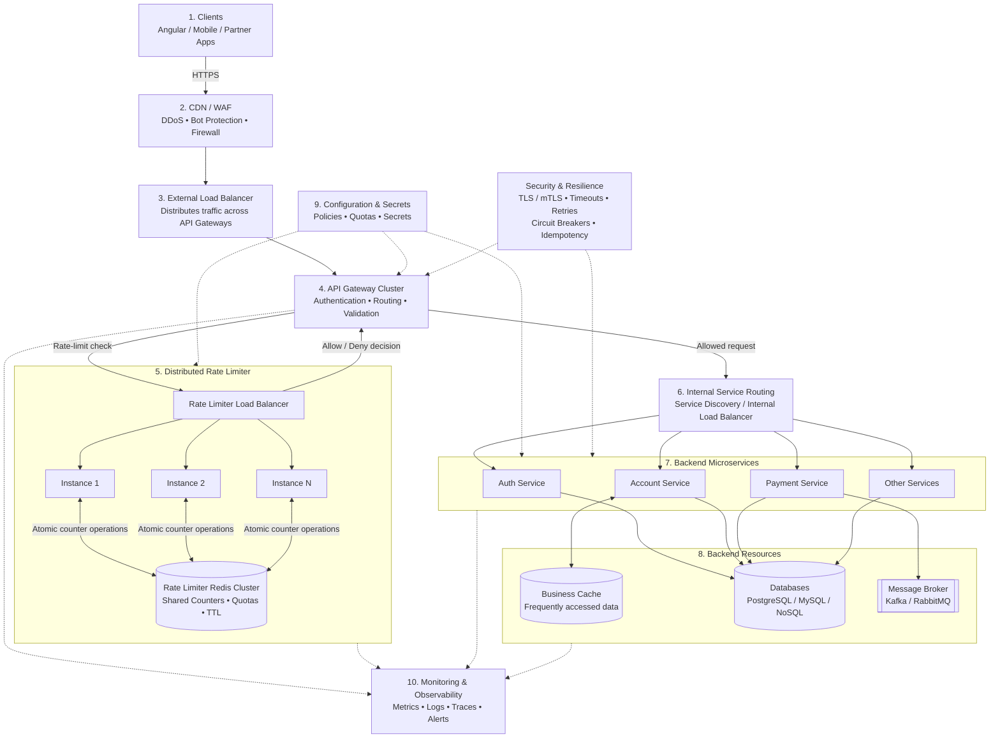

# Production-Grade Enterprise Banking API Architecture

Let's consolidate everything into one Production-Grade Enterprise Banking API Architecture.

I'll include all your missing components, explain where each belongs, and show how a request travels from the Angular client to the database and back.

One important design principle: we should separate responsibilities into layers rather than put every component into one sequential request pipeline.


## 1. Final production-grade architecture
Enterprise architecture - Microservices

### High-level architecture diagram



This is a logical architecture. In an actual deployment, some components may be provided together by a cloud platform, API management product, Kubernetes ingress, or service mesh.


## 2. Detailed explanation of every layer

### Layer 1 — Client applications

Examples:
- Angular web application.
- Android / iOS mobile applications.
- Third-party partner applications.

Responsibilities:
- Send HTTP requests.
- Attach access tokens.
- Display API responses.
- Handle errors such as 401, 403, 429 and 500.

Example API:

```http
GET /api/accounts/12345/balance
Authorization: Bearer <access_token>
```

### Layer 2 — CDN / WAF

**Purpose:** Protect the application before requests reach your infrastructure.

| Responsibility | Why needed? |
|---|---|
| DDoS protection | Protect against traffic floods |
| Bot filtering | Block malicious automated traffic |
| Web Application Firewall | Detect SQL injection, XSS and other attacks |
| Edge caching | Cache eligible static content |
| TLS termination | Secure incoming HTTPS connections |

Examples: Cloudflare, AWS CloudFront + AWS WAF, Azure Front Door.

### Layer 3 — External Load Balancer

**Purpose:** Distribute incoming requests across multiple API Gateway instances.

Example:

```text
External Load Balancer
       |
       +---- API Gateway 1
       |
       +---- API Gateway 2
       |
       +---- API Gateway 3
```

Why? If one API Gateway instance fails, the Load Balancer can route traffic to healthy instances.

### Layer 4 — API Gateway

**Purpose:** Central entry point for API requests.

| Responsibility | Explanation |
|---|---|
| Authentication | Validate access token / identity |
| Authorization | Apply coarse-grained access policies |
| Routing | Identify the appropriate backend service |
| Request validation | Validate headers, parameters and payload |
| Rate-limit integration | Ask Rate Limiter whether request is allowed |
| TLS | Secure external communication |
| Response handling | Return backend response to client |

Important authentication vs authorization distinction:
- **Authentication:** Who are you?
- **Authorization:** What are you allowed to do?

For banking, resource-level authorization must also be enforced inside the backend service. For example, an authenticated customer must not be allowed to access another customer's account just by changing the account ID.

### Layer 5 — Distributed Rate Limiter

**Purpose:** Protect backend services from excessive API requests.

Architecture:

```text
             API Gateway
                  |
                  v
          Rate Limiter LB
                  |
          +-------+-------+
          |       |       |
        RL-1    RL-2    RL-N
          |       |       |
          +-------+-------+
                  |
             Redis Cluster
          (Shared Counters)
```

How it works:
1. API Gateway sends a rate-limit evaluation request.
2. Rate Limiter Load Balancer selects an available instance.
3. Rate Limiter checks the user's quota in Redis.
4. Redis performs atomic counter operations.
5. Rate Limiter returns Allow or Deny.
6. API Gateway forwards or rejects the original request.

Example policy:

| User | Limit |
|---|---|
| Free user | 100 requests/minute |
| Premium user | 500 requests/minute |
| Partner API | 1,000 requests/minute |

These are illustrative limits, not recommended banking defaults.

**Important:** The Allow/Deny response comes from the Rate Limiter instance, not from Redis or its Load Balancer.

If denied:

```http
HTTP/1.1 429 Too Many Requests
Retry-After: 30
```

### Layer 6 — Backend Service Routing

**Purpose:** Discover and route requests to the correct backend microservice.

Two important concepts:

**A. Service Discovery**

Finds available and healthy service instances.

Example:

```text
Account Service
   |
   +-- Account Service Instance 1
   +-- Account Service Instance 2
   +-- Account Service Instance 3
```

**B. Internal Load Balancer**

Distributes requests across those instances.

The API Gateway may use an internal load balancer, service discovery, or a service mesh to perform this routing.

### Layer 7 — Backend Microservices

This is where actual business logic runs.

| Service | Responsibility |
|---|---|
| Auth Service | Login, token validation, session management |
| Account Service | Account details, balance inquiry |
| Payment Service | Fund transfers, payment processing |
| User Service | Customer profile management |
| Notification Service | Email, SMS and push notifications |

Each service can have multiple independently deployed instances.

### Layer 8 — Business Cache

**Purpose:** Reduce repeated database reads and improve response time.

Example:

```text
Account Service
      |
      v
Check Business Cache
      |
      +---- Cache HIT ----> Return cached data
      |
      +---- Cache MISS ---> Database
                                |
                                v
                          Fetch account data
                                |
                                v
                           Update cache
```

Possible technologies:
- Redis.
- Memcached.

**Important distinction:** You now have two logically separate Redis use cases:

| Rate Limiter Redis | Business Cache Redis |
|---|---|
| Stores request counters | Stores business data |
| Manages quotas | Improves read performance |
| Uses TTL for counter windows | Uses data expiration/invalidation |
| Used by Rate Limiter | Used by backend services |

They should have appropriate isolation, capacity planning and access controls. They do not have to be separate Redis products, but separating workloads is often preferable in enterprise systems.

### Layer 9 — Database and Message Broker

**Database:**
- PostgreSQL / MySQL for relational transactional data.
- NoSQL databases for appropriate non-relational workloads.
- Read replicas for scaling read traffic where consistency requirements permit.

**Message Broker:**

Kafka or RabbitMQ can handle asynchronous operations.

Example:

```text
Payment Service
      |
      v
Payment Database
      |
      v
Outbox / Event Publisher
      |
      v
Message Broker
      |
      +---- Notification Service
      |
      +---- Audit Service
      |
      +---- Analytics Service
```

For financial transactions, use transactional outbox patterns or equivalent reliable event-publishing mechanisms to avoid losing events after database commits.

### Layer 10 — Configuration and Secrets Management

**Purpose:** Centralize application configuration and protect sensitive credentials.

| Configuration | Examples |
|---|---|
| API policies | Routing, request limits |
| Rate-limit rules | Per-user and per-endpoint quotas |
| Feature flags | Enable/disable capabilities |
| Secrets | Database passwords, API keys |
| Certificates | TLS certificates |

Examples: AWS Secrets Manager, HashiCorp Vault, Kubernetes Secrets with appropriate encryption and access controls.

Do not put database passwords, private keys or other secrets into source code or ordinary configuration files.

## 3. Missing production-grade cross-cutting components

These components are not necessarily separate sequential steps. They operate across multiple layers.

| Component | Where it applies | Why needed? |
|---|---|---|
| Authentication | Gateway + services | Identify the caller |
| Authorization | Gateway + services | Enforce access permissions |
| Service Discovery | Service routing | Find healthy backend instances |
| Internal Load Balancer | Backend routing | Distribute traffic |
| Circuit Breaker | Service-to-service calls | Prevent repeated calls to failing services |
| Retry | Network/service calls | Recover from transient failures |
| Timeout | Every network boundary | Prevent requests hanging indefinitely |
| Business Cache | Backend/data layer | Reduce repeated database reads |
| Monitoring | All infrastructure | Track latency, errors, throughput and 429 responses |
| Distributed Tracing | End-to-end request flow | Follow one request across services |
| TLS / mTLS | External and internal communication | Protect data in transit |
| Idempotency | Payment APIs | Prevent duplicate processing on retries |
| Audit Logging | Banking operations | Maintain a record of sensitive actions |
| Secrets Management | All services | Secure credentials and keys |
| Health Checks | Gateways and services | Detect unhealthy instances |

### Understanding Circuit Breaker, Retry and Timeout

These three concepts are particularly important.

**1. Timeout**

A service should not wait forever for another service.

```text
Account Service
     |
     v
Payment Service
     |
     v
Maximum wait: 2 seconds
     |
     v
Timeout if no response
```

**2. Retry**

If a temporary network failure occurs, retry a limited number of times with exponential backoff and jitter.

```text
Request → Failure
     |
     v
Wait 200 ms
     |
     v
Retry → Failure
     |
     v
Wait 500 ms
     |
     v
Retry → Success
```

**3. Circuit Breaker**

If a downstream service repeatedly fails, stop sending requests temporarily.

```text
CLOSED
Normal traffic flows

OPEN
Requests are rejected or fallback is used

HALF-OPEN
Test requests check recovery
```

For payment APIs, never retry a potentially completed payment blindly. Use idempotency keys, transaction status checks and safe retry policies.

## 4. Monitoring and Observability

This is not an ordinary step in the request pipeline. It monitors the entire architecture.

I recommend using the following:

| Tool | Responsibility |
|---|---|
| Prometheus | Collect metrics |
| Grafana | Dashboards and visualization |
| OpenTelemetry | Instrument applications |
| OpenTelemetry Collector | Collect and export telemetry |
| Jaeger / Tempo | Distributed tracing |
| Loki / ELK | Centralized logs |
| Alertmanager | Trigger alerts |

What should we monitor?
- API response time (P95 / P99).
- Requests per second.
- HTTP 4xx and 5xx errors.
- Rate-limit rejections (429).
- Redis latency and availability.
- Database connection pool utilization.
- Backend service health.
- Circuit breaker state.
- Queue lag and message processing failures.

Example: A customer reports that checking their account balance takes 8 seconds.

Distributed tracing helps you identify whether the delay occurred in:
- API Gateway: 100 ms.
- Rate Limiter: 50 ms.
- Account Service: 200 ms.
- Database: 7.5 seconds.

Now you know where to investigate.

## 5. Complete request-response lifecycle

Let's bring everything together with one real-world example.

**Scenario:** A customer checks their bank account balance.

### Request flow

1. **Angular Client** — Sends `GET /api/accounts/12345/balance`.
2. **CDN / WAF** — Filters malicious traffic and checks security rules.
3. **External Load Balancer** — Selects a healthy API Gateway instance.
4. **API Gateway** — Validates the token, applies API policies and identifies the Account Service route.
5. **Distributed Rate Limiter** — Checks the customer's quota using shared Redis counters.
6. **API Gateway** — Receives the Allow decision and continues processing.
7. **Service Discovery / Internal Load Balancer** — Selects a healthy Account Service instance.
8. **Account Service** — Checks whether the authenticated customer is authorized to access account 12345.
9. **Business Cache** — Checks for a valid cached balance, if the caching policy permits it.
10. **Database** — Fetches the balance if required.
11. **Account Service** — Constructs the API response.
12. **API Gateway → CDN/WAF → Client** — Returns the response to Angular.

Example API response:

```json
{
  "accountId": "12345",
  "currency": "INR",
  "availableBalance": 50000.00,
  "status": "SUCCESS"
}
```

```http
HTTP 200 OK
```

The response travels back through the established connection path. It does not need to go through the Rate Limiter again.

## 6. Final architecture — component responsibility checklist

Use this as your system-design interview revision table.

| Layer | Component | Primary responsibility |
|---|---|---|
| 1 | Client | Initiate API requests |
| 2 | CDN / WAF | Edge security |
| 3 | External Load Balancer | Distribute gateway traffic |
| 4 | API Gateway | API management and routing |
| 5 | Distributed Rate Limiter | Enforce request quotas |
| 6 | Rate Limiter Load Balancer | Distribute limiter traffic |
| 7 | Redis Cluster | Shared rate-limit state |
| 8 | Service Discovery | Locate backend instances |
| 9 | Internal Load Balancer | Distribute backend traffic |
| 10 | Microservices | Execute business logic |
| 11 | Business Cache | Reduce database reads |
| 12 | Database | Persist business data |
| 13 | Message Broker | Asynchronous communication |
| 14 | Config / Secrets Store | Configuration and credentials |
| 15 | Observability | Metrics, logs, traces and alerts |

**Cross-cutting:** authentication, authorization, TLS/mTLS, timeout, retry, circuit breaker, idempotency and audit logging.

## 7. Recommended implementation technologies

Since this is a banking-grade microservices architecture, here is one possible technology mapping.

| Architecture layer | Technology |
|---|---|
| Frontend | Angular |
| CDN / WAF | Cloudflare / AWS CloudFront + WAF |
| External Load Balancer | AWS ALB / NGINX |
| API Gateway | Kong / AWS API Gateway |
| Rate Limiter | Java Spring Boot / Go / FastAPI |
| Rate Limiter Load Balancer | Kubernetes Service |
| Rate Limit Store | Redis Cluster |
| Backend Services | Java Spring Boot / Node.js / FastAPI |
| Service Discovery | Kubernetes DNS |
| Internal Routing | Kubernetes Service / Service Mesh |
| Business Cache | Redis |
| Database | PostgreSQL |
| Message Broker | Kafka / RabbitMQ |
| Secrets | HashiCorp Vault / AWS Secrets Manager |
| Monitoring | Prometheus + Grafana |
| Tracing | OpenTelemetry + Jaeger |
| Logging | Loki / ELK |
| Containerization | Docker |
| Orchestration | Kubernetes |
| CI/CD | GitHub Actions + Argo CD |

These are example choices, not a requirement to use every technology.

## 8. Three important design decisions before implementation

For a production banking system, I would explicitly document these:

1. **Rate limiter failure:** Fail-open or fail-closed? For sensitive payment operations, fail-closed may be appropriate, with a carefully designed emergency mechanism.
2. **Data consistency:** Which data can be cached, for how long, and how will stale data be invalidated? Account balances and payment status need special treatment.
3. **Payment reliability:** How will you prevent duplicate payments when clients or services retry requests? Use idempotency keys and durable transaction processing.
