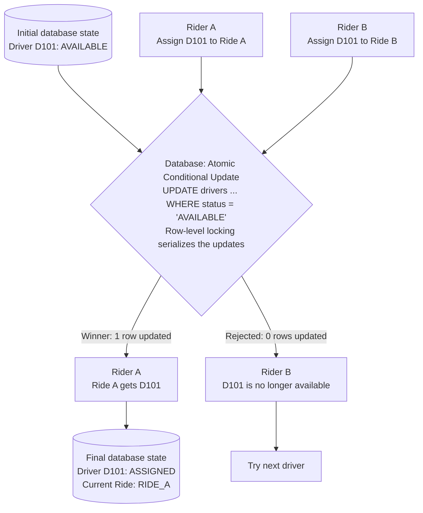

# Production-Grade Uber System Design

The diagram illustrates an enterprise-scale ride-hailing platform, including its architecture, components, request flow, real-time driver tracking, payments, notifications, scalability, reliability and monitoring.


## 1. Understand the high-level architecture

The system has these major layers:

| Step | Component | Responsibility |
|---|---|---|
| 1 | Rider / Driver App | User interaction |
| 2 | CDN / WAF | Security and edge protection |
| 3 | Load Balancer | Distribute incoming traffic |
| 4 | API Gateway | Authentication, authorization and routing |
| 5 | Ride Service Platform | Core business logic |
| 6 | Redis Cluster | Real-time location and caching |
| 7 | Message Queue | Asynchronous processing |
| 8 | Databases | Persistent trip, user and payment data |
| 9 | External Services | Maps, payments, SMS and email |

## 2. Step-by-step: What happens when a rider requests a cab?

Let's understand this using a real-life example.

Imagine you open the Uber app and request a ride from Location A to Location B.

### Ride booking lifecycle

1. **User action** — Rider opens the mobile app, selects pickup and destination, and requests a ride.
2. **CDN / WAF** — Filters malicious traffic and protects the application.
3. **Load Balancer** — Distributes requests across available API Gateway instances.
4. **API Gateway** — Validates authentication, applies rate limits and routes the request.
5. **Ride Service** — Creates a ride request and initiates driver matching.
6. **Driver Matching Service** — Finds nearby available drivers using geospatial location data and matching rules.
7. **Driver accepts the ride** — Ride assignment is confirmed and the rider receives an update.
8. **Real-time Location Service** — Driver location is continuously updated using WebSockets or another real-time communication mechanism.
9. **Payment Service** — Handles payment authorization and eventual payment capture according to the payment lifecycle.
10. **Notification Service** — Sends notifications about driver assignment, arrival and trip status.
11. **Trip completion** — Stores trip details, calculates the final fare and completes payment processing.

## 3. Understand the important technologies

### Redis — Real-time data

Stores driver locations, availability, nearby-driver indexes and frequently accessed data. Geospatial indexing helps find nearby drivers quickly.

### Kafka / Message Queue — Asynchronous processing

Handles trip events, notifications, analytics and downstream processing without blocking the main request.

### PostgreSQL — Persistent storage

Stores users, rides, trip records, payment references and other transactional information.

### WebSockets — Real-time communication

Pushes driver location and ride-status updates to connected clients without requiring constant polling.

## 4. Important production design considerations

| Challenge | Solution |
|---|---|
| Millions of concurrent users | Horizontal scaling |
| Finding nearby drivers | Redis geospatial indexes |
| Real-time tracking | WebSockets |
| Service failure | Circuit breakers and retries |
| Duplicate ride/payment requests | Idempotency keys |
| High database traffic | Caching and read replicas |
| Message loss | Durable queues and transactional outbox |
| Regional failures | Multi-AZ deployment and disaster recovery |
| High latency | CDN, caching and optimized queries |

## 5. Monitoring and observability

Monitor these metrics:
- API latency (P95/P99).
- Ride requests per second.
- Driver availability.
- Driver matching success rate.
- Ride cancellation rate.
- Payment failure rate.
- WebSocket connection health.
- Kafka consumer lag.
- Redis latency and availability.
- Database health.

## 6. Recommended learning sequence

To understand this architecture deeply, study it in this order:
1. Load Balancer and API Gateway.
2. Microservices architecture.
3. Redis caching and geospatial indexing.
4. Message queues and event-driven architecture.
5. WebSockets and real-time communication.
6. Database design and transaction consistency.
7. Distributed system scalability.
8. Circuit Breaker, Retry and Idempotency.
9. Observability with OpenTelemetry, Prometheus and Grafana.
10. Kubernetes deployment and auto-scaling.

## 7. Core ride flow — a worked example

Let's understand these four steps using a real-life example.

**Scenario:** A rider opens the Uber app, selects a pickup location and destination, and clicks Book Ride.

### 7.1 Overall architecture

```text
          RIDER (Mobile App)
                  |
                  | 1. Request a ride
                  v
             API Gateway
                  |
                  v
          +----------------+
          |  Ride Service  |
          +----------------+
                  |
                  | 2. Find nearby drivers
                  v
       +------------------------+
       | Driver Matching Service|
       +------------------------+
                  |
                  | Search nearby drivers
                  v
             Redis Cache
          (Driver locations)
                  |
                  | Nearby drivers found
                  v
       +------------------------+
       | Send Ride Request      |
       | to Available Drivers   |
       +------------------------+
                  |
                  | 3. Driver accepts
                  v
          +----------------+
          | Ride Service   |
          | Update Status  |
          +----------------+
                  |
             +----+----+
             |         |
             v         v
          Rider      Driver
          App        App
        (Assigned) (Confirmed)

                  |
                  | 4. Continuous location updates
                  v
       +------------------------+
       | Real-time Location    |
       | Service (WebSockets)  |
       +------------------------+
                  |
                  v
             Redis Cache
                  |
                  v
          Rider App (Live Map)
```

### 7.2 How each step works

#### Step 1: Ride Service — Create ride request

The rider clicks Book Ride.

The Angular/mobile application sends:

```http
POST /api/rides
```

Request:

```json
{
  "riderId": "R101",
  "pickup": "Location A",
  "destination": "Location B"
}
```

Ride Service:
1. Receives the request.
2. Validates pickup and destination.
3. Creates a ride record in the database.
4. Assigns a unique rideId.
5. Changes status to SEARCHING.
6. Triggers Driver Matching Service.

Example:

```text
Ride ID: RIDE101
Rider: R101
Status: SEARCHING
Pickup: Location A
Destination: Location B
```

#### Step 2: Driver Matching Service — Find nearby drivers

Now the Driver Matching Service needs to find available drivers near Location A.

Imagine these drivers:

| Driver | Distance | Status |
|---|---|---|
| D101 | 1 km | Available |
| D102 | 2 km | Available |
| D103 | 500 m | Busy |
| D104 | 3 km | Available |

The service searches Redis using geospatial queries.

```text
          Driver Matching Service
                    |
                    v
              Redis GEO Search
                    |
          +---------+---------+
          |         |         |
          v         v         v
        D101      D102      D103
        1 km      2 km     500 m
        Free      Free      Busy
          |         |
          +----+----+
               |
               v
       Filter available drivers
               |
               v
       D101 and D102 selected
```

The matching service can rank drivers based on distance, estimated arrival time, vehicle type and other business rules.

It then sends ride offers to selected drivers.

#### Step 3: Driver accepts the ride

Suppose D101 receives the ride request.

The driver's application displays:

```text
New Ride Request

Pickup: Location A
Destination: Location B

[ ACCEPT ]  [ REJECT ]
```

Driver clicks ACCEPT.

```text
Driver App
    |
    | POST /api/rides/RIDE101/accept
    v
API Gateway
    |
    v
Ride Service
    |
    v
Check ride is still available
    |
    v
Atomically assign driver D101
    |
    v
Update Database
```

Database update:

```json
{
  "rideId": "RIDE101",
  "driverId": "D101",
  "status": "DRIVER_ASSIGNED"
}
```

**Important:** The assignment must be atomic. If D101 and D102 both accept almost simultaneously, only one should successfully get the ride.

The system then notifies both rider and driver.

#### Step 4: Real-time Location Service — Track driver

Now the driver starts travelling towards the pickup location.

The driver's mobile app continuously sends GPS coordinates to the backend.

For example:

```text
Driver App
    |
    | GPS coordinates
    v
Real-time Location Service
    |
    | WebSocket / Location Events
    v
Redis GEO Update
    |
    v
WebSocket Server
    |
    v
Rider App (Live Map)
```

Example location update:

```json
{
  "driverId": "D101",
  "latitude": 22.5726,
  "longitude": 88.3639,
  "timestamp": "2026-11-07T10:00:00Z"
}
```

As the driver moves:
1. Driver app sends updated GPS coordinates.
2. Location Service receives them.
3. Redis updates the driver's latest location.
4. WebSocket pushes the location to the rider's application.
5. Rider sees the car moving on the map.

### 7.3 Which technology is used where?

| Component | Technology | Purpose |
|---|---|---|
| Ride Service | Java / Node.js | Create and manage rides |
| Driver Matching | Java / Go | Find nearby drivers |
| Location Service | Node.js / Go | Process GPS updates |
| Geospatial search | Redis GEO | Find nearby drivers |
| Real-time communication | WebSockets | Push location updates |
| Database | PostgreSQL | Store ride records |
| Message Queue | Kafka | Process ride events asynchronously |

**Simple Example**

Redis: Where is the driver right now?
- Driver location: Latitude and longitude
- Driver availability: Available / Busy
- Nearby driver search

PostgreSQL: What happened to the ride?
- Ride ID
- Passenger ID
- Assigned driver ID
- Pickup and drop locations
- Fare
- Ride status
- Payment details

Remember:
- Redis = Fast, frequently changing operational data.
- PostgreSQL = Durable, transactional business data.

Both databases work together: Redis helps find a driver quickly, while PostgreSQL maintains the authoritative ride records.

### 7.4 Important distinction: Redis vs Database

You might be wondering why we need both.

| Redis | PostgreSQL |
|---|---|
| Stores latest driver location | Stores permanent ride records |
| Stores driver availability for fast lookup | Stores ride assignment |
| Fast geospatial search | Transactional consistency |
| Frequently updated | Durable business data |

For example:
- Redis tells us where D101 is right now.
- PostgreSQL tells us which ride D101 has been assigned to.

### 7.5 Test your understanding

Suppose two riders request rides at almost the same time, and both Driver Matching Services find driver D101 as available.

What should happen if both requests try to assign D101?

Think about how you would prevent the same driver from being assigned to two different rides.

This is one of the most important distributed-system problems in an Uber-like architecture.


## 8. Preventing double driver assignment — race conditions and concurrency control

This is a very important distributed-system problem. It is called a **Race Condition**, and we need to solve it using Atomic Operations, Database Transactions and Concurrency Control.

Let's understand it from the beginning.

### 8.1 Understand the problem

Imagine:
- Rider A requests a ride.
- Rider B requests a ride.
- Driver D101 is available.
- Both Ride Matching requests identify D101 as the nearest available driver.

Now both riders receive D101 as a possible driver.

```text
Rider A                     Rider B
Requests a ride             Requests a ride
      |                           |
      v                           v
Matching Service A          Matching Service B
Finds D101 available        Finds D101 available
      \                           /
       \                         /
        v                       v
            Driver D101
            Available

        1 Driver
        Two competing ride requests
```

Both matching services might see D101 as available because they read Redis at almost the same time.

**The problem:** If both requests successfully assign D101, one driver gets two rides!

This is a race condition.

### 8.2 What happens without concurrency control?

Consider this sequence:

| Time | Rider A request | Rider B request |
|---|---|---|
| T1 | Checks D101 | |
| T2 | Sees AVAILABLE | |
| T3 | | Checks D101 |
| T4 | | Sees AVAILABLE |
| T5 | Assigns D101 to Ride A | |
| T6 | | Assigns D101 to Ride B |

Incorrect result:

```text
Driver D101
    |
    +---- Ride A
    |
    +---- Ride B
```

This happens because both requests read the same old state before either request updates it.

**What happens?**

1. Rider A checks D101's availability and finds AVAILABLE.
2. Before Rider A updates the status, Rider B also checks D101.
3. Rider B also finds AVAILABLE.
4. Both riders assign the same driver to different rides.

Result: Driver D101 gets assigned to two rides simultaneously.

**How to prevent this?**

Use an atomic operation in Redis (such as SET NX) or a conditional transactional update in PostgreSQL so that only one request can successfully reserve the driver.

### 8.3 Solution: Atomic database update

The simplest reliable approach is to use an atomic conditional update.

Instead of:
1. Read driver status.
2. Check whether driver is available.
3. Update driver status.

We perform the check and update together in one database operation.

For example, PostgreSQL:

```sql
UPDATE drivers
SET
    status = 'ASSIGNED',
    current_ride_id = 'RIDE_A'
WHERE
    driver_id = 'D101'
    AND status = 'AVAILABLE';
```

Now check the number of affected rows.
- If 1 row is updated: assignment succeeded.
- If 0 rows are updated: driver is no longer available.

**Why does this work?**

The database executes the update atomically. Concurrent updates to the same driver row are serialized by the database's locking mechanism.

Let's see.

### 8.4 How atomic update solves the problem

Initial database state: Driver D101 is `AVAILABLE`.

Two requests arrive simultaneously (Rider A: assign D101 to Ride A; Rider B: assign D101 to Ride B). Both attempt to change D101 from `AVAILABLE` to `ASSIGNED` using the atomic conditional update.




The database ensures only one request can successfully change the driver's status from AVAILABLE to ASSIGNED.

### 8.5 One more protection: Database transaction

There are actually two things we must update:
1. Driver status.
2. Ride status and assigned driver.

Both updates should succeed together or fail together.

Otherwise, imagine:
- Driver status becomes ASSIGNED.
- Ride record fails to update.

Now the driver is marked busy, but the ride has no assigned driver.

We must avoid this inconsistency.

Use a database transaction:

```sql
BEGIN;

-- Step 1: Try to reserve the driver
UPDATE drivers
SET
    status = 'ASSIGNED',
    current_ride_id = 'RIDE_A'
WHERE
    driver_id = 'D101'
    AND status = 'AVAILABLE';

-- Application checks affected rows.
-- If zero rows: ROLLBACK.

-- Step 2: Assign the driver to the ride
UPDATE rides
SET
    driver_id = 'D101',
    status = 'DRIVER_ASSIGNED'
WHERE
    ride_id = 'RIDE_A'
    AND status = 'SEARCHING';

-- Application checks affected rows.
-- If zero rows: ROLLBACK.

COMMIT;
```

This is illustrative application-managed transaction logic: the application must check both affected-row counts and roll back if either update fails.

Why transaction?

| Operation | Result |
|---|---|
| Driver update succeeds | Continue |
| Ride update succeeds | Commit both |
| Either update fails | Roll back both |

For additional protection, use database constraints to enforce that a driver cannot have multiple active ride assignments.

### 8.6 What role does Redis play?

You might ask:

*"We already use Redis to find nearby drivers. Why are we using PostgreSQL again?"*

Excellent question.

Redis and PostgreSQL have different responsibilities.

| Redis | PostgreSQL |
|---|---|
| Finds nearby drivers | Confirms actual assignment |
| Stores latest GPS location | Stores durable ride information |
| Helps identify available candidates | Enforces authoritative assignment |
| Fast geospatial search | Transactional consistency |

**Important:** Redis may show D101 as available even if another request has just assigned that driver.

Therefore, Redis is used for candidate discovery, not as the final authority for ride assignment.

After successful database assignment, publish the availability change to Redis and other interested services.

### 8.7 Complete production request flow

Now let's combine everything.

```text
             Rider A
                |
                v
           Ride Service
                |
                v
       Driver Matching Service
                |
                v
           Redis GEO Search
                |
                v
       Find nearby Driver D101
                |
                v
         Send ride offer
                |
                v
           Driver D101
                |
                v
          Accepts Ride A
                |
                v
           Ride Service
                |
                v
       PostgreSQL Transaction
                |
                v
    Atomic conditional UPDATE
                |
         +------+------+
         |             |
         v             v
      SUCCESS        FAILURE
         |             |
         v             v
    Assign Ride A   Already assigned
    to D101         to another ride
         |             |
         v             v
    Update Redis    Try next driver
         |
         v
    Publish RideAssigned event
         |
         +------------------+
         |                  |
         v                  v
      Rider App          Driver App
    Driver assigned    Ride confirmed
```

There are two additional production considerations:
- **Idempotency:** If D101 clicks Accept twice or the mobile app retries due to a network timeout, the same acceptance request should not create duplicate assignments.
- **Event reliability:** Publish `RideAssigned` through a transactional outbox or equivalent reliable event mechanism so notifications and Redis updates are not lost if the application crashes after committing the transaction.

### 8.8 Other techniques you should know

There are three common approaches to concurrency control.

| Technique | How it works | When useful |
|---|---|---|
| Optimistic locking | Check a version number before updating | Low contention |
| Pessimistic locking | Lock the database row while processing | High contention |
| Atomic conditional update | Update only if status is still AVAILABLE | Excellent fit for this assignment |

For your Uber-like system, I would start with atomic conditional updates inside a database transaction, backed by appropriate unique constraints.

Redis distributed locks are another possible technique, but I would not rely on Redis locks alone to guarantee durable ride assignment.

### 8.9 Test your understanding

Imagine D101 rejects Rider A's request.

What should the Driver Matching Service do next?

- A. Keep assigning D101 to Rider A.
- B. Mark D101 as unavailable permanently.
- C. Find the next eligible available driver and send the ride offer.
- D. Delete D101 from the database.

The correct answer is **C**.

The matching process continues until a driver accepts, the search expires, or the rider cancels.

**Key interview takeaway:**

The problem is not finding a nearby driver. The difficult part is ensuring that two concurrent requests cannot assign the same driver to two different rides. That's why we combine Redis for fast discovery with PostgreSQL transactions and atomic conditional updates for reliable assignment.
