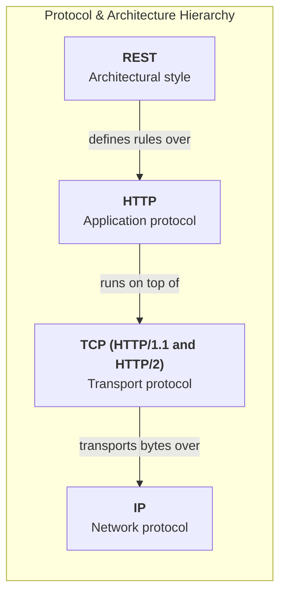
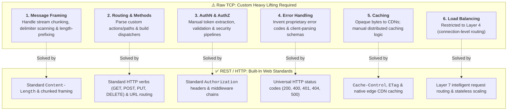
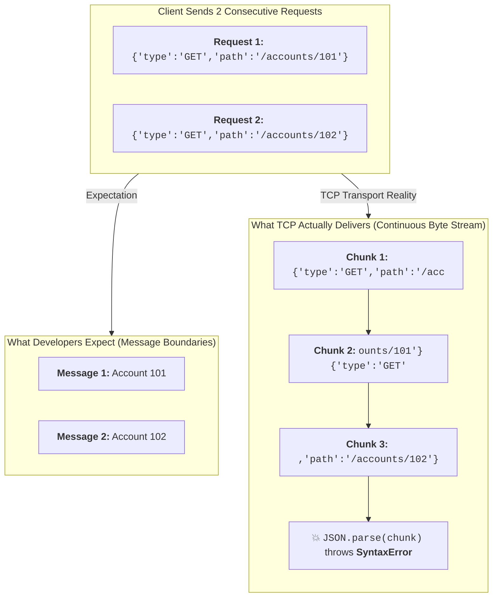

# TCP vs. HTTP/HTTPS vs. REST: Architectural Differences & Trade-Offs

In distributed systems and backend engineering, developers and architects often debate:

> *"Why choose REST over raw TCP? If TCP supports connections, load balancing, and data transfer, why do we need HTTP and REST?"*

The short answer: **REST does not replace TCP.** 
- **TCP** is a **Layer 4 transport protocol** that guarantees reliable, ordered byte delivery.
- **HTTP / HTTPS** is a **Layer 7 application protocol** (commonly running on top of TCP) that defines web communication semantics.
- **REST** is an **architectural style** that uses HTTP conventions to make APIs scalable, stateless, and interoperable.


---

## 1. High-Level Architectural Relationship

```
┌─────────────────────────────────────────────────────────────────────────────┐
│                       THE PROTOCOL & ARCHITECTURE STACK                     │
├───────────────────────────────┬─────────────────────────────────────────────┤
│ 1. REST                       │ Architectural Style (Rules for APIs)        │
│    (Representational State)   │ Resource-oriented, Stateless, Uniform URI   │
├───────────────────────────────┼─────────────────────────────────────────────┤
│ 2. HTTP / HTTPS (Layer 7)     │ Application Protocol                        │
│    (Hypertext Transfer)       │ Methods (GET/POST), Status Codes, Headers   │
├───────────────────────────────┼─────────────────────────────────────────────┤
│ 3. TLS (Optional Layer 6/7)   │ Transport Layer Security                    │
│    (Security & Encryption)    │ Certificate verification, Transit encryption│
├───────────────────────────────┼─────────────────────────────────────────────┤
│ 4. TCP (Layer 4)              │ Transport Protocol                          │
│    (Transmission Control)     │ Reliable, ordered byte streams, Handshake   │
├───────────────────────────────┼─────────────────────────────────────────────┤
│ 5. IP (Layer 3)               │ Internet Protocol                           │
│    (Network Addressing)       │ Packet routing across hosts (IP addresses)  │
└───────────────────────────────┴─────────────────────────────────────────────┘
```

---

## 2. Statelessness, Caching, and Load Balancing: TCP vs. REST

### 2.1 Does TCP Support Statelessness?
- **TCP is stateful at the connection level:** It maintains connection states (`SYN_SENT`, `ESTABLISHED`, `TIME_WAIT`), sequence numbers, acknowledgment counters, and sliding window buffers between endpoints.
- **REST is stateless at the application session level:** The server does not store client session state between requests. Every request must carry its own authentication token (e.g., JWT) and context.

```
┌─────────────────────────────────────────────────────────────────────────────┐
│                      CONNECTION STATE VS. SESSION STATE                     │
├──────────────────────────────────────┬──────────────────────────────────────┤
│ TCP Connection State (Stateful)      │ REST Application State (Stateless)   │
├──────────────────────────────────────┼──────────────────────────────────────┤
│ • Tracks sequence numbers            │ • Every request carries context/token│
│ • Maintains socket buffers & timers  │ • Any backend node can handle Req #2 │
│ • State exists only during the socket│ • No server memory tied to user ID   │
└──────────────────────────────────────┴──────────────────────────────────────┘
```

> **Key Distinction:** A TCP connection being stateful does not prevent the HTTP/REST application layer running on top of it from being completely stateless.

---

### 2.2 Does TCP Support Caching?
- **TCP does not define caching:** TCP only transports raw bytes without understanding message semantics, expiration policies, or resource representations.
- **HTTP defines caching semantics:** HTTP standardizes headers (`Cache-Control: public, max-age=300`, `ETag`, `Last-Modified`) that CDNs, reverse proxies, and browsers natively understand.

```
Client Requests Resource
        │
        ▼
┌──────────────────┐    Cache Hit (Return in 2ms)
│   CDN / Proxy    │───────────────────────────────► Client
└──────────────────┘
        │ Cache Miss
        ▼ (TCP / HTTP)
┌──────────────────┐
│ REST API Server  │
└──────────────────┘
```

---

### 2.3 Does TCP Support Load Balancing?
Yes, but with different capabilities:
- **Layer 4 Load Balancers (TCP):** Distribute raw TCP connections (IP + Port) without inspecting payload contents.
- **Layer 7 Load Balancers (HTTP/REST):** Inspect HTTP methods, URL paths, headers, and cookies to route individual API requests to specialized services.

```
Layer 4 (TCP) Load Balancing:
Client Socket ───► [L4 LB: Distributes Sockets] ───► Server Instance A (Holds entire socket)

Layer 7 (HTTP/REST) Load Balancing:
Request 1: GET /accounts/101  ───► [L7 LB: Inspects Path] ───► Account Service (Node A)
Request 2: POST /payments     ───► [L7 LB: Inspects Path] ───► Payment Service (Node B)
```

---

### 2.4 Comparative Matrix

| Feature | TCP (Layer 4) | HTTP / HTTPS (Layer 7) | REST (Architectural Style) |
|---|---|---|---|
| **Primary Role** | Reliable byte transmission | Web application protocol | API design principles |
| **Connection State** | Stateful (Socket-level) | Can reuse persistent sockets (`Keep-Alive`) | Not concerned with sockets |
| **Application Statelessness** | Not defined | Supported | **Mandatory constraint** |
| **Caching Semantics** | None (Transports bytes) | Standardized (`Cache-Control`) | Leverages HTTP caching |
| **Load Balancing** | Layer 4 (Connection level) | Layer 7 (Request level) | Maximized via statelessness |
| **Data Framing** | Continuous Byte Stream | Message Framing (Headers + Body)| Standardized JSON/XML entities |

---

## 3. Why Choose REST over Raw TCP? (Node.js Implementation)

> "Actually, REST and TCP are not direct alternatives. REST is an architectural style that commonly uses HTTP, and HTTP/1.1 and HTTP/2 typically use TCP as their transport protocol.
>
> TCP provides reliable communication between two endpoints, but it doesn't define application-level concepts such as HTTP methods, resource URLs, status codes, headers or standardized message formats.
>
> REST uses these established HTTP capabilities to simplify communication between frontend and backend systems.
>
> Therefore, for enterprise applications such as banking, e-commerce and CRUD-based systems, REST is generally preferred because it offers standardization, interoperability, caching support and easier integration with API gateways and load balancers."

### Remember this relationship: REST doesn't replace TCP



> **The biggest takeaway:** **TCP provides the communication channel; REST defines how applications should communicate using HTTP conventions.**

---

Imagine building a Banking API where a client queries an account balance.

### Option A: Using Raw TCP (`net` module)

#### `tcp-server.js`
```javascript
const net = require("net");

const server = net.createServer((socket) => {
    console.log("Client connected via TCP");

    socket.on("data", (data) => {
        const message = data.toString().trim();
        console.log("Received raw TCP payload:", message);

        if (message === "GET_BALANCE:101") {
            socket.write("BALANCE:50000\n");
        } else {
            socket.write("ERROR:INVALID_COMMAND\n");
        }
    });

    socket.on("end", () => console.log("Client disconnected"));
});

server.listen(4000, () => console.log("TCP Server running on port 4000"));
```

#### `tcp-client.js`
```javascript
const net = require("net");

const client = net.createConnection({ port: 4000 }, () => {
    client.write("GET_BALANCE:101");
});

client.on("data", (data) => {
    console.log("Response from TCP server:", data.toString());
    client.end();
});
```

---

### Option B: Using REST API (`express` module)

#### `rest-server.js`
```javascript
const express = require("express");
const app = express();

app.use(express.json());

// Standardized RESTful endpoint
app.get("/accounts/:accountId/balance", (req, res) => {
    const { accountId } = req.params;

    res.status(200).json({
        accountId,
        accountHolder: "John",
        balance: 50000,
        currency: "USD"
    });
});

app.listen(3000, () => console.log("REST API running on port 3000"));
```

#### `rest-client.js`
```javascript
async function getAccountBalance() {
    const response = await fetch("http://localhost:3000/accounts/101/balance");
    const data = await response.json();
    console.log("Response from REST API:", data);
}

getAccountBalance();
```

---

### What Express and HTTP Provide Out of the Box

| Requirement | Raw TCP | REST / HTTP |
|---|---|---|
| **Resource Identification** | Must parse custom strings manually | Standardized URIs (`/accounts/:id`) |
| **Operations / Verbs** | Must invent commands (`GET_BALANCE`) | Standardized HTTP methods (`GET`, `POST`, `PUT`, `DELETE`) |
| **Message Framing** | Must implement byte-length or delimiters | Built-in (`Content-Length`, `chunked`) |
| **Status / Error Codes** | Must invent custom error strings | Standardized HTTP status codes (`200`, `400`, `401`, `404`, `500`) |
| **Authentication** | Must design custom auth flow | Standard `Authorization: Bearer <token>` |
| **Browser Compatibility**| Browsers cannot open raw TCP sockets | Native `fetch()` and `XMLHttpRequest` support |
| **Tooling & Docs** | Custom documentation | OpenAPI (Swagger), Postman, cURL |

---

## 4. Problems We Must Handle Ourselves with Raw TCP


Suppose you decide to send this JSON structure over raw TCP instead of HTTP:

```json
{
  "type": "GET",
  "path": "/accounts/101",
  "headers": {
    "authorization": "abc123"
  },
  "payload": null
}
```

Now imagine this banking application scales to **10,000 concurrent clients and millions of requests**. Here are the 6 major architectural problems you must manually implement when using raw TCP instead of REST/HTTP:



---

### Problem 1: Message Framing

This is one of the biggest differences between TCP and HTTP.

**TCP is a byte stream, not a message-based protocol.**

Suppose a client sends two consecutive requests:
```json
Request 1: {"type":"GET","path":"/accounts/101"}
Request 2: {"type":"GET","path":"/accounts/102"}
```



- **What you expect:**
  - `Message 1`: Account 101
  - `Message 2`: Account 102

- **What TCP might actually deliver:**
  - `Chunk 1`: `{"type":"GET","path":"/acc`
  - `Chunk 2`: `ounts/101"}{"type":"GET"`
  - `Chunk 3`: `,"path":"/accounts/102"}`

Or both requests might arrive together merged into a single chunk.

#### The Problem:
This common TCP server code is completely unsafe:
```javascript
socket.on("data", (data) => {
    // 💥 Unsafe! data is NOT guaranteed to contain exactly one complete JSON document
    const request = JSON.parse(data.toString());
});
```

#### What you must implement manually:
You must implement a **custom Message Framing protocol**:
- Add a fixed-size message length header before each JSON payload.
- Read the length bytes first.
- Buffer incoming bytes until the complete message arrives.
- Parse the JSON only after the entire frame is received.

> **HTTP solves this natively:** HTTP provides standardized framing via `Content-Length` headers and `Transfer-Encoding: chunked`.

---

### Problem 2: HTTP Methods and Routing

Your JSON request specifies:
```json
{
  "type": "GET",
  "path": "/accounts/101"
}
```

Now imagine you need standard banking operations:
- `GET /accounts/101`
- `POST /payments`
- `PUT /accounts/101`
- `DELETE /beneficiaries/101`

#### With Raw TCP:
You must write complex custom parsing code to:
1. Read the `type` field.
2. Read the `path` string.
3. Identify the requested operation.
4. Find the matching route handler.
5. Validate route parameters.

#### With Express / REST:
Routing is clean, expressive, and out-of-the-box:
```javascript
app.get("/accounts/:id", getAccount);
app.post("/payments", createPayment);
app.put("/accounts/:id", updateAccount);
app.delete("/beneficiaries/:id", deleteBeneficiary);
```

---

### Problem 3: Authentication and Authorization

Your JSON request contains authentication metadata:
```json
"headers": {
    "authorization": "abc123"
}
```

#### With Raw TCP:
You must manually write custom logic for:
- Token extraction from custom payload formats.
- Token validation and signature checking.
- Expiration verification.
- Formatting and sending authentication error payloads.
- Enforcing authorization rules.

#### With Express / REST:
Reusable middleware handles authentication cleanly:
```javascript
function authenticate(req, res, next) {
    const token = req.headers.authorization;

    if (!token || token !== "abc123") {
        return res.status(401).json({
            error: "Unauthorized"
        });
    }

    next();
}

app.get("/accounts/:id", authenticate, getAccount);
```
*(In production, use standard JWT verification, HTTPS, and secure token rotation).*

---

### Problem 4: Error Handling and Status Codes

Suppose account `101` does not exist in the database.

#### With Raw TCP:
You must invent your own error schema and ensure all clients in every programming language know how to parse it:
```json
{
  "success": false,
  "errorCode": "ACCOUNT_NOT_FOUND",
  "message": "Account not found"
}
```

#### With Express / REST:
Standardized HTTP status codes communicate error semantics immediately to browsers, API gateways, load balancers, and monitoring tools:
```http
HTTP/1.1 404 Not Found
Content-Type: application/json

{
  "message": "Account not found"
}
```

---

### Problem 5: Caching

Suppose 10,000 users simultaneously request:
```http
GET /products
```

#### With Express / REST:
You can leverage standard HTTP caching headers:
```http
Cache-Control: public, max-age=300
```
CDNs (Cloudflare, CloudFront, Akamai) and reverse proxies (NGINX) immediately understand this and serve cached responses without hitting origin servers.

#### With Raw TCP:
TCP does not define caching. You must manually implement:
- Cache key generation.
- TTL expiration policies.
- Cache invalidation and eviction.
- Cache coordination across distributed nodes.

*(Note: Sensitive banking account info must be marked `Cache-Control: no-store`; public caching would be inappropriate).*

---

### Problem 6: Load Balancing and Scaling

Suppose we have 10,000 concurrent clients distributed across three Node.js application servers:

```
                  10,000 Clients
                        │
                        ▼
               ┌─────────────────┐
               │  Load Balancer  │
               └────────┬────────┘
        ┌───────────────┼───────────────┐
        ▼               ▼               ▼
┌──────────────┐┌──────────────┐┌──────────────┐
│   Server A   ││   Server B   ││   Server C   │
│   (Node.js)  ││   (Node.js)  ││   (Node.js)  │
└──────────────┘└──────────────┘└──────────────┘
```

#### With Raw TCP (Layer 4 Load Balancing):
- A Layer 4 load balancer distributes raw TCP connections (IP + Port).
- You must design your own protocol for managing long-lived connections, connection drain, and routing failures.

#### With HTTP/REST (Layer 7 Load Balancing):
- A Layer 7 load balancer understands HTTP methods, URL paths, headers, and status codes.
- **REST statelessness** enables granular request-level distribution:

```
GET /accounts/101  ───►  [Layer 7 Load Balancer]  ───►  Server A
GET /accounts/102  ───►  [Layer 7 Load Balancer]  ───►  Server B
```

---

### Complete Comparison: Raw TCP vs. REST/HTTP

| Responsibility | Raw TCP | REST/HTTP |
| :--- | :--- | :--- |
| Sending JSON | You implement message handling | Supported by application frameworks |
| Message framing | You implement | HTTP defines it |
| Routing | You implement | HTTP + Express routing |
| Authentication | You implement conventions | Standard HTTP mechanisms available |
| Error codes | Custom protocol | HTTP status codes |
| Caching | Custom implementation | Standard HTTP caching |
| Load balancing | Layer 4 possible | Layer 4 and Layer 7 |
| API documentation | Custom | OpenAPI ecosystem |
| Browser integration | Custom | Native HTTP support |

---

## 5. Authentication vs. Authorization in TCP and REST

Both Authentication and Authorization can be implemented over raw TCP—they are application-level concepts. However, REST provides standard conventions.

```
┌──────────────────────────────────────┬──────────────────────────────────────┐
│ Authentication ("Who are you?")     │ Authorization ("What can you do?")   │
├──────────────────────────────────────┼──────────────────────────────────────┤
│ • Validates credentials (User/Pass)  │ • Verifies role and permissions (RBAC)│
│ • Validates signature of JWT Token   │ • Checks resource ownership          │
│ • Example: Is this valid user "John"?│ • Example: Can John access Acct 101? │
└──────────────────────────────────────┴──────────────────────────────────────┘
```

### Authorization Check Example (Node.js):
```javascript
function authorizeAccountAccess(user, requestedAccountId) {
    if (user.role === "ADMIN") return true;
    return user.ownedAccounts.includes(requestedAccountId);
}

const user = { id: "john", role: "CUSTOMER", ownedAccounts: ["101"] };

console.log(authorizeAccountAccess(user, "101")); // true (Access Granted)
console.log(authorizeAccountAccess(user, "102")); // false (Access Denied)
```

---

## 6. The 4 Security Layers: TLS vs. mTLS vs. AuthN vs. AuthZ

A critical architectural pitfall is confusing **Transport Security (TLS)** with **Application Authorization (RBAC)**.

```
┌─────────────────────────────────────────────────────────────────────────────┐
│                      THE 4 APPLICATION SECURITY LAYERS                      │
├───────────────────┬──────────────────────────────────┬──────────────────────┤
│ Security Layer    │ Question Answered                │ Mechanism            │
├───────────────────┼──────────────────────────────────┼──────────────────────┤
│ 1. TLS            │ Is transit secure & is server    │ Server Certificate   │
│                   │ identity verified?               │ (e.g., X.509)        │
├───────────────────┼──────────────────────────────────┼──────────────────────┤
│ 2. mTLS           │ Have both client and server      │ Mutual Certificates  │
│                   │ verified each other's identity?  │ (Service-to-Service) │
├───────────────────┼──────────────────────────────────┼──────────────────────┤
│ 3. Application    │ Who is the logged-in user or     │ JWT, OAuth2 Bearer,  │
│    Authentication │ principal making the request?    │ API Key              │
├───────────────────┼──────────────────────────────────┼──────────────────────┤
│ 4. Application    │ Does this authenticated user     │ RBAC, ABAC,          │
│    Authorization  │ have permission for resource X?  │ Account Ownership    │
└───────────────────┴──────────────────────────────────┴──────────────────────┘
```

### Why TLS Authentication $\neq$ Resource Authorization:
- **TLS/HTTPS** ensures that John is communicating securely with `banking.example.com`.
- **mTLS** ensures that Payment Service is communicating with Account Service.
- **Neither TLS nor mTLS knows if John owns Account 101 or Account 102.** Application authorization logic must independently verify resource permissions against the database.

---

## 7. System Design Interview Focus & Self-Assessment

### Interview Scenario:
> **Question:** *"If user John successfully authenticates with a valid signed JWT token, does that automatically allow him to access Account 102?"*

**Answer:** **No.** 
Authentication proves John's identity. The backend must execute an authorization check (verifying if John's `user_id` matches the owner of `account_id: 102` or if he possesses the necessary RBAC permissions) before returning data.

---

### Why Choose REST over TCP in System Design?

> *"REST and TCP operate at different abstraction layers. TCP provides a reliable, ordered transport channel, but does not define application semantics. REST leverages HTTP's standard methods, status codes, headers, and caching mechanisms. For enterprise applications (banking, e-commerce, CRUD systems), REST provides out-of-the-box standardization, broad language interoperability, native CDN caching, and seamless integration with API gateways."*

---

## Summary & Key Takeaways

1. **TCP provides the pipe; REST defines the conversation:** TCP transports raw byte streams reliably. REST defines how applications exchange resources using standardized HTTP verbs, URIs, and status codes.
2. **Statelessness is an application concern:** TCP manages connection state, while REST enforces stateless application sessions.
3. **Raw TCP introduces undifferentiated heavy lifting:** Using raw TCP for APIs forces you to manually build message framing, routing, error codes, authentication extraction, and custom client SDKs.
4. **Security operates in distinct layers:** TLS encrypts the transport pipe; Application AuthN identifies the user; Application AuthZ validates resource permissions.
