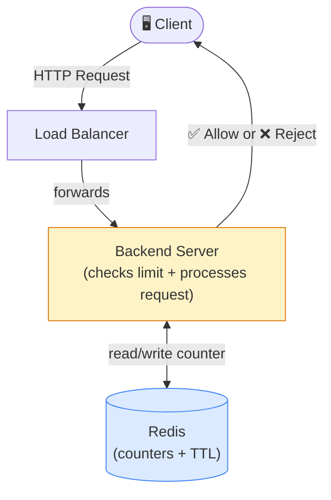
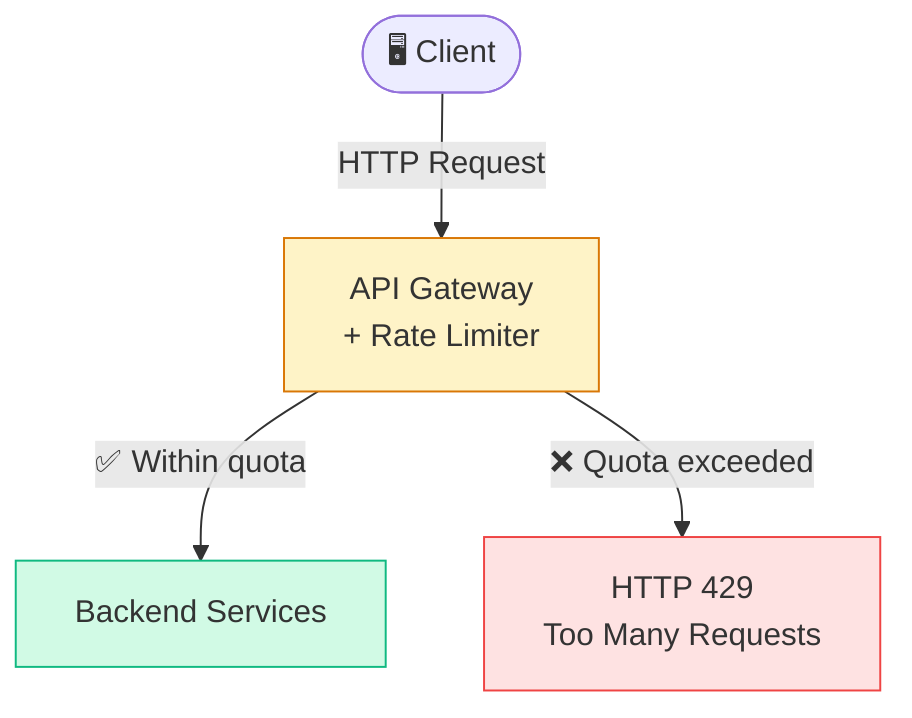
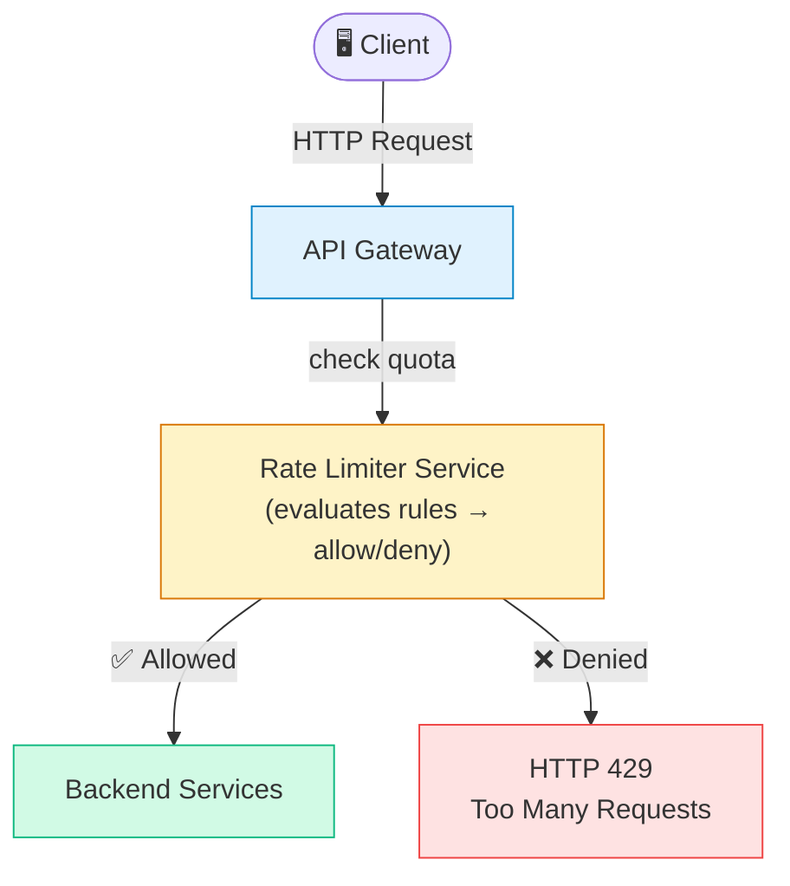
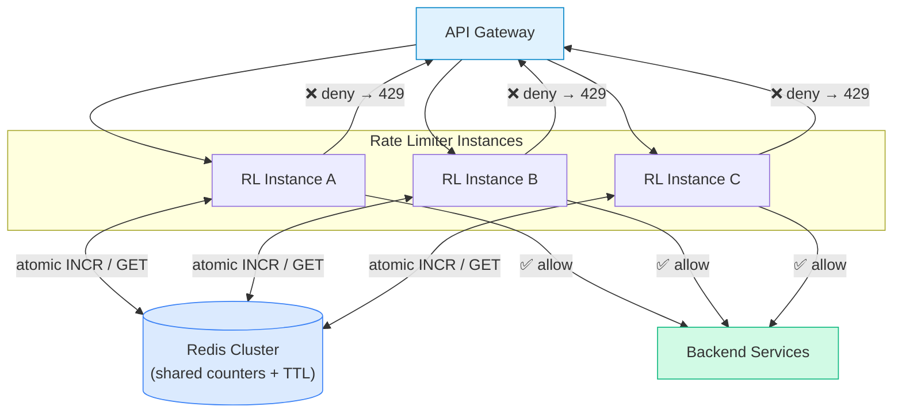
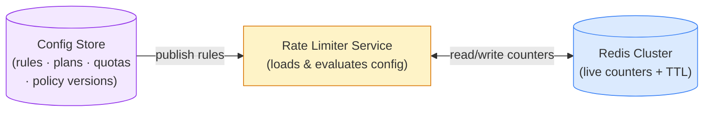
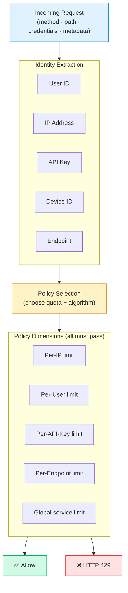
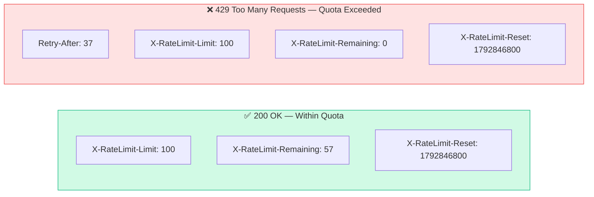
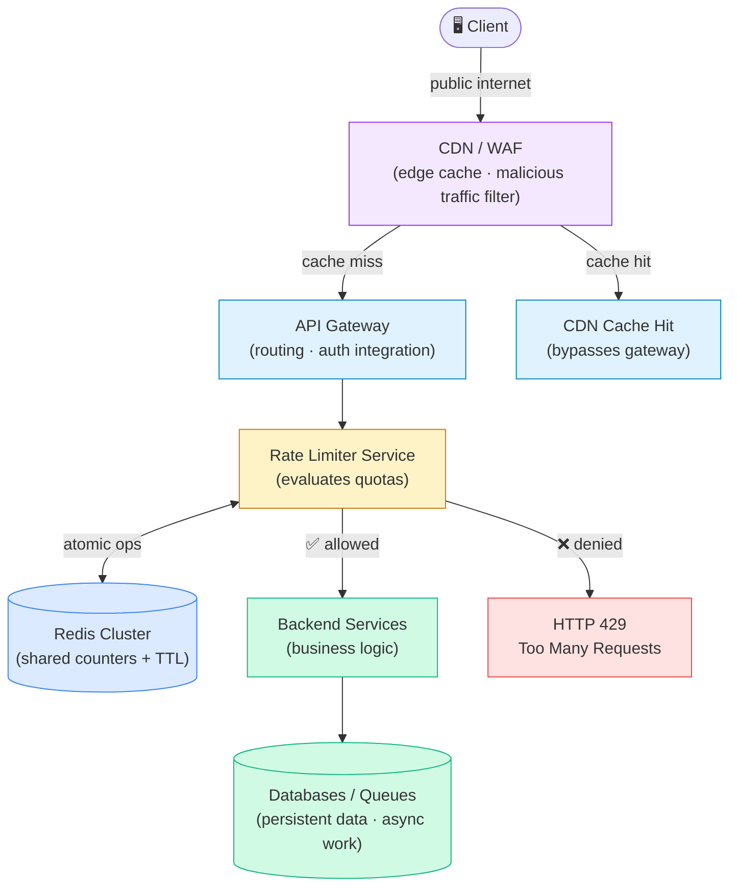
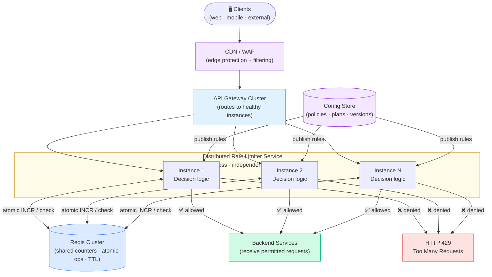

# How to Design a Production-Grade Rate Limiter — Step by Step

The key idea is: **start with a simple design, identify its bottlenecks and failure points, and improve the architecture one step at a time.**

This document traces that progression — from a rate limiter embedded inside a backend server, all the way to a distributed, horizontally scalable rate-limiting system with Redis, configurable rules, identity extraction, response headers, a CDN/WAF, and multiple service instances.


---

## Step 1: Understand the Basic Architecture

A rate limiter controls how many requests a client can make during a defined period.

> **Example:** an API might allow a client to make 100 requests per minute. Once the limit is exceeded, additional requests are rejected until the window resets.



### What is wrong with this design?

The backend checks the limit **only after the request has already reached it**. Even rejected requests consume:
- Network bandwidth and TCP connections
- CPU cycles and memory
- Application thread / process time

That defeats one of the main purposes of rate limiting: **protecting the backend from excessive traffic**.

> **First principle:** enforce the limit as early as possible, before the request reaches expensive business logic.

---

## Step 2: Move Rate Limiting to the API Gateway

The first improvement is to enforce the limit at the **API Gateway**, before requests reach backend services.



Requests within the permitted quota continue to the backend. Requests that exceed the quota are rejected at the gateway — the backend never sees them.

### Why is this still not sufficient?

The API Gateway now has **two responsibilities**: routing requests and maintaining rate-limit logic.

- If the gateway fails, it becomes a **single point of failure** (unless deployed redundantly).
- As rate-limiting rules grow more complex, the gateway becomes harder to maintain.

The next step is to separate rate limiting into its own service.

---

## Step 3: Create a Dedicated Rate Limiter Service

Instead of embedding all rate-limiting logic in the gateway, create a **separate service** responsible for making allow/deny decisions.



Responsibilities are now clearly separated:

| Component | Responsibility |
|---|---|
| **API Gateway** | Routing, authentication integration, request forwarding |
| **Rate Limiter Service** | Evaluating quotas and making allow/deny decisions |
| **Backend Services** | Executing business logic |
| **Redis** | Storing shared rate-limit state |

> **Production detail:** a synchronous rate-limit check for every request introduces network latency and an additional dependency. The gateway and rate-limiter service should communicate over a low-latency internal interface with strict timeouts and a defined failure policy. Some API gateways run rate-limiting logic locally while sharing state through Redis, avoiding a separate network call on every request.

---

## Step 4: Add a Redis Cluster for Shared Counters

A dedicated rate-limiter service is **not enough** when multiple instances are running.

### The split-counter problem

| Instance | Requests received |
|---|---|
| RL Instance A | 40 |
| RL Instance B | 35 |
| RL Instance C | 30 |
| **Total** | **105** |

If the quota is 100 requests/minute, none of the instances individually sees more than 100 — but together they have processed 105. Each local counter is unaware of the others.

### The solution: shared state in Redis



All instances read and write the **same counter in Redis**.

A counter key might look like:

```
rate_limit:{user-123}:GET:/api/orders
```

A simplified fixed-window entry:

```
counter = 57
TTL     = 24 seconds
limit   = 100 requests
```

The request is **allowed** if the counter is below the limit. Redis operations must update the counter and evaluate the limit **atomically** — otherwise, concurrent requests can all observe available quota and collectively exceed the limit.

### Which algorithm should you use?

| Algorithm | Best use | Trade-off |
|---|---|---|
| **Fixed window** | Simple quotas, low overhead | Bursts can occur at window boundaries |
| **Sliding window** | More accurate rolling quotas | More state or computation required |
| **Token bucket** | Allows controlled bursts | Requires token-refill logic |
| **Leaky bucket** | Smooths traffic to a steady rate | Can delay or reject bursts |

> Choose the algorithm based on your traffic pattern and business requirement, not by assuming one algorithm is universally best. See [Rate_Limiting_Algorithm](./Rate_Limiting_Algorithm.jpg) and [Redis Key Structures](./Redis_Key_Structure_Storing_Rate_Limiter_Keys.md).

---

## Step 5: Move Rate-Limit Rules into a Config Store

Without a config store, limits may be **hard-coded**:

```
RATE_LIMIT = 100
WINDOW_SECONDS = 60
```

Changing the limit from 100 to 200 requires a code change and a new deployment.

Instead, **store rules separately** and let the rate-limiter service load them dynamically:



### Example policy table

| API | Plan | Limit |
|---|---|---|
| `GET /api/profile` | Free | 100 req/min |
| `GET /api/profile` | Premium | 300 req/min |
| `POST /api/payments` | Premium | 30 req/min |

*These are illustrative values, not recommended universal quotas.*

### What a production Config Store must support

- **Versioned policies** with validation before activation
- **Controlled admin access** and audit logs
- A mechanism to **publish changes** to all rate-limiter instances
- **Local caching** of rules to avoid a config DB read on every request
- **Defined fallback behavior** when a configuration update fails or connectivity is lost

> The Config Store holds **policy**. Redis holds **operational state**. They have different jobs.

---

## Step 6: Extract Request Identity Before Evaluating the Limit

Not every request should share the same counter. The system needs to determine **who** is making the request and **what resource** is being accessed.

Possible rate-limiting dimensions:



### Per-user vs. per-endpoint example

```
User A → GET /api/orders   (uses User A's counter)
User B → GET /api/orders   (uses User B's counter — independent)
```

If the rule is **per-user**, each user gets an independent quota. If the rule is **per-endpoint globally**, both consume the same shared counter.

### Enforcing multiple policies simultaneously

A robust design can apply several policies to the same request:

| Policy dimension | Purpose |
|---|---|
| **Per-IP** | Reduce anonymous abuse |
| **Per-user** | Enforce account quotas |
| **Per-API-key** | Enforce client subscription tiers |
| **Per-endpoint** | Protect expensive operations |
| **Global service limit** | Protect backend capacity |

> The request must satisfy **all** applicable policies.

> **Security requirement:** derive user identity from validated authentication credentials. Trust IP information only from correctly configured proxy headers. Never trust arbitrary client-supplied user IDs or device IDs as proof of identity.

---

## Step 7: Return Rate-Limit Response Headers

A good rate limiter does more than allow or reject a request — it tells the client **what happened** and, where possible, **when it can try again**.



### Successful request

```http
HTTP/1.1 200 OK
X-RateLimit-Limit: 100
X-RateLimit-Remaining: 57
X-RateLimit-Reset: 1792846800
```

### Rejected request

```http
HTTP/1.1 429 Too Many Requests
Retry-After: 37
X-RateLimit-Limit: 100
X-RateLimit-Remaining: 0
X-RateLimit-Reset: 1792846800
```

### Header reference

| Header | Purpose |
|---|---|
| `X-RateLimit-Limit` | Maximum permitted requests for the applicable quota |
| `X-RateLimit-Remaining` | Estimated requests remaining in the current window |
| `X-RateLimit-Reset` | When the quota resets (Unix timestamp or HTTP date) |
| `Retry-After` | How long the client should wait before retrying |

> - `Retry-After` can be a delay in seconds or an HTTP date.
> - For a **fixed-window** limiter, reset is the end of the current window.
> - For a **token bucket**, retry delay depends on how quickly tokens refill.
> - Clients should handle HTTP 429 with bounded retries and backoff — not a tight retry loop.

---

## Step 8: Add a CDN and WAF in Front of the API Gateway

Place a CDN/WAF **before** the API Gateway to intercept traffic as early as possible.



### Roles of each layer

| Layer | Role |
|---|---|
| **CDN** | Serves eligible cached content closer to users; reduces origin traffic |
| **WAF** | Detects or blocks malicious patterns, exploits, and configured threats |
| **API Gateway** | API entry point; routes requests |
| **Rate Limiter** | Enforces quotas at the correct granularity |
| **Redis** | Maintains shared counter state |
| **Backend + Data** | Executes business operations; persists and processes data |

> A **CDN cache hit** may bypass the API Gateway entirely — useful for performance, but you must decide which quotas apply at the edge vs. at the origin.

> For sensitive operations — payments, account changes, authentication — **origin-side enforcement must remain in place** even when edge protections exist.

---

## Step 9: Distribute the Rate Limiter Service

In a production-grade architecture, the Rate Limiter Service must be **distributed across multiple instances** so it can handle high traffic, scale horizontally, and continue operating when an individual instance fails.

Distributing the service alone is not enough. All instances must coordinate their rate-limit decisions using **shared state** — otherwise each instance tracks its own independent counter and the global quota is violated.

### Architecture diagram



> The Config Store supplies rate-limit policies to the distributed instances. It is shown here to complete the picture but is omitted from timing flows below to keep them focused on request processing.

### How distributed rate limiting works

Suppose the quota is **100 requests per minute per user** using a fixed-window policy.

| Time | Instance | Requests received | Shared Redis counter |
|---|---|---|---|
| 10:00:05 | Instance 1 | 40 | 40 |
| 10:00:10 | Instance 2 | 35 | 75 |
| 10:00:15 | Instance N | 25 | 100 |
| 10:00:20 | Instance 1 | 1 | 101 — **rejected ❌** |

The first 100 requests are allowed. The 101st is rejected with **HTTP 429 Too Many Requests**.

This works because every instance checks and updates the **same logical counter in Redis**, rather than an independent local one. The counter update and limit decision must be **atomic** — otherwise concurrent requests on different instances could all observe quota available and collectively exceed the limit.

### What should be distributed?

| Component | Distributed? | Reason |
|---|---|---|
| **API Gateway** | Yes | Availability and request throughput |
| **Rate Limiter Service** | Yes | Horizontal scaling and fault tolerance |
| **Redis** | Usually clustered or highly available | Shared state and resilience |
| **Config Store** | Highly available | Policy availability during updates |
| **Backend Services** | Usually | Independent scaling and availability |

### Important production considerations

| Concern | Guidance |
|---|---|
| **Stateless instances** | Do not keep authoritative counters in local memory |
| **Shared state** | Use Redis or another coordination system for quota enforcement |
| **Atomicity** | Use Redis Lua scripts, Redis Functions, or equivalent atomic ops |
| **Fault tolerance** | Health checks, timeouts, retries where safe, deliberate fail-open/fail-closed policy |
| **Hot keys** | A very active user or global quota can create a Redis bottleneck; use key sharding or local approximation |
| **Redis failover** | Understand how failover, replication lag, and lost recent writes affect quota accuracy |
| **Latency** | A separate service call per request adds a network hop — consider gateway-native limiting when latency requirements are strict |

> A distributed rate limiter does **not** have to be a separate microservice. It can run inside multiple API Gateway instances, provided enforcement is coordinated correctly through shared state.

### Recommended design

> **Multiple stateless Rate Limiter Service instances** behind internal load balancing, a **Redis Cluster** for shared rate-limit state, and a **versioned Config Store** for rules and plans.

---

## Step 10: Scale the Rate Limiter Service Horizontally

Even a well-designed rate limiter can become a bottleneck if all requests must pass through a **single instance**.

```
API Gateway
  │
  ├── RL Instance 1 ──┐
  ├── RL Instance 2 ──┼──► Redis Cluster   ← shared state
  └── RL Instance N ──┘
        │
  Backend Services
```

### Illustrative horizontal scaling capacity

| Instances | Illustrative aggregate capacity |
|---|---|
| 1 | 5,000 req/sec |
| 2 | 10,000 req/sec |
| 4 | 20,000 req/sec |
| 8 | 40,000 req/sec |

*These numbers are hypothetical. Real capacity depends on Redis throughput, network latency, algorithm complexity, key distribution, and other bottlenecks.*

### How to scale safely

1. Deploy multiple **stateless** rate-limiter instances.
2. Put them behind a **load balancer** or service discovery mechanism.
3. Keep shared counters in **Redis** rather than instance-local memory.
4. **Scale Redis** itself according to throughput, memory, and availability requirements.
5. Use **health checks** and automatic replacement of unhealthy instances.
6. **Load-test the entire request path**, not just the rate-limiter code.

> A Redis Cluster improves distribution and availability but does not automatically guarantee that every operation succeeds or that all limits remain exact during failures and topology changes. Those behaviors must be **designed and tested**.

---

## Step 11: Production-Grade Reliability Controls

The architecture above is a strong starting point. A real production system requires these additional engineering controls.

### A. Atomic quota enforcement
Counter updates and allow/deny decisions must be **atomic**. Use Redis Lua scripts, Redis Functions, or an equivalent atomic operation. Choose the correct key structure and algorithm for your quota semantics.

See: [Redis Key Structure Guide](./Redis_Key_Structure_Storing_Rate_Limiter_Keys.md)

### B. Timeouts and failure policy
Define what happens when Redis or the rate-limiter service becomes unavailable. For sensitive banking or payment operations, failing open may expose the backend; failing closed may interrupt legitimate transactions. Choose per route and risk level.

Define what happens when Redis or the rate-limiter service becomes unavailable.

| Route type | Fail-open | Fail-closed |
|---|---|---|
| Public read API | Reasonable default | May be overly strict |
| Payment / auth | Exposes backend to abuse | Protects integrity |

> Choose per route and risk level. Document and test the behavior.

### C. Monitoring and alerting
Track:
- Allowed and denied requests, HTTP 429 rates
- p95/p99 decision latency
- Redis errors and timeout rates
- Configuration propagation delays
- Backend saturation signals

> Avoid high-cardinality metrics labelled with individual user IDs.

### D. Configuration safety
- Validate rules **before** publishing them.
- Support **versioned updates and rollback**.
- Cache last-known-good configuration for use when the config store is temporarily unavailable.
- Define behavior when **no valid policy is available**.

### E. Load and failure testing
Test:
- Concurrent bursts from many clients
- Multiple gateway and rate-limiter instances running simultaneously
- Redis failover and recovery
- Hot keys and uneven key distribution
- Malformed or missing identity
- Policy updates applied mid-traffic
- Clock boundary transitions
- Recovery after outages

### F. Resource and abuse protection
- Limit request body sizes and throttle expensive operations.
- Protect the rate-limiter endpoint from unauthorized access.
- Apply **separate, stricter quotas** to authentication, payments, and other sensitive APIs.

---

## Practical Decision: Central Service or Gateway-Native Limiter?

| Design | How it works | When to prefer it |
|---|---|---|
| **Gateway-native + Redis** | Rate-limiting logic runs inside the gateway or its plugin; Redis shares state | Lower latency; fewer network hops; simpler ops |
| **Dedicated service + Redis** | Gateway calls a separate service for every decision | Common policies across multiple gateways; centralized enforcement |

Both can be production-grade. Choose based on your gateway capabilities, latency target, operational complexity, and team structure.

---

## Step 12: Final Architecture — Complete Request Flow

```
1. Client
        │  (public internet)
2. CDN / WAF
        │  (edge caching and security filtering)
3. API Gateway
        │  (authentication integration and routing)
4. Identity & Policy Resolution
        │  (user ID, IP, API key, endpoint, subscription plan)
5. Rate Limiter Service Instances
        │  (evaluate quotas, atomically update Redis counters)
6. Redis Cluster
        │  (shared counter state and TTL expiry)
7. Backend Services
        │  (execute allowed business operations)
8. Databases / Queues
           (persist data, handle async work)
```

When the quota is exceeded, the request is **rejected with HTTP 429** and appropriate retry metadata — without reaching any backend business operation.

### Worked timing example

Suppose three downstream APIs each take 200 ms.

| Approach | Total time |
|---|---|
| Frontend calls REST **sequentially** | ~600 ms + overhead |
| Frontend calls REST **in parallel** | ~200 ms + overhead |
| Rate limiter rejects before backend | **< 5 ms** (no backend call) |

---

## Step 13: Implementation Roadmap

Build in this order to validate each concern before adding the next:

| # | Step | What it validates |
|---|---|---|
| 1 | **Basic limiter** — single-instance token bucket or fixed window | Core algorithm correctness |
| 2 | **API Gateway integration** — reject over-limit requests before backend | Early enforcement |
| 3 | **Redis-backed counters** — atomic distributed counters with TTL | Shared state correctness |
| 4 | **Dedicated service and horizontal scaling** — multiple instances, health checks, timeouts | Scalability and failure handling |
| 5 | **Config Store** — externalize quotas, plans, endpoints, policy versions | Dynamic rule management |
| 6 | **Identity and multiple policies** — per-user, per-IP, per-key, per-endpoint limits | Fine-grained enforcement |
| 7 | **Response metadata** — 429, `Retry-After`, quota headers | Client experience |
| 8 | **CDN/WAF + observability** — edge protection, metrics, alerts, load tests, failure tests | Production hardening |

---

## Summary

| Concern | Solution |
|---|---|
| Early enforcement | API Gateway rejects before backend |
| Shared state across instances | Redis Cluster with atomic operations |
| Dynamic rules | Config Store (versioned, cached) |
| Accurate identity | Validated auth credentials, trusted proxy headers |
| Client transparency | `X-RateLimit-*` and `Retry-After` headers |
| Edge protection | CDN/WAF in front of the gateway |
| Horizontal scalability | Stateless RL instances + Redis shared state |
| Fault tolerance | Timeouts, failure policy, health checks |
| Observability | Latency metrics, 429 rates, Redis error tracking |

> **Production readiness comes from more than adding Redis or choosing an algorithm.** It comes from early enforcement, shared state, independent responsibilities, dynamic policies, identity-aware quotas, useful client feedback, edge protection, and horizontal scalability.

---

## Related Files

- [Rate Limiter LLD](./Design%20Rate%20Limiter%20—%20LLD.md)
- [Production Distributed Rate Limiter — Interview LLD](./Production%20Distributed%20Rate%20Limiter%20—%20Interview%20LLD.md)
- [Redis Key Structure Guide](./Redis_Key_Structure_Storing_Rate_Limiter_Keys.md)
- [Rate Limiting Key Selection](./Rate_Limiting_Keys_Choose.md)
- [Rate Limiter README](./README.md)
