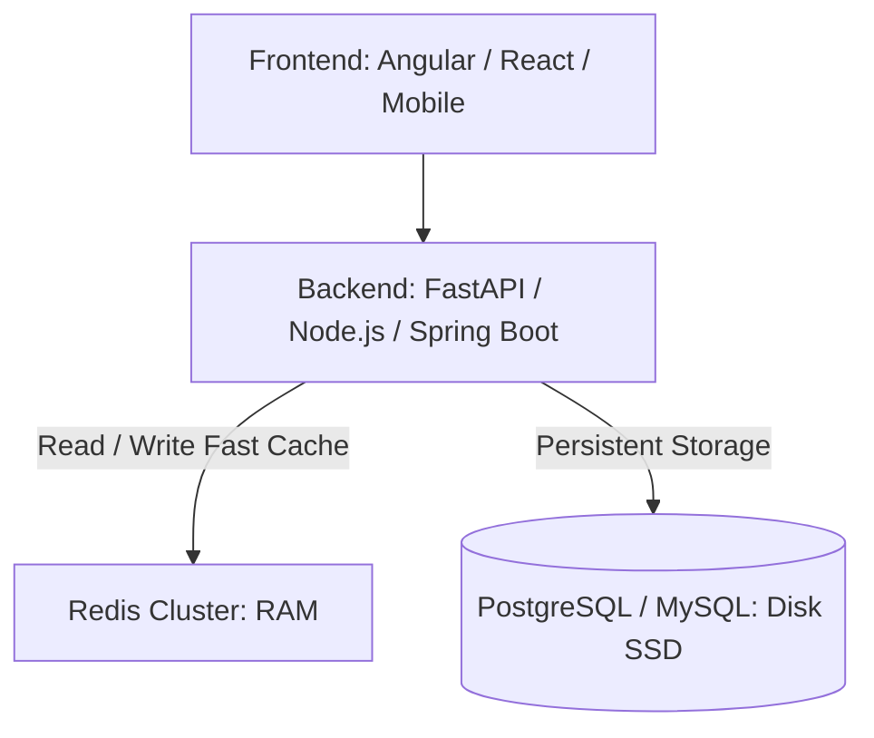
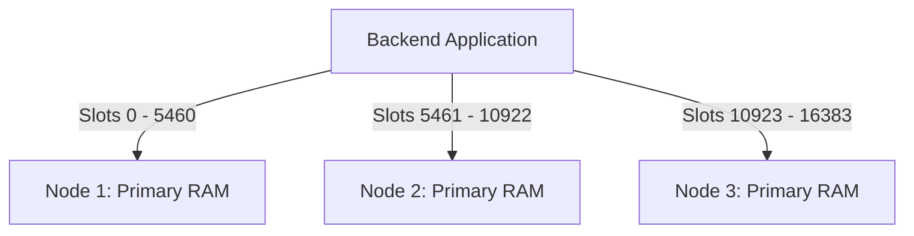

# Redis is In-Memory Database

When we say Redis is an **in-memory database**, it means Redis primarily stores and retrieves data directly from **RAM (Random Access Memory)** instead of accessing a disk (HDD/SSD) for every read and write operation.

---

## 1. Traditional Database vs. Redis

### Traditional Database (PostgreSQL / MySQL)
```
[ Application ]
       │
       ▼
[ Database ]
       │
       ▼
[ Disk (SSD / HDD) ] ── (Persistent data storage)
```
> Databases use RAM for caching and working memory, but persist and read primary data on disk.

---

### Redis (In-Memory Database)
```
[ Application ]
       │
       ▼
    [ Redis ]
       │
       ▼
 [ Server RAM ] ── (Primary data storage)
       │ (Optional persistence)
       ▼
[ Disk (RDB / AOF) ]
```
> Redis primarily reads and writes data in RAM. It can optionally persist data to disk.

---

## 2. Why is RAM faster than SSD?

| Feature | RAM | SSD |
| :--- | :--- | :--- |
| **Storage** | Temporary / Working memory | Persistent storage |
| **Speed** | Extremely fast (nanoseconds) | Slower than RAM (microseconds) |
| **Data Retention** | Lost when power is removed | Retained when powered off |
| **Cost per GB** | More expensive | Cheaper |

> **Latency Benchmark:** RAM access is typically measured in **nanoseconds (~10–100 ns)**, whereas SSD access is typically measured in **microseconds (~50–150 μs)** (which is 1000x slower).

---

## 3. Real-World Example: Banking Application

Suppose **10,000 users** log in to your banking application simultaneously and you need to store and validate their session tokens.

### Without Redis:
```
User ──► Application ──► Database (PostgreSQL / Disk)
                               │
                               ▼
                          Fetch session (Disk I/O bottleneck)
```

### With Redis:
```
User ──► Application ──► Redis (RAM)
                               │
                               ▼
                          Fetch session (Sub-millisecond latency)
```

### Example Redis Commands:
```bash
# Store session key-value in RAM
SET user:101 "Piyali"

# Retrieve session from RAM
GET user:101
```

- Redis stores this key-value pair directly in **RAM**.
- When the application requests `user:101`, Redis retrieves it directly from memory with sub-millisecond response times.

---

## 4. Does Redis Lose Data When the Server Restarts?

**Not necessarily!**

Although Redis primarily operates on data in RAM, it provides robust persistence mechanisms:

1. **RDB (Redis Database Backup):**
   - Periodically creates point-in-time snapshots of the dataset on disk.
   - Compact and suitable for backups and disaster recovery.
2. **AOF (Append-Only File):**
   - Logs every write operation received by the server.
   - Operations can be replayed at server startup to reconstruct the original dataset.
3. **No Persistence (Pure Cache):**
   - Operates strictly in-memory without saving anything to disk for maximum throughput when data loss is acceptable.

---

## 5. Where is Redis Used in Production?

| Use Case | Example |
| :--- | :--- |
| **Caching** | Frequently accessed product catalog / API responses |
| **Session Management** | Banking or e-commerce user login sessions |
| **Rate Limiting** | API request counters (e.g., 100 requests/minute/user) |
| **Distributed Locking** | Preventing race conditions and concurrent processing (Redlock) |
| **Real-time Leaderboard** | Gaming rankings using Redis Sorted Sets (`ZSET`) |
| **Pub/Sub & Streaming** | Real-time notifications and chat message routing |

---

## 6. Important System Design Architecture Concept



### Key Takeaways:
- **Redis** = Primarily stores data in RAM for extremely fast access.
- **PostgreSQL / MySQL** = Primarily stores data persistently on disk (Source of Truth).
- **Redis + PostgreSQL** = A common, highly scalable production architecture (Cache-Aside / Write-Through).

> **Important Distinction:** In-memory does not mean data can never be saved to disk. It means **RAM is the primary place where Redis operates on its data**.

---

## 7. Deep Dive FAQs

### Q1: Is the RAM used by Redis the Server's RAM?
**Yes!** Redis uses the RAM of the physical machine, virtual server, or container on which the Redis server process is running.

```
┌─────────────────────────────────┐
│ Server 1 – Application Server   │
│   Backend (FastAPI / Node.js)   │
└─────────────────────────────────┘
                 │ (Network / TCP)
                 ▼
┌─────────────────────────────────┐
│ Server 2 – Redis Server         │
│   Server RAM (e.g., 16 GB)      │
│   Redis (In-Memory Engine)      │
└─────────────────────────────────┘
                 │ (Network / TCP)
                 ▼
┌─────────────────────────────────┐
│ Server 3 – Database Server      │
│   PostgreSQL (Disk / SSD)       │
└─────────────────────────────────┘
```

#### What happens internally?
1. You install Redis on a host machine/server.
2. Redis allocates memory from that server's RAM.
3. Your application backend sends read/write commands over TCP/IP.
4. Redis reads or writes data directly in its allocated RAM.
5. Redis can optionally persist data snapshots or logs to disk.

#### What if Redis runs inside Docker?
- The Docker container runs the Redis process.
- Redis uses memory allocated by the host OS.
- Docker memory limits (`--memory="4g"`) restrict maximum memory usage.

> **Note:** Redis does **not** use the client's laptop/browser RAM (e.g., Angular frontend). It uses the RAM of the server hosting Redis. In production, Redis is often deployed via managed services like **AWS ElastiCache** or **Azure Managed Redis**.

---

### Q2: Is One Server Shared Between Application Backend & Redis?
**Not necessarily.** There are two deployment architectures:

#### 1. Same Server (Co-located: Backend + Redis)
Both applications run on the same virtual/physical server and share resources:
```
┌──────────────────────────────────────────────┐
│ Single Server (16 GB RAM)                    │
│ ┌──────────────────────┐ ┌─────────────────┐ │
│ │ Backend (FastAPI)    │ │ Redis           │ │
│ │ (Uses ~4 GB RAM)     │ │ (Uses ~4 GB RAM)│ │
│ └──────────────────────┘ └─────────────────┘ │
│ ┌──────────────────────────────────────────┐ │
│ │ Remaining ~8 GB RAM for OS / Processes   │ │
│ └──────────────────────────────────────────┘ │
└──────────────────────────────────────────────┘
```

#### 2. Separate Servers (Dedicated: Backend & Redis)
In production, services are isolated across dedicated servers:
```
┌───────────────────────┐          TCP/IP Network          ┌───────────────────────┐
│ Server 1              │ ───────────────────────────────► │ Server 2              │
│ Backend (App Server)  │                                  │ Redis Server          │
│ 16 GB RAM             │                                  │ 16 GB RAM             │
└───────────────────────┘                                  └───────────────────────┘
```

#### Comparison: Single Server vs. Dedicated Servers

| Factor | Same Server | Separate Servers |
| :--- | :--- | :--- |
| **Infrastructure Cost** | Lower | Higher |
| **Resource Isolation** | No (Contention risk) | Yes (Isolated CPU/RAM) |
| **Independent Scaling**| Difficult | Easy |
| **Failure Isolation**  | Low (Crash affects both)| High (Independent recovery) |
| **Best For**           | Development / Small Apps| Production / High Traffic |

---

### Q3: Does Redis Always Scale Horizontally with Redis Cluster?
**No.** Redis supports both **Vertical Scaling** and **Horizontal Scaling**.

#### 1. Vertical Scaling (Scale Up)
Increase CPU, RAM, and hardware specs on a single Redis instance:
```
[ Redis Server: 8 GB RAM, 4 vCPUs ] ──(Upgrade)──► [ Redis Server: 32 GB RAM, 8 vCPUs ]
```

#### 2. Horizontal Scaling (Scale Out with Redis Cluster)
Add multiple Redis nodes and shard the dataset using **16,384 Hash Slots**:



- **Hash Slot Distribution:** Redis Cluster partitions keys automatically across shards via `CRC16(key) mod 16384`.
- **Primary-Replica High Availability:** Each primary node can have one or more replicas. If a primary fails, automatic failover promotes a replica to primary without manual intervention.

```
┌─────────────────────┐   ┌─────────────────────┐   ┌─────────────────────┐
│ Primary Node 1      │   │ Primary Node 2      │   │ Primary Node 3      │
│ (Slots 0 - 5460)    │   │ (Slots 5461 - 10922)│   │ (Slots 10923 - 16383│
└──────────┬──────────┘   └──────────┬──────────┘   └──────────┬──────────┘
           │ Async Rep               │ Async Rep               │ Async Rep
           ▼                         ▼                         ▼
┌─────────────────────┐   ┌─────────────────────┐   ┌─────────────────────┐
│ Replica Node 1      │   │ Replica Node 2      │   │ Replica Node 3      │
└─────────────────────┘   └─────────────────────┘   └─────────────────────┘
```

---

## 8. Summary & Decision Matrix

| Requirement | Recommended Approach |
| :--- | :--- |
| **Small application / Low traffic** | Single Redis instance |
| **More memory / CPU needed on single node** | Vertical scaling |
| **Dataset larger than single machine RAM** | Redis Cluster (Horizontal sharding) |
| **High Availability & Auto-failover** | Redis Sentinel or Redis Cluster with Replicas |
| **High Read Throughput** | Read Replicas with read-only routing |

### Key Summary:
1. **Vertical Scaling** = Scale up resources (RAM / CPU) of a single Redis server.
2. **Horizontal Scaling** = Add more Redis nodes to distribute workload.
3. **Redis Cluster** = Partition data across primary nodes across 16,384 hash slots with optional failover replicas.
