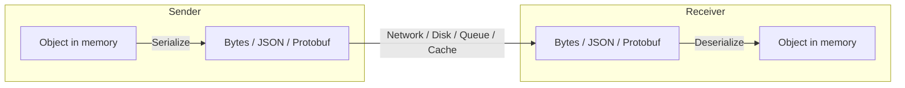
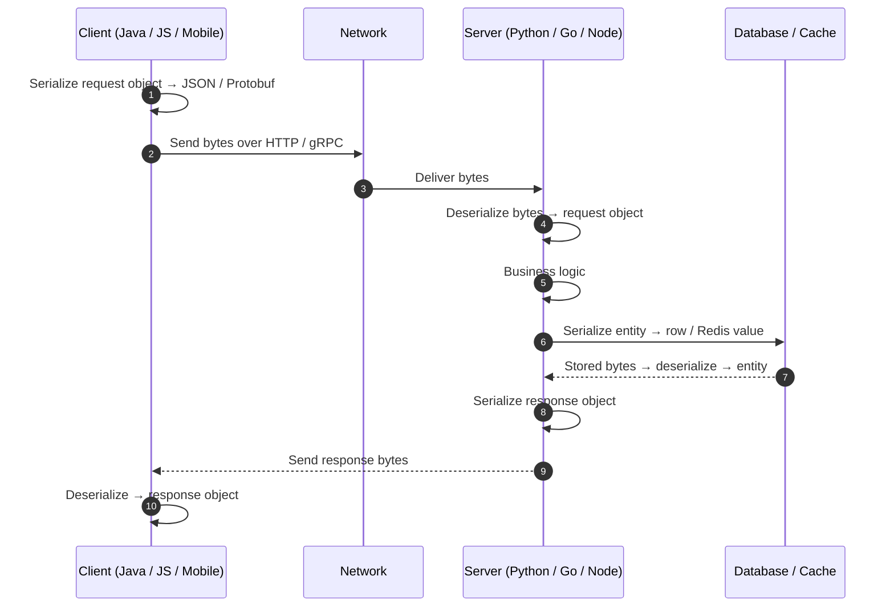
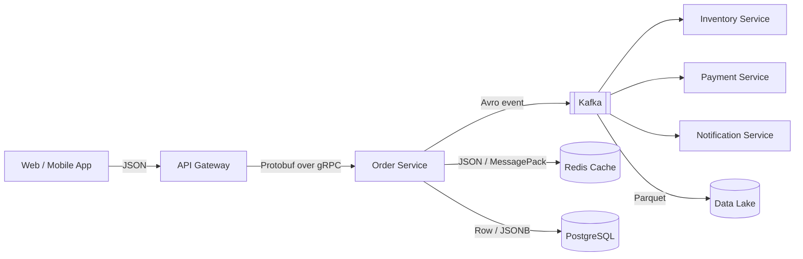

# Serialization vs Deserialization

## Table of Contents

1. [Definition](#1-definition)
2. [Difference](#2-difference)
3. [Purpose](#3-purpose)
4. [How It Works (Flow)](#4-how-it-works-flow)
5. [Common Formats](#5-common-formats)
6. [Real-Time Use Cases](#6-real-time-use-cases)
7. [Production Uses](#7-production-uses)
8. [Security & Pitfalls](#8-security--pitfalls)
9. [Best Practices](#9-best-practices)
10. [Interview Quick Revision](#10-interview-quick-revision)

---

## 1. Definition

### Serialization
**Serialization** is the process of converting an in-memory object or data structure (class instance, map, list, struct) into a format that can be **stored or transmitted** — a sequence of bytes or text such as JSON, XML, Protobuf, or Avro.

```
Object in memory  ──►  Serialize  ──►  Bytes / Text (JSON, Protobuf, ...)
```

### Deserialization
**Deserialization** is the reverse process: reconstructing the original object or data structure from the serialized bytes/text so a program can use it again.

```
Bytes / Text  ──►  Deserialize  ──►  Object in memory
```

### Example

```java
// Object in memory
User user = new User(1001, "Vishwa", "vishwa@example.com");

// Serialization  → JSON string
String json = mapper.writeValueAsString(user);
// {"id":1001,"name":"Vishwa","email":"vishwa@example.com"}

// Deserialization → Object
User copy = mapper.readValue(json, User.class);
```

> Other names: serialization = **marshalling / encoding**, deserialization = **unmarshalling / decoding**.

---

## 2. Difference

| Aspect | Serialization | Deserialization |
| :--- | :--- | :--- |
| **Direction** | Object → bytes/text | Bytes/text → object |
| **Also called** | Marshalling, encoding, pickling, dumping | Unmarshalling, decoding, unpickling, loading |
| **Performed by** | Sender / writer | Receiver / reader |
| **Input** | Trusted in-memory object | Often **untrusted external data** |
| **Output** | Portable byte stream or string | Usable in-memory object |
| **Typical moment** | Before sending over network, saving to disk/cache, publishing to queue | After receiving from network, reading from disk/cache, consuming from queue |
| **Main risk** | Leaking sensitive fields, large payloads | Injection, malformed data, insecure deserialization attacks, version mismatch |
| **Typical failure** | Non-serializable field, cyclic reference | Schema mismatch, missing/unknown fields, corrupt data |
| **Examples** | `JSON.stringify`, `json.dumps`, `ObjectMapper.writeValueAsString`, `pickle.dump` | `JSON.parse`, `json.loads`, `ObjectMapper.readValue`, `pickle.load` |



---

## 3. Purpose

Memory objects contain **pointers/references and language-specific layouts** that are meaningless outside the running process. Serialization turns them into a self-contained, portable representation.

| Purpose | Explanation |
| :--- | :--- |
| **Network communication** | Send data between client/server or between microservices over HTTP, gRPC, TCP |
| **Persistence** | Save object state to files or databases and restore it later |
| **Caching** | Store objects in Redis/Memcached as strings or bytes |
| **Messaging** | Put events on Kafka, RabbitMQ, SQS in a defined format |
| **Interoperability** | Let systems written in different languages (Java, Python, Go, JS) exchange data |
| **Deep copy / cloning** | Serialize then deserialize to clone complex object graphs |
| **State transfer** | Session replication, distributed computing (Spark), checkpointing |
| **Logging / auditing** | Record structured events (JSON logs) |

---

## 4. How It Works (Flow)



Key idea: **both sides must agree on the format and schema** (contract).

---

## 5. Common Formats

| Format | Type | Human readable | Size | Speed | Schema | Typical use |
| :--- | :--- | :--- | :--- | :--- | :--- | :--- |
| **JSON** | Text | Yes | Medium | Medium | Optional (JSON Schema) | REST APIs, configs, web/mobile |
| **XML** | Text | Yes | Large | Slow | XSD | SOAP, legacy enterprise, configs |
| **YAML** | Text | Yes | Medium | Slow | Optional | Config (Kubernetes, CI/CD) |
| **CSV** | Text | Yes | Small | Fast | None | Tabular data, exports |
| **Protocol Buffers** | Binary | No | Very small | Very fast | Required (`.proto`) | gRPC, internal microservices |
| **Apache Avro** | Binary | No | Small | Fast | Required (embedded/registry) | Kafka, Hadoop, data pipelines |
| **Apache Thrift** | Binary | No | Small | Fast | Required (`.thrift`) | RPC (Facebook origin) |
| **MessagePack** | Binary | No | Small | Fast | None | Compact JSON alternative, Redis |
| **Parquet / ORC** | Binary (columnar) | No | Very small | Fast for analytics | Embedded | Data lakes, analytics |
| **Java Serializable / Python pickle** | Binary | No | Varies | Medium | Language-specific | In-language persistence (risky) |

### Text vs Binary

| | Text (JSON, XML) | Binary (Protobuf, Avro) |
| :--- | :--- | :--- |
| Debugging | Easy, readable | Needs tooling |
| Payload size | Larger | Much smaller |
| CPU cost | Higher parsing cost | Lower |
| Schema evolution | Loose, flexible | Strict, well-defined rules |
| Best for | Public APIs, browsers | High-throughput internal systems |

### Same object, three representations

```
JSON:      {"id":1001,"name":"Vishwa"}                    (~28 bytes, readable)
XML:       <user><id>1001</id><name>Vishwa</name></user>  (~46 bytes, readable)
Protobuf:  08 E9 07 12 06 56 69 73 68 77 61               (~11 bytes, binary)
```

---

## 6. Real-Time Use Cases

### 6.1 REST API request/response
- Browser or mobile app serializes form data to **JSON** and sends it with `POST /orders`.
- The backend deserializes JSON into a DTO, validates it, runs logic, then serializes the result back to JSON.

### 6.2 gRPC microservice calls
- `GetUser(1001)` is serialized with **Protobuf** into a compact binary message and sent over HTTP/2; the server deserializes it, and the response travels the same way back.
- See [gRPC notes](../API/gRPC-Notes.md) for the full flow.

### 6.3 Caching with Redis
- Product details object → serialized to JSON/MessagePack → `SET product:42 <bytes>`.
- On a cache hit, the app deserializes the value back into an object instead of querying the database.

### 6.4 Event streaming with Kafka
- An `OrderPlaced` event is serialized (Avro/Protobuf/JSON) by the producer and deserialized by the consumers (inventory, billing, notification).
- A **Schema Registry** keeps both sides compatible as the event evolves.

### 6.5 Real-time chat and notifications
- WebSocket messages are serialized as JSON or binary frames; the receiving client deserializes them to update the UI instantly.

### 6.6 Session storage
- User session objects are serialized and stored in Redis so any server behind the load balancer can deserialize and continue the session (stateless app servers).

### 6.7 File persistence and game saves
- Application or game state is serialized to a file/save slot and deserialized on load to resume exactly where the user left off.

### 6.8 Mobile app offline mode
- API responses are serialized into local storage (SQLite/JSON files) and deserialized when the app reopens without network.

### 6.9 Deep cloning
- To copy a complex object graph, serialize it and deserialize into a fresh instance (simple, though slower than dedicated copy logic).

---

## 7. Production Uses

| Area | How serialization/deserialization is used | Typical technology |
| :--- | :--- | :--- |
| **Public REST APIs** | JSON payloads between clients and backends | Jackson, Gson, `System.Text.Json`, Express `JSON.parse` |
| **Internal microservices** | Compact, typed contracts and low latency | **gRPC + Protobuf**, Thrift |
| **Event-driven architecture** | Versioned events with compatibility checks | **Kafka + Avro/Protobuf + Schema Registry** |
| **Distributed caches** | Store objects in Redis/Memcached | JSON, MessagePack, Protobuf, Java serialization (avoid) |
| **Databases** | JSON/JSONB columns, document stores, row encoding | PostgreSQL JSONB, MongoDB BSON, DynamoDB items |
| **Big data & analytics** | Columnar storage for fast scans | Parquet, ORC, Avro on Spark/Hadoop/S3 |
| **Distributed compute** | Ship tasks and data between nodes (shuffle) | Spark (Kryo/Java), Flink |
| **Logging & observability** | Structured JSON logs, OpenTelemetry (Protobuf over OTLP) | ELK, Loki, OTel |
| **Configuration & infra** | Declarative configs parsed at startup | YAML (Kubernetes, Helm), JSON, TOML |
| **Message queues** | Task payloads for workers | Celery (JSON), SQS, RabbitMQ |
| **Machine learning** | Persist and load trained models | ONNX, TensorFlow SavedModel, pickle/joblib |
| **Auth tokens** | Claims serialized into signed tokens | JWT (Base64URL-encoded JSON) |

### Production example: E-commerce order flow



- **Edge:** JSON for compatibility with browsers and mobile clients.
- **Internal calls:** Protobuf/gRPC for speed and strict contracts.
- **Events:** Avro or Protobuf with a schema registry to evolve events safely.
- **Cache:** compact format to cut memory and network cost.
- **Analytics:** Parquet for efficient columnar queries.

### Schema evolution in production

Services deploy independently, so old and new versions coexist. Rules for safe changes (Protobuf/Avro):

| Change | Safe? | Note |
| :--- | :--- | :--- |
| Add a new optional field with a default | Yes | Old readers ignore it |
| Remove a field | Yes, if never reused | Reserve the field number/name |
| Rename a field | Depends | Safe in Protobuf (numbers), risky in JSON |
| Change a field's type | No | Add a new field instead |
| Reuse a field number | No | Corrupts data for old readers |

- **Backward compatible:** new readers can read old data.
- **Forward compatible:** old readers can read new data.

---

## 8. Security & Pitfalls

### Insecure deserialization
Deserializing **untrusted data** into arbitrary object types can let attackers execute code (e.g., Java `ObjectInputStream`, Python `pickle.load`, .NET `BinaryFormatter`, PHP `unserialize`). It is a recognised OWASP risk.

**Mitigations:**
- Never deserialize untrusted data with native binary serializers (pickle, Java serialization).
- Use data-only formats (JSON, Protobuf) bound to **explicit, known types**.
- Validate against a schema, enforce size and depth limits.
- Sign/verify payloads (HMAC) when integrity matters.
- Disable polymorphic/default typing in JSON libraries unless strictly allowlisted.

### Other pitfalls

| Pitfall | Impact | Fix |
| :--- | :--- | :--- |
| Serializing sensitive fields (password, tokens) | Data leak | Exclude with `@JsonIgnore`, DTOs, allowlists |
| Large payloads / deep nesting | High latency, memory pressure, DoS | Pagination, limits, streaming parsers |
| Schema/version mismatch | Runtime errors, silent data loss | Schema registry, compatibility checks, versioned APIs |
| Date/time and timezone formats | Wrong values across systems | Use ISO-8601 in UTC |
| Floating point and big integers | Precision loss (e.g., JS numbers > 2⁵³) | Send IDs/money as strings or integers in minor units |
| Cyclic references | Infinite loops / stack overflow | Use DTOs, ignore back-references |
| Language-specific formats | Locks you into one language | Prefer language-neutral formats |
| Serialization on hot path | CPU bottleneck | Faster format, reuse mappers, cache serialized form |

---

## 9. Best Practices

1. **Choose the format by need:** JSON for external/human-facing, Protobuf/Avro for internal high-throughput.
2. **Define explicit contracts** (OpenAPI, `.proto`, Avro schema) and version them.
3. **Use DTOs** instead of serializing domain/entity objects directly.
4. **Design for evolution:** optional fields, defaults, never reuse field IDs.
5. **Validate on deserialization:** types, ranges, required fields, size limits.
6. **Treat all inbound data as untrusted.**
7. **Reuse expensive objects** (e.g., `ObjectMapper`, serializers) instead of creating them per request.
8. **Use compression** (gzip/zstd) for large text payloads.
9. **Monitor** payload sizes, serialization latency, and deserialization error rates.
10. **Test compatibility** between producer and consumer versions in CI.

---

## 10. Interview Quick Revision

- **Serialization:** object → bytes/text for storage or transmission.
- **Deserialization:** bytes/text → object; the reverse step, done by the receiver.
- **Why needed:** network transfer, persistence, caching, messaging, cross-language interoperability.
- **Formats:** JSON/XML/YAML (text, readable) vs Protobuf/Avro/Thrift/MessagePack (binary, compact, fast).
- **REST → JSON**, **gRPC → Protobuf**, **Kafka → Avro/Protobuf + Schema Registry**, **Analytics → Parquet**.
- **Biggest risk:** insecure deserialization of untrusted data.
- **Production must-haves:** explicit schemas, backward/forward compatibility, validation, size limits.

> **One-liner:** *Serialization packs data so it can travel or be stored; deserialization unpacks it so it can be used again.*
