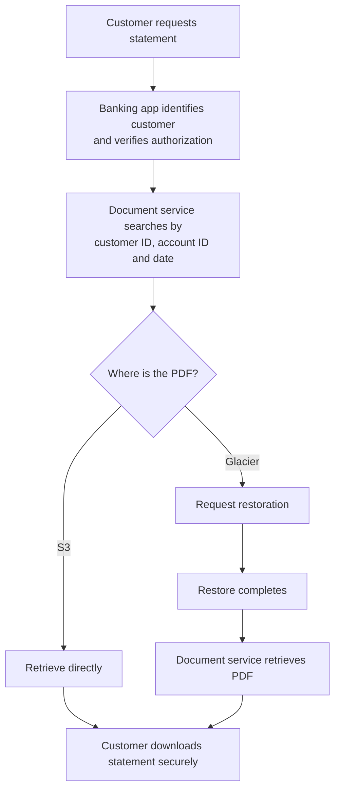

# Old Bank Statements vs Production Logs

Old bank statements are a good real-world example of **long-term production data storage**, but there is one important technical distinction:

> A bank statement is **not** technically a raw production log. It is a **business record** generated from production transaction data.

---

## 1. How a Bank Statement Relates to Production Logs

Imagine you use online banking to transfer ₹10,000 to another person. The banking application generates several records:

| Record | Example |
|---|---|
| Transaction record | ₹10,000 transferred |
| API log | Transfer API called |
| Authentication log | Customer successfully logged in |
| Security log | Transaction verified |
| Audit log | Transaction approved by customer |
| Bank statement | Shows ₹10,000 debit |

Notice the difference:

- **Production logs** record what happened inside the application and infrastructure.
- **Transaction records** record financial activities.
- **Bank statements** present those financial activities in a customer-readable format.

---

## 2. How Old Bank Statements Are Stored

Imagine a customer requests a bank statement from 2019. The bank doesn't necessarily keep every old PDF in its fast-access application database. Instead, it can:

1. Generate the statement from transaction records.
2. Store the PDF in durable object storage.
3. Apply retention and archival policies.
4. Move older statements to low-cost archival storage.
5. Restore the statement when the customer requests it.

Example tiering:

| Statement | Storage tier |
|---|---|
| 2026 statement | Fast-access storage |
| 2024 statement | Historical storage |
| 2019 statement | Glacier archive (if the bank's architecture uses it) |

---

## 3. How Does the Bank Retrieve an Old Statement?

Suppose a customer asks: *"I need my bank statement from January 2019."*

The retrieval process could be:

> **Important:** Glacier is storage, not a search engine. The bank needs a **searchable index or metadata database** to locate the correct document.

---

## 4. Storage Requirements by Record Type

| Banking example | Storage requirement |
|---|---|
| API logs | Operational log storage |
| Authentication logs | Security log storage |
| Transaction audit records | Protected audit storage |
| Bank statements (PDF) | Document/object storage |
| Old bank statements | Long-term archival storage |

---

## Key Takeaway

> A bank statement is like a **historical business document**. Production logs are like the **technical diary** of the banking system.

Both can require long-term retention, security, controlled access and archival storage, but they serve different purposes.
