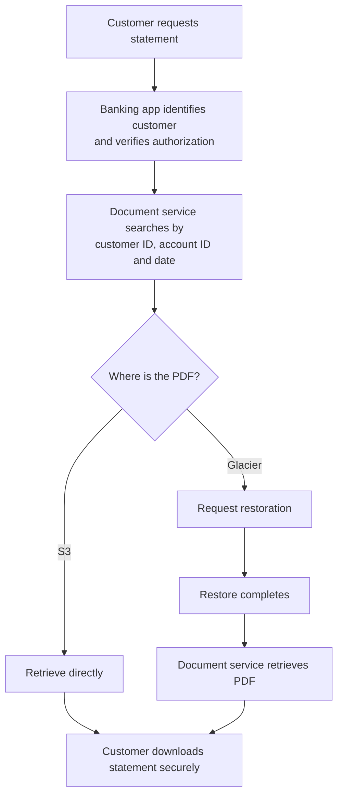
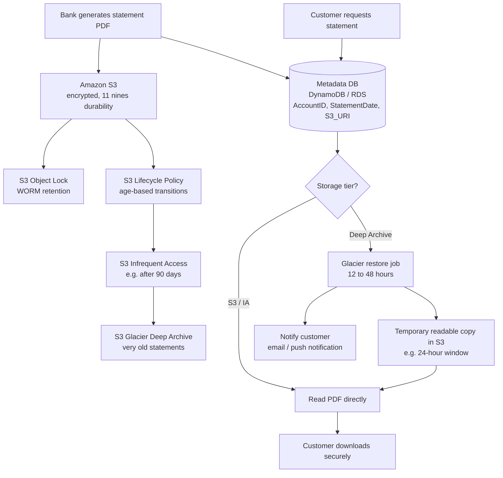

# Old Bank Statements vs Production Logs

Old bank statements are a good real-world example of **long-term production data storage**, but there is one important technical distinction:

> A bank statement is **not** technically a raw production log. It is a **business record** generated from production transaction data.

---

## 1. How a Bank Statement Relates to Production Logs

Imagine you use online banking to transfer ₹10,000 to another person. The banking application generates several records:

| Record | Example |
|---|---|
| Transaction record | ₹10,000 transferred |
| API log | Transfer API called |
| Authentication log | Customer successfully logged in |
| Security log | Transaction verified |
| Audit log | Transaction approved by customer |
| Bank statement | Shows ₹10,000 debit |

Notice the difference:

- **Production logs** record what happened inside the application and infrastructure.
- **Transaction records** record financial activities.
- **Bank statements** present those financial activities in a customer-readable format.

---

## 2. How Old Bank Statements Are Stored

Imagine a customer requests a bank statement from 2019. The bank doesn't necessarily keep every old PDF in its fast-access application database. Instead, it can:

1. Generate the statement from transaction records.
2. Store the PDF in durable object storage.
3. Apply retention and archival policies.
4. Move older statements to low-cost archival storage.
5. Restore the statement when the customer requests it.

Example tiering:

| Statement | Storage tier |
|---|---|
| 2026 statement | Fast-access storage |
| 2024 statement | Historical storage |
| 2019 statement | Glacier archive (if the bank's architecture uses it) |

---

## 3. How Does the Bank Retrieve an Old Statement?

Suppose a customer asks: *"I need my bank statement from January 2019."*

The retrieval process could be:

> **Important:** Glacier is storage, not a search engine. The bank needs a **searchable index or metadata database** to locate the correct document.

---

## 4. Storage Requirements by Record Type

| Banking example | Storage requirement |
|---|---|
| API logs | Operational log storage |
| Authentication logs | Security log storage |
| Transaction audit records | Protected audit storage |
| Bank statements (PDF) | Document/object storage |
| Old bank statements | Long-term archival storage |

---

## 5. Mapping the Bank Example to AWS Storage Architecture and Data Lifecycle

This is how the bank example maps to AWS cloud storage architecture and data lifecycle management, a core system design pattern for financial compliance and cost optimization.

### End-to-End Architecture Flow

### Concept Breakdown

| Bank scenario | AWS technical concept | How it works and why it matters |
|---|---|---|
| 2015 bank statement | Historical business document | Unstructured, immutable data that must be retained for years to meet financial regulations (e.g., RBI, SEC, GDPR). |
| Store PDF securely | Amazon S3 (Simple Storage Service) | Object storage offering 99.999999999% (11 nines) durability, encrypted at rest (SSE-S3/KMS) and in transit (TLS). |
| Protect from modification | S3 Object Lock | Enforces WORM (Write-Once-Read-Many). Prevents anyone, even root admins (in Compliance Mode), from deleting or altering the PDF during a set retention period. |
| Find by account/date | Metadata database and search | S3 is a key-value store, not a search engine. You store file attributes (AccountID, StatementDate, S3_URI) in a database like Amazon DynamoDB or RDS for instant querying. |
| Move older statements | S3 Lifecycle Policy | Automated rules that transition objects to cheaper storage tiers based on age (e.g., move to Infrequent Access after 90 days) without manual intervention. |
| Store very old statements | S3 Glacier Deep Archive | The lowest-cost AWS storage tier (~$0.00099/GB/month), designed for data accessed once or twice a year, such as a 2015 statement. |
| Customer requests statement | Glacier restore | Deep Archive files cannot be read instantly. An asynchronous restore job copies the PDF back to a readable S3 tier for a set window (e.g., 24 hours), taking 12 to 48 hours to complete. |

### Key Engineering Trade-offs

- **Cost vs. retrieval speed:** Glacier Deep Archive saves a large amount of money on multi-year archives, but customers cannot download the statement immediately. The application must notify them (e.g., via email or push notification) once the restore completes.
- **Compliance Mode vs. Governance Mode:** When configuring S3 Object Lock, Compliance Mode strictly blocks all deletions until the timer expires (ideal for banking regulations), whereas Governance Mode allows privileged admins to override the lock.

---

## Key Takeaway

> A bank statement is like a **historical business document**. Production logs are like the **technical diary** of the banking system.

Both can require long-term retention, security, controlled access and archival storage, but they serve different purposes.
