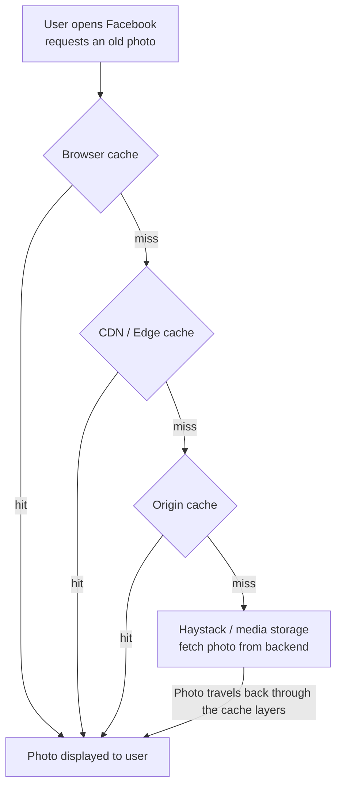

# How Facebook Stores Old Posts and Images at Billion-User Scale

Facebook (Meta) has billions of users who upload photos, videos, posts, comments and other content. Some content is 10–15 years old, yet users can still access it.

How is that possible without keeping everything in expensive, high-performance storage?

> **Answer:** distributed storage + object storage + caching + replication + tiered storage.

---

## 1. What Does Facebook Need to Store?

| Content | Example |
|---|---|
| Text posts | Your 2015 birthday post |
| Images | Photos uploaded in 2016 |
| Videos | Videos uploaded in 2018 |
| Comments | Comments from friends |
| Likes/reactions | Likes on old posts |
| User profiles | Profile information |
| Messages | Conversations |

Each content type has different storage and access requirements:

- A recent photo may be viewed thousands of times.
- A photo uploaded 10 years ago may be viewed once a year.
- A viral video may be viewed millions of times.

Storing all of them in the same expensive, high-speed storage system would be inefficient.

---

## 2. Facebook's Storage Architecture (Simplified)

Facebook developed its own storage technologies because ordinary file storage was not efficient enough for billions of photos. It does not need every old photo to remain on expensive, high-speed storage. It uses different storage and caching strategies depending on how frequently content is accessed.

Meta has publicly described several technologies used in its storage architecture:

| Technology | Main responsibility |
|---|---|
| Haystack | Photo and media object storage |
| f4 | More storage-efficient handling of warm media |
| TAO | Social graph data access |
| Memcache | Caching frequently accessed data |
| Cold storage | Cost-efficient preservation of older photos |

> These are technologies described in Meta's published engineering work. This is a conceptual architecture, not a claim that every component is used in exactly this arrangement today.

---

## 3. Hot, Warm and Cold Storage

Imagine you uploaded a photograph on Facebook in 2015.

| Tier | Access pattern | Examples | Characteristics |
|---|---|---|---|
| **Hot** | Frequently accessed | Popular posts, viral photos | Needs fast retrieval |
| **Warm** | Occasionally accessed | Older photos and posts, family portraits | Can use more storage-efficient systems |
| **Cold** | Rarely accessed | Very old, rarely viewed photos | Lower-cost storage; retrieval can involve additional steps |

Meta's published cold-storage architecture explains how older photos can use fewer active replicas while retaining an additional highly durable copy. The goal was to preserve old memories efficiently without sacrificing durability.

---

## 4. How Does Facebook Retrieve a Photo Uploaded 10 Years Ago?

Suppose you open Facebook and click a photograph you uploaded in 2015. Facebook's publicly documented photo-serving architecture describes multiple cache layers:



The key idea: the photo does not need to be fetched from the original storage system every time. If it is already present in a cache, Facebook can serve it from there.

---

## 5. What Happens When Someone Uploads a New Photo?

1. You upload a photo from your mobile application.
2. Facebook receives the image.
3. The image is processed into different sizes.
4. The media storage system stores the image objects.
5. The system maintains metadata connecting the photo to its owner and other related objects.
6. The photo becomes available to authorized viewers.

The **photo** and its **metadata** are different things.

**Photo object storage** – `photo_98765.jpg`: the actual image binary data stored in object storage.

**Metadata / social graph** (illustrative, not Facebook's actual internal schema):

```json
{
  "photo_id": "98765",
  "user_id": "12345",
  "upload_date": "2015-06-20",
  "visibility": "friends",
  "storage_key": "media/98765"
}
```

This separation is important. You don't need to search through billions of image files to find a particular user's photo. You first locate the photo using its metadata and then retrieve its image data.

---

## 6. What Did Facebook Build Instead of Using Only Amazon S3 Glacier?

Facebook published research on important systems:

- **Haystack – Photo storage:** designed to efficiently store and serve billions of photos by reducing unnecessary filesystem metadata operations.
- **f4 – Warm BLOB storage:** designed to store less frequently accessed photos and videos more efficiently while maintaining fault tolerance.
- **Cold storage – Older photos:** designed to preserve older, less popular photos using lower-cost storage and durable copies.

---

## 7. Translating Facebook's Concepts to an Enterprise Architecture (Angular + FastAPI + Docker + Kubernetes)

| Facebook concept | Enterprise equivalent |
|---|---|
| Haystack / media object storage | Amazon S3 / MinIO |
| f4 / warm storage | Cost-optimized object storage |
| Cold storage | S3 Glacier |
| Browser / edge cache | Browser cache / CDN |
| Origin cache | Redis / distributed cache |
| TAO / social graph | Database + relationship services |
| Photo metadata | PostgreSQL |
| Photo retrieval | Media retrieval API |

---

## The Five Concepts to Remember

1. **Distributed storage:** store enormous amounts of data across multiple machines and locations.
2. **Tiered storage:** hot, warm and cold data have different storage requirements.
3. **Caching:** avoid repeatedly accessing the original storage system.
4. **Metadata indexing:** find the correct object without scanning all stored files.
5. **Replication and durability:** protect data against hardware and infrastructure failures.

---

## Key Takeaway

> Facebook's challenge isn't simply storing billions of photos. It is storing them **economically** while ensuring that a photo uploaded many years ago can still be **found and delivered quickly**.

That is the difference between building an ordinary file-storage application and designing an enterprise-scale distributed storage system.
