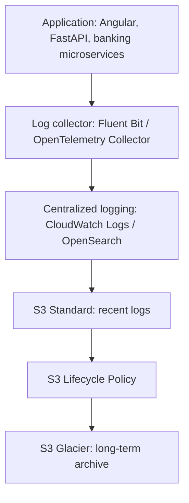
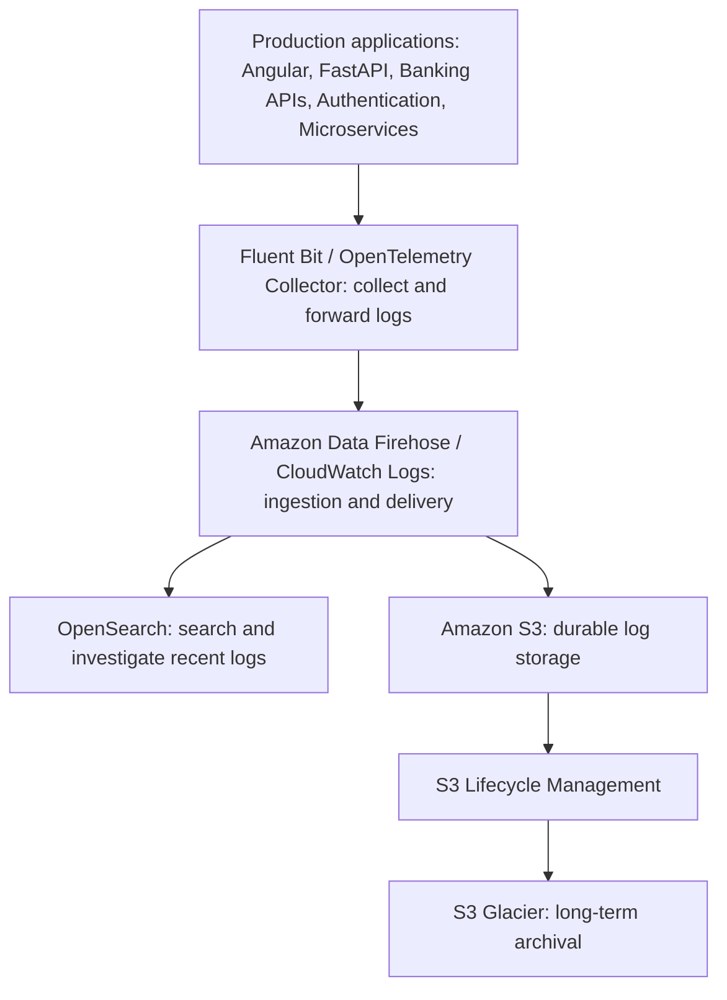
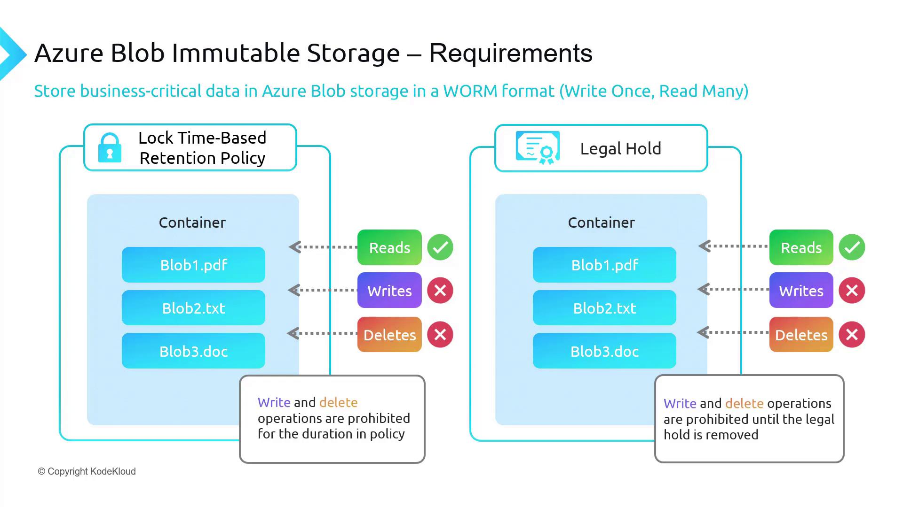
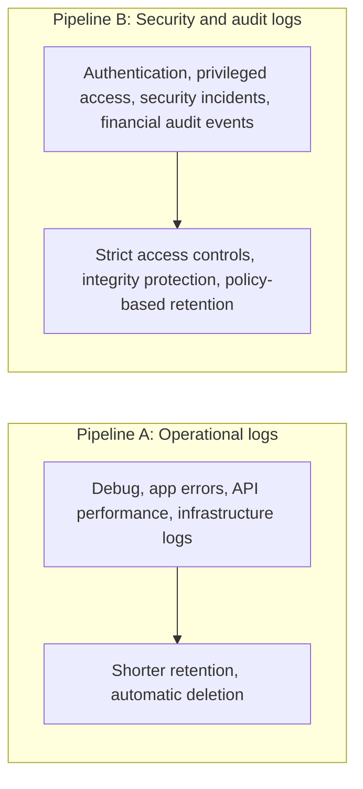

# Storage for Production Logs (Amazon S3 Glacier and Alternatives)

In production enterprise applications, you can use Amazon S3 Glacier to store application logs for long-term retention at a low cost.

> **Key principle:** Don't send all production logs directly to Glacier. First store and process logs in a system that supports quick searching and troubleshooting. Move older logs to Glacier automatically.

---

## 1. What is Amazon S3 Glacier?

A low-cost cloud storage option for archiving data that you don't need to access frequently.

For example, a banking application may generate:

- Application logs
- API request/response logs
- Authentication logs
- Security audit logs
- Error and exception logs
- Transaction processing logs

You may need to retain these logs for 1 year, 3 years, 5 years, or longer, depending on compliance requirements. Keeping all of them in expensive, fast-searching storage becomes costly. Glacier helps reduce long-term storage costs.

---

## 2. Recommended production architecture

1. **Application:** Angular frontend, FastAPI backend, banking microservices generate logs.
2. **Log collector:** Fluent Bit, OpenTelemetry Collector, or another log agent collects logs.
3. **Centralized logging:** Send logs to CloudWatch Logs, OpenSearch, or another log management platform.
4. **S3 Standard:** Store logs for recent access and troubleshooting.
5. **S3 Lifecycle Policy:** Automatically transition older logs to cheaper storage classes.
6. **S3 Glacier:** Archive logs for long-term retention.

---

## 3. Which Glacier storage class should you use?

| Storage class | Retrieval time | Minimum storage duration | Good for |
|---|---|---|---|
| **S3 Glacier Instant Retrieval** | Milliseconds | 90 days | Logs accessed occasionally |
| **S3 Glacier Flexible Retrieval** | Minutes to 12 hours (depends on retrieval option: Expedited / Standard / Bulk) | 90 days | Historical application and audit logs |
| **S3 Glacier Deep Archive** | Approximately 9–48 hours | 180 days | Old compliance and audit logs (lowest-cost tier) |

> Retrieval times and minimum durations are AWS-published typical values and requirements, not guaranteed incident-response times.

---

## 4. Real production example: log retention policy

Suppose your banking application generates 100 GB of logs every month. You could configure the following lifecycle policy:

| Log age | Storage | Purpose |
|---|---|---|
| 0–30 days | S3 Standard | Recent logs |
| 30–90 days | S3 Standard-IA | Infrequent access |
| 90–365 days | Glacier Flexible Retrieval | Historical logs |
| 1–7 years | Glacier Deep Archive | Compliance archive |

> Illustrative policy, not a universal recommendation. Check transition eligibility, minimum-duration charges, retrieval costs and regulatory retention requirements before implementation.

### Who moves the logs?

You don't need to write a scheduled application or manually move files. **AWS S3 Lifecycle Management** does this automatically based on the rules you configure.

- **Day 1:** Log file is stored in S3 Standard.
- **Day 30:** AWS moves it to Standard-IA.
- **Day 90:** AWS moves it to Glacier Flexible Retrieval.
- **Day 365:** AWS moves it to Deep Archive.

---

## 5. What happens when you need an old log?

A production incident occurs today, and the security team wants to investigate a suspicious login from 2 years ago.

1. Security engineer identifies the required date and log file.
2. Engineer requests restoration of the archived S3 object.
3. AWS restores a temporary accessible copy.
4. Engineer downloads or analyzes the log.
5. Engineer completes the investigation.

> **Important:** Glacier Flexible Retrieval and Deep Archive are **not** real-time searchable storage. You must restore archived objects before accessing their contents.

---

## 6. Enterprise implementation (Angular + FastAPI + microservices)

**Enterprise security controls**

- AWS KMS encryption
- IAM access policies
- S3 Object Lock for immutable audit records
- Separate security/log-archive AWS account
- Monitoring and retention policies

For continuous log delivery from CloudWatch, consider subscription-based delivery rather than repeatedly running export jobs.

---

## 7. Other cloud storage alternatives for long-term archival

| Provider | Long-term archival |
|---|---|
| AWS | S3 Glacier Deep Archive |
| Microsoft Azure | Azure Blob Storage Archive |
| Google Cloud | Cloud Storage Archive |
| On-premises | MinIO / object storage with lifecycle policies |

**Recommendation:** Use OpenSearch or CloudWatch for searching and troubleshooting, Amazon S3 for recent and intermediate log storage, and Glacier for long-term archival.

> Never archive sensitive logs without encryption, restricted access, and appropriate retention controls. For banking audit logs, consider S3 Object Lock as well.

---

# Other Production Log Storage Systems

Large enterprises, banks, healthcare organizations, and government systems often use multiple storage systems together.

> You generally do **not** need to store every production log permanently. You need to retain the right logs for the right duration, based on business, security, legal, and compliance requirements. **Permanent storage is not the same as long-term retention.**

## 1. Production log storage options

### Azure Blob Storage
- Cloud-based object storage.
- Supports Archive access tier.
- Supports immutable storage and retention policies.
- Suitable for long-term audit and application logs.
- Alternative to AWS S3 and Glacier.

### Google Cloud Storage
- Object storage for large volumes of logs.
- Archive storage class for long-term retention.
- Supports retention policies and Bucket Lock.
- Useful for compliance archives.

### Splunk Enterprise
- Enterprise log management and analytics.
- Search, investigate, and correlate logs.
- Supports retention and archival architectures.
- Useful for security monitoring and SIEM.
- Primarily an analytics and log-management platform, not simply an archive.

### Elastic Stack
- Elasticsearch for searchable logs.
- Logstash or Beats for ingestion.
- Kibana for dashboards and investigations.
- Supports searchable snapshots and lifecycle management.

### Grafana Loki
- Centralized log aggregation.
- Works with Grafana dashboards.
- Stores log chunks in object storage (S3, GCS, Azure Blob Storage).
- Supports long-term retention through its storage backend, with configurable retention.
- A good option for Kubernetes and microservices environments.

### MinIO
- S3-compatible object storage.
- Can be deployed in your own infrastructure.
- Suitable for private-cloud and on-premises architectures.
- Supports object versioning and retention capabilities depending on deployment and configuration.

---

## 2. Do we need permanent storage?

Use **policy-based retention** instead of permanent retention for everything.

| Log type | Suggested retention approach |
|---|---|
| Debug logs | 7–30 days |
| Application information logs | 30–90 days |
| Application error logs | 30–90 days |
| API access logs | 90–180 days |
| Security logs | 1–2 years or as required |
| Authentication logs | Based on security policy |
| Financial audit logs | As required by applicable regulations |
| Critical transaction audit records | As required by legal and business policy |

> These are illustrative engineering starting points, not mandatory regulatory periods. Your organization must establish the actual periods.

### Why not store everything forever?

1. **Storage cost:** Billions of log records accumulate over time.
2. **Privacy:** Logs can contain personal information, IP addresses, account identifiers, and other sensitive data.
3. **Compliance:** Some regulations require retention for a specific period, while privacy rules may require deletion when retention is no longer justified.
4. **Security:** Keeping unnecessary sensitive information increases the impact of a data breach.
5. **Performance:** Searching years of raw logs is not the same as searching recent operational logs.

There is also a difference between retaining a log for seven years and retaining it forever.

---

## 3. What if logs must never be modified or deleted?

Use **Immutable Storage (WORM)**:

- **W**rite **O**nce
- **R**ead **M**any

Once a log has been written, unauthorized users cannot modify or delete it during the configured retention period.

| Platform | Immutable storage feature |
|---|---|
| AWS | S3 Object Lock |
| Azure | Blob Immutable Storage |
| Google Cloud | Bucket Lock / Object Retention Lock |

AWS also recommends a separate centralized log archive account with strict access controls and immutable security logs.

> **Important:** Immutable does not necessarily mean permanent. It means the records cannot be changed or deleted during the enforced retention period. Some configurations can also support legal holds.

---

## 4. Recommended architecture for a banking enterprise application

Separate log storage into three layers:

| Layer | Purpose | Technology | Example retention |
|---|---|---|---|
| **Layer 1 – Operational logs** | Frequently accessed; search, troubleshoot, investigate production issues | Elasticsearch / OpenSearch | 7–30 days for debug logs |
| **Layer 2 – Historical logs** | Long-term storage of historical application, API and infrastructure logs | Amazon S3 | 90 days to 1 year or longer |
| **Layer 3 – Compliance archive** | Immutable preservation of critical security and audit records | Glacier + S3 Object Lock | 7 years, if required by applicable policy or regulation |

This separation is important because the system used to investigate a production error should not be the same system used to preserve an immutable audit record.

---

## 5. Suggested technology choices

| Requirement | Choice |
|---|---|
| Production log searching | OpenSearch |
| Log dashboards | Grafana |
| Log collection | Fluent Bit / OpenTelemetry |
| Centralized storage | Amazon S3 |
| Cheap long-term archive | Glacier Deep Archive |
| Tamper-resistant audit logs | S3 Object Lock |
| Security monitoring | SIEM / Splunk |

You don't need to implement all these products. Choose based on your infrastructure and operational requirements.

---

## 6. Two separate log pipelines

- **Pipeline A – Operational logs:** Debug, application errors, API performance, infrastructure logs. These can have shorter retention and automatic deletion.
- **Pipeline B – Security and audit logs:** Authentication events, privileged access, security incidents, financial audit events. These get stricter access controls, integrity protection and policy-based retention.

This prevents an application administrator from silently erasing the audit trail simply by deleting application logs.

---

## Final advice

Don't design a production system around keeping all logs forever. Design it around retaining the right evidence for as long as necessary, protecting critical records from tampering, and automatically deleting data when its retention period expires.
