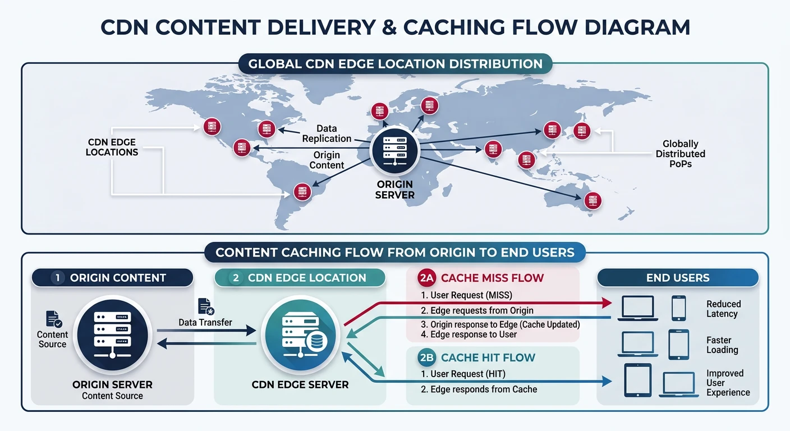
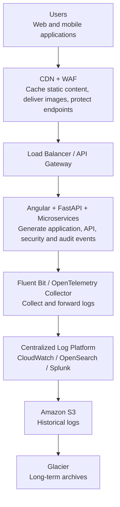

# Why Not Store Production Logs Inside a CDN?

A CDN **can** store data such as images, videos and other files. But it is generally **not** the right place to permanently store production logs, because CDNs and log storage solve two different problems:

- **CDN:** delivers content to users quickly.
- **Log storage:** preserves application activity so engineers can search, investigate, audit and retrieve historical records.

---

## 1. What Is a CDN Designed For?

A CDN (Content Delivery Network) has servers distributed across geographical locations.

Suppose you upload a photograph to Facebook from India, and a user in the USA wants to view it. Instead of fetching the original image from the primary storage location every time, a CDN can serve a cached copy from an edge location closer to the user.

1. The original photo is stored in backend object storage.
2. The CDN receives a request for the photo.
3. The CDN checks whether it has a cached copy.
4. If yes, it serves the cached image.
5. If not, it fetches the image from origin storage and may cache it.

This reduces latency and backend load.



---

## 2. Why Shouldn't We Store Production Logs Directly in a CDN?

Consider a FastAPI application generating these logs:

```text
2026-11-27 10:00:01 INFO User logged in
2026-11-27 10:00:05 INFO Payment initiated
2026-11-27 10:00:07 ERROR Payment failed
2026-11-27 10:00:08 WARN Retry initiated
```

You need these records for troubleshooting and security investigations. A CDN is not designed to provide the complete capabilities required.

| Requirement | CDN | Log storage |
|---|---|---|
| Fast content delivery | Excellent | Not its primary purpose |
| Permanent retention | Not guaranteed | Yes, with retention policies |
| Search logs by keyword | Limited / not its purpose | Yes |
| Investigate errors | Not designed for this | Yes |
| Audit historical activity | Not a canonical audit store | Yes |
| Immutable retention | Not its primary purpose | Supported by suitable storage |
| Log analytics | Not its primary purpose | Yes |

> **Important:** CDN caches can expire, be evicted, or be purged. A cached object should never be treated as your permanent source of truth.

---

## 3. Can CDN and Log Storage Work Together?

Yes. Enterprise production architecture:



### CDN access logs

CDNs can generate their own access logs. For example, Amazon CloudFront can record:

- Requested URL
- Client IP address
- HTTP status code
- Request timestamp
- Bytes transferred

These CDN access logs can be delivered to Amazon S3 for long-term storage and analysis.

So CDN logs are useful, but you generally store the records in S3 or another log platform, **not in the CDN cache itself**.

---

## 4. Three Different Storage Responsibilities

| Layer | Role | What it does |
|---|---|---|
| **CDN** | Content delivery | Stores temporary cached copies of images, videos, CSS, JavaScript and other content to speed up delivery. |
| **Object storage (Amazon S3)** | Durable storage | Stores images, videos, documents, historical logs and backups with configured durability and retention. |
| **Log analytics (OpenSearch)** | Searching and investigation | Lets engineers search errors, trace requests, investigate incidents and monitor application health. |

---

## 5. Real-World Analogy: A Library

| Technology | Library analogy |
|---|---|
| CDN | A nearby reading room with popular books |
| Amazon S3 | Main library containing the books |
| Glacier | Long-term archive for rarely requested books |
| OpenSearch | Library catalogue to find a particular book |

You wouldn't permanently store the only copy of a historical book in a temporary reading room. Similarly, you shouldn't treat CDN cache as the permanent storage location for production logs.

---

## Key Takeaway

> **CDN is for faster access. Object storage is for durable retention. Log analytics is for investigation.**

These three systems complement each other; they don't replace each other.
