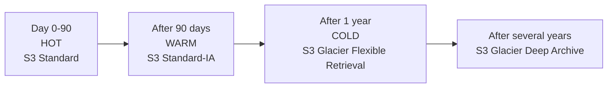
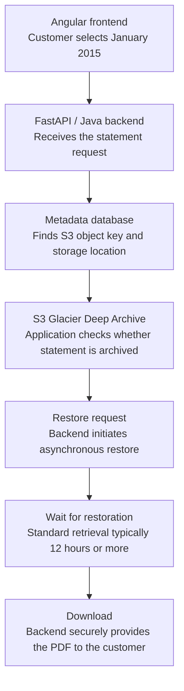

# Hot, Warm and Cold Storage in a Banking Application

Imagine a bank has millions of customers and stores years of information:

- Today's account transactions
- Last month's transaction history
- 2020 bank statements
- 2015 bank statements
- Audit logs and regulatory records

Should the bank store all this data in the same type of storage?

**No.** Different data is accessed at different frequencies. Banks use a storage strategy called **Hot, Warm and Cold Storage** to balance performance, availability and storage cost.

---

## 1. The Three Storage Types

| Type | Data | Characteristics | Used for |
|---|---|---|---|
| **Hot** | Frequently accessed; customers and banking applications access it continuously | Very fast access, higher storage cost | Real-time operations |
| **Warm** | Occasionally accessed, such as recent historical transactions | Reasonably fast access, moderate storage cost | Historical queries and reports |
| **Cold** | Rarely accessed; old records that must be retained | Retrieval can take minutes or hours, lowest storage cost | Long-term retention and compliance |

---

## 2. Real Banking Application Example

Suppose a customer opens a banking application and checks their account. The bank might organize the customer's data like this:

| Customer data | Storage category | Example |
|---|---|---|
| Current account balance | Hot | Available balance right now |
| Today's transactions | Hot | Money transferred today |
| Last 30 days' transactions | Hot | Recent transaction history |
| 3–12 months' transactions | Warm | Older transaction history |
| 2-year-old bank statements | Warm | Occasionally requested PDF |
| 2015 bank statements | Cold | Rarely requested historical PDF |
| 10-year-old audit records | Cold | Long-term compliance retention |

> These are illustrative retention and access categories, not mandatory banking rules. Actual placement depends on access patterns and applicable retention policies.

---

## 3. Which AWS Services Can Implement This?

| Storage category | AWS service / storage class | Purpose |
|---|---|---|
| Hot | Amazon RDS / DynamoDB | Frequently accessed transactional data |
| Hot | Amazon S3 Standard | Frequently accessed documents |
| Warm | Amazon S3 Standard-IA | Less frequently accessed documents |
| Warm | Amazon S3 Intelligent-Tiering | Automatically optimizes storage based on access patterns |
| Cold | S3 Glacier Flexible Retrieval | Long-term archival with retrieval in minutes to hours |
| Cold | S3 Glacier Deep Archive | Very long-term archival; typically 12–48 hours for standard retrieval |

> **Important:** RDS and DynamoDB are databases, whereas S3 is object storage. They serve different purposes. Hot/Warm/Cold describes an **access and cost strategy**, not three mandatory AWS products.

---

## 4. How Does Data Move from Hot → Warm → Cold?

Imagine a customer generates a bank statement on 27 November 2026. The bank stores the PDF in Amazon S3 Standard initially. As the document gets older and is accessed less frequently, it can move to cheaper storage classes using an **S3 Lifecycle Policy**.

### Bank statement storage lifecycle



1. **Day 0–90: Hot (S3 Standard).** The statement is recently generated and may be downloaded frequently by customers.
2. **After 90 days: Warm (S3 Standard-IA).** Customers access it less often, so the bank can move it to a lower-cost tier.
3. **After 1 year: Cold (S3 Glacier Flexible Retrieval).** The statement is rarely accessed but must remain available for historical requests.
4. **After several years: Deep Archive (S3 Glacier Deep Archive).** The statement is retained for long-term requirements and is rarely retrieved.

> Illustrative lifecycle only. Actual transition dates must account for applicable retention requirements, minimum storage durations, retrieval needs and costs.

---

## 5. What Happens When a Customer Requests a 2015 Bank Statement?

Let's understand the actual production flow.


Suppose a customer logs into the banking application and requests a statement from January 2015.



The customer may see a message such as:

> "Your January 2015 statement is being prepared. We will notify you when it is ready."

> **Important:** Restoring an archived object does not permanently move the original back to Standard. It creates a **temporary accessible copy** for the specified period.

---

## 6. Why Not Store Everything in Hot Storage?

Imagine a bank stores 1 PB (approximately 1 million GB) of documents. The exact prices depend on AWS region and storage class, but the cost principle is:

| Tier | Relative storage cost |
|---|---|
| Hot storage | Highest |
| Warm storage | Moderate |
| Cold storage | Lowest |

*Conceptual comparison, not actual AWS pricing.*

- If a bank stores every historical statement in Hot Storage, it may pay more than necessary.
- If it stores today's transaction data in Cold Storage, the banking application becomes too slow.

Therefore, banks choose storage based on **how frequently data is accessed** and **how quickly it must be retrieved**.

---

## 7. Complete Banking Architecture

| Component | Responsibility |
|---|---|
| Angular | Customer-facing banking UI |
| FastAPI / Java | Business logic and APIs |
| RDS / DynamoDB | Account and document metadata |
| Amazon S3 Standard | Frequently accessed PDFs |
| S3 Standard-IA | Less frequently accessed PDFs |
| S3 Glacier | Historical document archive |
| S3 Lifecycle | Automatically transitions eligible objects |
| S3 Object Lock | Protects records against deletion or modification under configured retention rules |
| SNS / SQS | Can notify customers and coordinate asynchronous restore workflows |

---

## 8. Important Concepts to Remember

| Question | Answer |
|---|---|
| Is Hot Storage always faster? | Generally, yes, for the storage classes in this example. |
| Is Cold Storage always cheaper? | Usually cheaper for storage, but retrieval and other charges matter. |
| Can we search for a 2015 statement in Glacier directly? | Search its metadata database first, then retrieve the archived object. |
| Does Lifecycle Policy automatically decide everything? | No. Engineers configure transition rules and retention policies. |
| Can a bank permanently delete old records? | Only when permitted by applicable retention, legal-hold and compliance requirements. |

> **Key lesson:** Hot, Warm and Cold Storage help a banking application achieve three goals: fast access to frequently used data, reasonable cost for historical data, and economical long-term retention.

---

# Going Deeper: Three Types of Data, Three Strategies

A real production banking application manages three different types of data:

1. **Transaction data:** money transfers, deposits, withdrawals.
2. **Application and security logs:** API requests, errors, login attempts, audit events.
3. **Business documents:** bank statements, loan documents, KYC documents.

All three need different Hot, Warm and Cold storage strategies.

## 1. Transaction Data

Imagine a customer transfers ₹5,000 to another account.

| Tier | AWS service | Data |
|---|---|---|
| **Hot:** current transactions | RDS / Aurora / DynamoDB | Today's transactions, account balances and recent activity. Need fast access. |
| **Warm:** historical transactions | RDS / Aurora read replicas or analytical storage | Older transactions used for customer history, reporting and reconciliation. |
| **Cold:** archived transaction records | S3 / Glacier | Older records retained for regulatory and business requirements. Usually exported as archival datasets rather than directly moving active database records into Glacier. |

> **Important:** Banks cannot simply move old transaction rows out of their primary database without considering account balances, reconciliation, reporting, audit trails and legal requirements. The system must preserve the authoritative transaction history.

## 2. Application and Security Logs

Suppose a banking application receives 10 million API requests every day. It generates:

- API request logs
- Authentication logs
- Failed login attempts
- Payment failure logs
- Security alerts
- Audit logs

A practical architecture:


| Storage | AWS service | Example |
|---|---|---|
| Hot | CloudWatch Logs / OpenSearch | Today's API errors and security alerts |
| Warm | OpenSearch / S3 Standard-IA | Recent historical logs for investigation |
| Cold | S3 Glacier | Old logs retained for audit and compliance |

**Real example:** A customer says, *"I tried transferring ₹50,000 yesterday, but the transaction failed."* The support team searches recent application logs in OpenSearch. But suppose the security team investigates a suspicious login from 2022. They may need to retrieve archived logs from S3 Glacier.

> Security and audit logs may need stricter retention, access controls and immutable protection than ordinary application debug logs.

## 3. Business Documents: Bank Statements, KYC and Loan PDFs

Imagine a bank stores:

- Bank statements
- PAN and identity documents
- Address proofs
- Loan agreements
- Mortgage documents

These are usually stored as objects in Amazon S3, with metadata in a database.

| Storage | Example | AWS service |
|---|---|---|
| Hot | Recently generated bank statements | S3 Standard |
| Warm | Older statements accessed occasionally | S3 Standard-IA |
| Cold | 2015 bank statements | S3 Glacier Deep Archive |
| Cold | Old loan agreements | S3 Glacier Deep Archive |

For sensitive KYC documents, the bank must also enforce strict authorization, encryption, audit logging and retention/deletion policies.

## 4. Complete Production Architecture

Logical architecture combining all three data categories:


```text
              BANKING APPLICATION
                      |
                Angular Frontend
                      |
                API Gateway / WAF
                      |
                FastAPI / Java APIs
                      |
          +-----------+------------+
          |           |            |
     Transactions   Logs       Documents
          |           |            |
          v           v            v
       RDS DB     Fluent Bit    Amazon S3
          |       / OTel           |
          |           |            |
          v           v            v
      Historical   CloudWatch   S3 Lifecycle
      Analytics    OpenSearch        |
          |           |              |
          v           v              v
       Archive     S3 Archive    Glacier
       to S3        / Glacier    Deep Archive
```

> This is a conceptual architecture. In production, each data category may have separate accounts, buckets, databases, security boundaries and retention policies.

## 5. Compare All Three Strategies

| Question | Transactions | Application logs | Business documents |
|---|---|---|---|
| Hot storage | RDS / DynamoDB | CloudWatch / OpenSearch | S3 Standard |
| Warm storage | Historical database / analytics | OpenSearch / S3 | S3 Standard-IA |
| Cold storage | Archived datasets in S3 | S3 Glacier | S3 Glacier |
| Primary purpose | Financial operations | Monitoring and investigation | Document retention |
| Retrieval priority | Very high | High for recent logs | Depends on document age |
| Immutable protection | Audit controls | Security/audit log controls | Object Lock where required |

## 6. What Should an Engineer Decide Before Implementing This?

1. **Access frequency:** How often will users or internal teams access the data?
2. **Retrieval time:** Must the data be available immediately, within minutes or within 24–48 hours?
3. **Retention period:** How long must the bank retain it?
4. **Compliance:** Does it need WORM protection or legal hold?
5. **Cost:** What are the storage, retrieval and request costs?
6. **Security:** Who can read, modify, restore or delete the data?

---

## Key Takeaway

Understand these three storage strategies separately before implementing them together. **A transaction database is not a log store, and a PDF archive is not a searchable transaction database.**

That distinction is extremely important when designing banking systems at enterprise scale.
