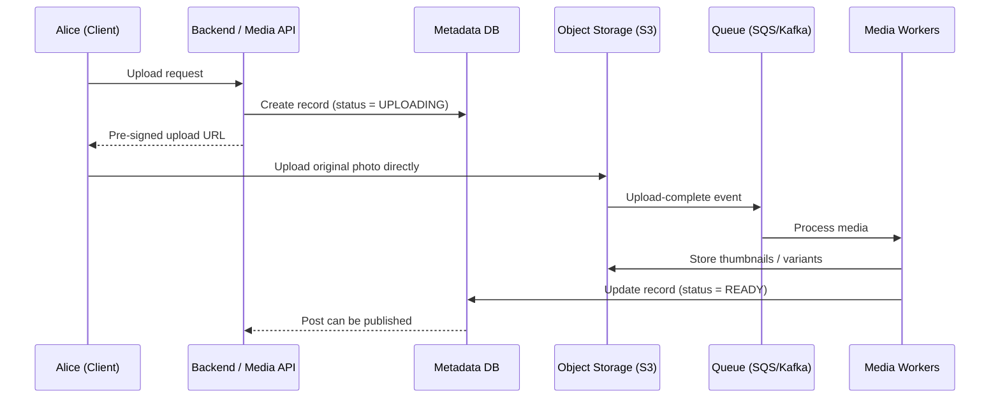
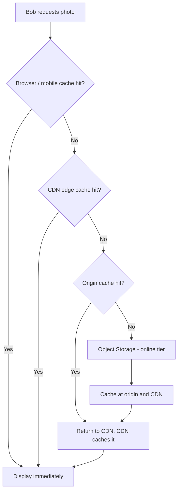
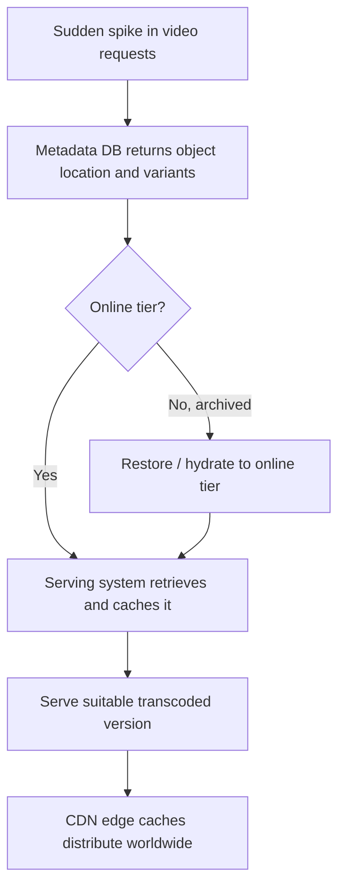
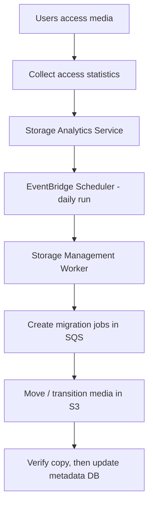

# How Facebook-Like Applications Store Billions of Photos and Videos

How a social media platform combines **Object Storage, CDN, Caching, a Metadata Database and Hot/Warm/Cold storage** to store and serve billions of photos and videos.

---

## Design Assumptions

Imagine our application has:

- 2 billion registered users
- 500 million daily active users
- 100 million new photos and videos uploaded every day
- Billions of likes, comments and shares
- Photos and videos uploaded more than 10 years ago
- Users accessing content from different countries

> The scale figures above are **hypothetical design assumptions**, not claims about Facebook's actual current traffic.

### The core challenge

How can we store billions of media files, deliver them quickly to users worldwide, control storage costs, and still retrieve very old content?

### Technologies that work together

| Technology | Role |
|---|---|
| Object Storage | Stores original photos and videos |
| CDN | Delivers media close to users |
| Caching | Avoids repeatedly accessing databases and storage |
| Metadata Database | Remembers who uploaded each file and where it is stored |
| Hot/Warm/Cold Storage | Optimizes storage cost based on access patterns |
| Background Processing | Resizes images, transcodes videos, manages storage transitions |

---

## 1. Two Major Flows

- **Upload flow** — a user uploads a photo or video.
- **Retrieval flow** — another user views that photo or video.

These flows share many components, but their responsibilities differ.

---

## 2. Responsibility of Each Component

### Object Storage — the media warehouse
- Stores the actual binary files: JPG, PNG, MP4, etc.
- AWS example: **Amazon S3**.
- The source of truth for stored media objects.

### CDN — the global delivery network
- Delivers photos and videos from locations closer to users.
- AWS example: **CloudFront**.
- Avoids fetching every media request from the central origin.

### Caching — the temporary fast-access layer
- Keeps frequently requested data in memory or fast storage.
- Examples: Redis, Memcached, local browser cache.
- Avoids repeatedly querying databases and origin storage.

### Metadata Database — the media catalogue
Stores information about each post and its media:
- Who uploaded it?
- Which post does it belong to?
- Where is the original file?
- Is it public or private?
- Which media versions exist?

### Hot/Warm/Cold — the storage placement strategy
Keeps frequently accessed media on faster, readily available storage and less frequently accessed media on cheaper tiers.

> **Real-world reference:** Meta publicly described **Haystack**, a custom photo object store designed to reduce the metadata overhead of storing billions of individual photos. It also described a multi-layer photo-serving system involving browser caches, edge caches, origin caches and Haystack storage.

---

## 3. Upload Flow — Alice Uploads a Photo




**Step 1 — User uploads a photo.** Alice selects a photo and clicks Upload. The Angular/React mobile or web frontend sends an upload request to the backend.

**Step 2 — Backend creates a media record.** The backend creates a unique media ID:

```json
{
  "media_id": "IMG-10001",
  "user_id": "USER-500",
  "status": "UPLOADING"
}
```

The backend may issue a **pre-signed upload URL** so the client can upload directly to object storage without sending all media bytes through the application server.

**Step 3 — Photo goes to Object Storage.** The original image is uploaded to S3.

```
media/
  user-500/
    IMG-10001/
      original.jpg
```

The database stores the media *information*; S3 stores the actual photo *bytes*.

**Step 4 — Background processing.** An event is sent to a queue such as SQS or Kafka. Background workers perform:
- Image resizing
- Thumbnail generation
- Image format optimization
- Malware/content checks where appropriate
- Video transcoding into multiple resolutions
- Metadata extraction

The application can store separate versions for thumbnails, feed previews and full-size viewing.

**Step 5 — Metadata database is updated** once processing succeeds:

```json
{
  "media_id": "IMG-10001",
  "user_id": "USER-500",
  "object_key": "media/user-500/IMG-10001/original.jpg",
  "thumbnail_key": "media/user-500/IMG-10001/thumb.jpg",
  "status": "READY",
  "visibility": "PUBLIC"
}
```

**Step 6 — Post becomes visible.** The post service associates the media ID with Alice's post. The feed service can now include the post in other users' feeds.

---

## 4. Metadata Database — Why Is It So Important?

Suppose the platform stores 100 billion photos. Would you search the entire S3 bucket to find Alice's photo? **No.** Maintain an indexed metadata database instead.

| Media ID | User ID | Post ID | Object Key | Visibility |
|---|---|---|---|---|
| IMG-10001 | USER-500 | POST-100 | user-500/IMG-10001/original.jpg | Public |
| IMG-10002 | USER-501 | POST-101 | user-501/IMG-10002/original.jpg | Friends |
| IMG-10003 | USER-502 | POST-102 | user-502/IMG-10003/original.jpg | Private |

The application queries the database using a media ID or post ID and gets the object key.

A production design would also maintain:
- Database indexes and partition keys
- Media processing status
- Object version and checksum
- Storage tier or archive status
- Thumbnail and transcoded video variants
- Deletion and retention state

> **Very important:** Never make the S3 URL itself the only record of a media file. Use a stable media ID and keep storage location details in the metadata layer. This makes it easier to change storage providers, move objects, and manage permissions.

---

## 5. Retrieval Flow — Bob Views Alice's Photo

Bob opens Facebook and sees Alice's photo in his News Feed. CDN and caching are critical here.



1. **Browser / mobile cache** — valid cached copy? Yes → display. No → continue.
2. **CDN edge cache** — does a nearby CloudFront edge location have it? Yes → return. No → continue to origin.
3. **Origin cache** — available in the origin-side cache? Yes → return to CDN. No → continue.
4. **Object storage** — retrieve the original or appropriate processed image from the online tier.
5. **Cache the response** — send it back through the origin and CDN layers, which may cache it for subsequent requests.

Meta documented this multi-layer design in its photo-caching engineering article: browser caches, edge caches, origin caches and Haystack.

### What if Alice's photo is private?

The application must authorize Bob before delivering the photo. **A CDN cache hit must never bypass privacy checks.**

Common techniques:
- Authorization before issuing a signed URL or cookie
- Short-lived signed access tokens
- Cache keys that respect access policy
- Private origin access
- Cache invalidation or versioned URLs when content changes

Public content can be cached more aggressively. Private content needs a carefully designed caching policy.

---

## 6. Hot, Warm and Cold Storage at Facebook-Like Scale

Consider three media files:

- **Photo A** — uploaded 10 minutes ago, already 1 million views.
- **Video B** — uploaded 2 years ago, 500 views per month.
- **Photo C** — uploaded 10 years ago, 2 views per year.

They should not necessarily use the same storage tier.

| Tier | Access pattern | Typical content | Storage |
|---|---|---|---|
| **HOT** | Frequently accessed, fast | Viral reels, trending videos, recently uploaded popular photos, frequently viewed profile pictures | Online object storage and fast media-serving infrastructure |
| **WARM** | Occasionally accessed, lower cost | Older posts that still receive views, moderate-traffic videos, photos from previous years | Lower-cost storage optimized for less frequent access |
| **COLD** | Rarely accessed, archive | Very old photos, old retained videos, historical media records | Archival storage, potentially requiring restoration before retrieval |

### Example AWS implementation

| Tier | Possible AWS implementation | Retrieval characteristics |
|---|---|---|
| Hot | S3 Standard + CDN + cache | Immediate online access |
| Warm | S3 Standard-IA or Intelligent-Tiering | Online access, different cost and access characteristics |
| Cold | S3 Glacier Flexible Retrieval | Archive restore required |
| Deep cold | S3 Glacier Deep Archive | Longer restore times, typically hours |

> S3 Standard-IA and Intelligent-Tiering are still **online** storage classes. Glacier archival classes have different retrieval behavior.

### Does Facebook use these exact AWS services?

No. These AWS services are examples for building our own system. Meta has published its own storage research:

- **Haystack** — a photo object-storage system.
- **f4** — a warm BLOB storage system for less frequently accessed objects.
- **Cold storage** — a specialized archival system for older media.

The f4 research explicitly discusses separating warm objects from hot objects to improve storage efficiency. Meta's more recent storage architecture writing also discusses automated placement of hot, warm and cold data across different storage media using its **Tectonic** storage infrastructure.

---

## 7. What Happens When an Old Video Suddenly Becomes Viral?

A video was uploaded in 2015. In 2026, an influencer shares it and 20 million people suddenly want to watch it.



1. The platform receives a sudden increase in video requests.
2. The metadata database identifies the video's object location and variants.
3. If in an online tier, the serving system retrieves it and caches it.
4. If in archival storage, a restore/hydration process must make it available.
5. The video-serving system can generate or retrieve suitable transcoded versions.
6. CDN edge caches distribute the popular video worldwide.

> **Architecture lesson:** A popularity change should influence storage placement, but moving data from archive to online storage takes time. The platform must handle initial demand while restoration is in progress. A production platform might also retain a durable online copy of especially popular content to avoid repeatedly restoring it.

---

## 8. Who Moves Old Images to Archive? (Storage Lifecycle Management)

In a production social media application, engineers do not manually move old photos to archive storage. A background process or storage-management service handles this automatically.

There are two common approaches:

1. **Automatic storage movement** using lifecycle policies.
2. **Intelligent storage movement** using a custom background worker.

### 8.1 Approach 1: AWS S3 Lifecycle Policy

Suppose Alice uploads a photo today. Initially, the photo is stored in **Amazon S3 Standard**. Engineers configure an **S3 Lifecycle Policy** to automatically transition eligible objects into cheaper storage classes as they age.


| Photo age | Storage location | Who moves it? |
|---|---|---|
| Day 0–90 | S3 Standard | Initial upload |
| Day 90–365 | S3 Standard-IA | S3 Lifecycle |
| After 1 year | S3 Glacier Flexible Retrieval | S3 Lifecycle |
| After 3 years | S3 Glacier Deep Archive | S3 Lifecycle, if configured and eligible |

> These are illustrative policy settings, not universal rules.

**Who actually performs the movement?** AWS manages it automatically. The S3 Lifecycle service evaluates the configured rules and performs eligible storage transitions. Your application does not need to run a Python script every day to move each photo.

### 8.2 Approach 2: Custom Storage Management Worker

Now consider a more intelligent Facebook-like application. Suppose:

- **Photo A** is 5 years old but receives 1 million views every month.
- **Photo B** is only 6 months old but receives zero views.
- **Photo C** is 10 years old and receives only 2 views per year.

Should the platform decide storage placement using age alone? **No.** It should also consider access frequency, popularity and retrieval requirements. For this, we can build a custom **Storage Management Service**.



**How does it work?**

1. **Collect media access statistics.** Every time users access media, the system collects relevant statistics.

   ```json
   {
     "media_id": "IMG-10001",
     "views_last_30_days": 2,
     "last_accessed": "2026-10-01",
     "current_tier": "HOT"
   }
   ```

2. **Storage Analytics Service.** An analytics job evaluates media access patterns. Example rules:
   - High views → Hot
   - Moderate views → Warm
   - Very low views → Candidate for Cold
3. **Scheduler.** A scheduled job runs periodically, for example once every day. AWS options include EventBridge Scheduler or scheduled workflows.
4. **Storage Management Worker.** The worker identifies objects that qualify for tier changes and creates migration jobs.
5. **Move or transition media.** The worker can use S3 APIs to copy objects between buckets or storage locations. For supported transitions within the same bucket, S3 Lifecycle can handle the transition instead.
6. **Update the metadata database.** Once the transition is confirmed, update the storage metadata.

   ```json
   {
     "media_id": "IMG-10001",
     "storage_tier": "COLD",
     "archive_status": "READY"
   }
   ```

### 8.3 Who Is Responsible for What?

| Component | Responsibility |
|---|---|
| **Amazon S3 Lifecycle** | Automatically transitions objects according to configured rules |
| **EventBridge Scheduler** | Starts scheduled storage-management jobs |
| **Storage Analytics Service** | Evaluates access patterns |
| **Storage Management Worker** | Performs custom migration and orchestration |
| **S3** | Stores the original media |
| **DynamoDB / RDS** | Stores media metadata and storage status |
| **CloudWatch** | Monitors jobs, errors and performance |

### 8.4 Important Scenario: What If an Archived Photo Becomes Viral?

Imagine Alice uploaded a photo in 2015. The photo was moved to Glacier Deep Archive. In 2026, it suddenly becomes viral. The application must:

1. Receive requests for the photo.
2. Check the metadata database for its current storage tier.
3. Detect that the original is archived.
4. Initiate an asynchronous Glacier restore.
5. Wait for restoration to complete.
6. Make an online copy available for serving.
7. Generate or retrieve the required image versions.
8. Distribute the image through the CDN.

The platform might then retain an online copy because the photo has become popular.

**Automated Archive Restore with S3 Batch Operations Copy**


1. Step 1 : Allow the AWS CloudFormation stack to automate manifest generation or upload a manifest of archived objects to the Amazon Simple Storage Service (Amazon S3) bucket.
2. Step 2 : The Stack or CSV upload invokes the Custom Resource or Restore Worker AWS Lambda function.
3. Step 3 : The Restore Worker Lambda function submits a Restore Operation job to Amazon S3 Batch Operations.
4. Step 4 : Amazon S3 Batch Operations initiates object restore in the S3 bucket containing the archived objects.
5. Step 5 : The Amazon S3 Batch Operations completion report invokes the Job Tracker Worker Lambda function.
6. Step 6 : The Job Tracker Worker Lambda function creates an entry in the Amazon DynamoDB table with the restore details.
7. Step 7 : Amazon EventBridge invokes the Job Scheduler Worker Lambda function on a schedule.
8. Step 8 : The Job Scheduler Worker Lambda function queries the state table to determine the status of each restore job and when it is eligible for a copy job.
9. Step 9 : The Job Scheduler Worker Lambda function invokes the Copy Worker Lambda function to submit Amazon S3 Batch Operations and invoke the Lambda function job.
10. Step 10 : Amazon S3 Batch Operations invokes a Lambda function that performs the actual copy operation to the destination S3 bucket.
11. Step 11 : The Amazon S3 Batch Operations report invokes the Job Tracker Worker Lambda function to send an Amazon Simple Notification Service (Amazon SNS) message to the user stating that the Amazon S3 Batch Operations Copy Job is completed.


> **Important:** The first users may need to wait for restoration. An archived object cannot be delivered instantly just because its popularity increased.

### 8.5 Which Approach Should We Use?

| Requirement | Recommended approach |
|---|---|
| Move media based on age | S3 Lifecycle Policy |
| Move media based on popularity | Custom Storage Management Worker |
| Monitor media access patterns | Analytics / event processing |
| Automatically restore archived media | Restore workflow |
| Manage metadata changes | Backend service + database |

**Recommendation for a social media architecture:** use a combination.

- **S3 Lifecycle** for predictable age-based transitions.
- A **custom Storage Management Service** for access-based decisions.
- **EventBridge Scheduler** for periodic analysis.
- **SQS** for migration and restoration jobs.
- **DynamoDB** for media metadata and tier status.

This gives you both automatic storage management and intelligent placement.

> **Production rule:** Never delete the original object immediately after starting a migration. Verify the destination object, checksum, metadata and access permissions first. Make the metadata update safely, and only remove the old copy when retention and migration policies permit it.

---

## 9. Videos Need Additional Architecture

A photo can often be delivered as a single image file. A video may be several gigabytes and needs different resolutions, bitrates and streaming behavior.

Suppose Alice uploads a 4K video:


```
             Original 4K Video
                    |
                    v
             Object Storage
                    |
                    v
             Kafka / SQS Queue
                    |
                    v
            Video Processing Workers
                    |
           +--------+--------+
           |        |        |
           v        v        v
         1080p     720p     480p
           |        |        |
           +--------+--------+
                    |
                    v
              Object Storage
                    |
                    v
             CDN Distribution
                    |
                    v
               Viewers
```

**Why multiple versions?** Bob may be on a slow mobile connection while another user is on high-speed broadband. The player selects an appropriate bitrate using **adaptive bitrate streaming**, such as **HLS** or **MPEG-DASH**.

Meta's engineering article on Facebook's video delivery system describes a video-serving stack that works with different data sources, feeds, databases and caches.

---

## 10. Caching Strategy — What Exactly Should We Cache?

Not everything belongs in Redis.

| Data | Suitable cache | Why |
|---|---|---|
| Popular post metadata | Redis / Memcached | Fast post lookup |
| User profile summary | Redis / Memcached | Frequently accessed |
| Likes count | Redis or specialized counters | Fast counter reads |
| Social graph relationships | Distributed graph/cache layer | Fast relationship lookup |
| Photo/video bytes | CDN edge cache | Fast media delivery |
| Frequently requested metadata | Application local cache | Reduce network calls |
| Original photo/video | Object storage | Durable source of truth |

Example: when Bob opens his News Feed, the application retrieves cached post metadata, user information and relationship information instead of querying the database for every detail, then requests the media from the CDN.

> **Remember:** Redis is not where we store billions of original videos. It is for caching suitable metadata and small, frequently accessed values.

Meta has documented how its **Memcache** and **TAO** systems reduce database work for social graph queries.

---

## 11. Scaling the Metadata Database

With 100 billion media records, a single database server cannot handle every request. We need horizontal scaling.

```json
{
  "media_id": "IMG-10001",
  "user_id": "USER-500",
  "post_id": "POST-100",
  "object_key": "media/user-500/IMG-10001/original.jpg",
  "media_type": "IMAGE",
  "visibility": "PUBLIC",
  "storage_tier": "HOT",
  "status": "READY"
}
```

### Database partitioning

Partition records using a stable key such as `media_id` or `user_id`, depending on access patterns.

| Shard | Media IDs |
|---|---|
| Shard 1 | 1 – N |
| Shard 2 | N – 2N |
| Shard 3 | 2N – 3N |

*Illustrative only. Real systems use carefully designed partition keys, indexes, replication and rebalancing.*

On AWS, **DynamoDB** is one option for highly scalable key-value metadata access. **RDS/Aurora** may suit relational data and transactional requirements.

Meta's **TAO** is a useful reference: a distributed social graph using sharding, caching and persistent storage to serve relationships such as user-to-post, user-to-friend and post-to-comment.

---

## 12. Complete AWS Production Architecture


| Layer | AWS technology | Responsibility |
|---|---|---|
| Frontend | Angular / React | User interface |
| Global delivery | CloudFront | Deliver images and videos |
| Security | AWS WAF | Protect public entry points |
| API entry | API Gateway / ALB | Route requests |
| Backend | ECS / EKS | Run application microservices |
| Media storage | S3 | Store photos and videos |
| Metadata | DynamoDB | Store media and post metadata |
| Relational data | Aurora / RDS | Store relational application data |
| Cache | ElastiCache Redis | Cache popular metadata |
| Async processing | SQS / Kafka | Queue background work |
| Image processing | Lambda / ECS workers | Generate image variants |
| Video processing | MediaConvert / ECS workers | Transcode videos |
| Archival | S3 Glacier | Retain older media |
| Monitoring | CloudWatch / OpenTelemetry | Monitor system health |

### Logical diagram

```
                   GLOBAL USERS
                        |
                  CLOUDFRONT CDN
                        |
                      AWS WAF
                        |
                  API GATEWAY / ALB
                        |
                MICROSERVICE CLUSTER
                   (ECS / EKS)
                        |
          +-------------+--------------+
          |             |              |
       Post API       Media API     User API
          |             |              |
          |             v              |
          |         S3 Upload          |
          |             |              |
          |          SQS/Kafka         |
          |             |              |
          |       Media Workers        |
          |       Image/Video          |
          |        Processing          |
          |             |              |
          +-------------+--------------+
                        |
              +---------+---------+
              |                   |
          Metadata DB          Redis
          DynamoDB             Cache
              |
         Media Metadata
              |
          S3 Object Storage
              |
       +------+------+------+
       |             |      |
      HOT           WARM   COLD
       |             |      |
     S3 Standard  S3 IA  Glacier
       |
    CloudFront
       |
     Viewers
```

> This is a reference design, not Facebook's exact internal architecture.

---

## 13. Production Failure Scenarios

| Scenario | What should happen |
|---|---|
| Upload fails halfway | Mark upload incomplete; retry or clean up abandoned multipart uploads |
| Image worker crashes | Queue retries processing; use idempotent workers |
| Metadata saved but S3 upload fails | Reconcile incomplete records and retry or mark failure |
| CDN cache miss | Fetch from origin or object storage |
| Redis goes down | Fall back to the database with rate limits and load protection |
| Database shard becomes unavailable | Fail over to a healthy replica or shard owner |
| Old video is archived | Restore/hydrate before serving if necessary |
| Video becomes viral | Scale delivery and cache popular variants |
| User deletes a photo | Update metadata, invalidate caches, delete eligible object versions per retention rules |

**Idempotency** is a key principle: if a video-processing job is delivered twice, the worker must not create duplicate posts or inconsistent media records.

---

## 14. Facebook Technologies vs. Our AWS Implementation

| Meta published technology | What it solves | Our learning implementation |
|---|---|---|
| Haystack | Photo object storage | Amazon S3 |
| f4 | Warm BLOB storage | S3 Intelligent-Tiering / Standard-IA (approximation) |
| Tectonic | Distributed storage infrastructure | S3 and distributed storage concepts |
| Memcache | Fast caching | Redis / ElastiCache |
| TAO | Social graph storage and queries | DynamoDB or a graph-oriented service |
| Edge and origin caches | Photo delivery | CloudFront and origin caching |

These are conceptual equivalents, not identical implementations. Meta has evolved its internal infrastructure over time.

---

## 15. Test Your Understanding

1. **A newly uploaded video becomes viral. Which component helps deliver it globally?**
   Redis / **CDN** / Glacier Deep Archive → **CDN** — it caches and distributes popular video close to viewers.

2. **Where should the original 4K video be stored?**
   Redis / Metadata database / **Object storage** → **Object storage** — it holds the durable video bytes.

3. **Where do we store the media ID, user ID and object key?**
   **Metadata database** / CDN edge cache only / Video transcoder → **Metadata database** — it maps media identifiers to storage locations and attributes.

4. **An old video in Deep Archive suddenly becomes popular. What must happen?**
   Redis automatically restores it / **Restore or hydrate it into an online tier** / Only update the likes count → an archived object must be restored before normal online delivery.

5. **Should we store original videos in Redis?**
   Yes, always / **No, use object storage** / Only when viral → Redis is a cache, not the durable home for massive original media files.

---

## 16. Recommended Learning Sequence

1. **Object storage and S3** — upload, multipart upload, object keys, versioning.
2. **Metadata database** — DynamoDB partition keys, indexes, media mapping.
3. **CDN** — CloudFront, cache policies, signed URLs, invalidation.
4. **Redis** — caching popular posts, user profiles and counters.
5. **Kafka/SQS** — asynchronous media-processing workflows.
6. **Hot/Warm/Cold** — lifecycle policies and archival restoration.
7. **Video processing** — transcoding, HLS, adaptive bitrate streaming.
8. **Distributed architecture** — sharding, replication, failures, multi-region deployment.

### Official engineering resources worth studying

- **Haystack** — Finding a needle in Haystack: efficient storage of billions of photos (object storage)
- **Facebook photo caching architecture** — browser, edge and origin caching
- **f4: Facebook's Warm BLOB Storage System** — warm storage
- **Facebook's cold storage system** — archival storage
- **TAO: The power of the graph** — social graph databases
- **Inside Facebook's video delivery system** — video delivery

---

## Social Media Note (Point-to-Point)
Headline: How Facebook-Scale Apps Store Billions of Photos & Videos 📸🎥


Ever wonder how platforms with billions of users serve content instantly without crashing? It's not one giant hard drive; it's a sophisticated, multi-layered architecture. Here’s the breakdown:

The Core Challenge: Storing exabytes of data, delivering it globally, keeping costs low, AND retrieving 10-year-old posts instantly. 📉📈

1. Object Storage (The Warehouse): Services like Amazon S3 are the "source of truth." They store the actual durable photo/video bytes (the .jpg or .mp4).

2. The Metadata Database (The Librarian): YOU DO NOT SEARCH S3. 🛑 An indexed database (like DynamoDB) is essential. It maps a stable Media ID to the exact S3 Object Key, along with permissions, user ID, and location.

3. Upload Efficiency (Direct-to-S3): The backend issues a "pre-signed URL," allowing the client to upload large media files directly to S3. This prevents the main application servers from becoming a bottleneck. 🚀

4. Asynchronous Processing (The Factory): After upload, an event is queued (SQS/Kafka). Background workers then resize images, generate thumbnails, transcode videos (into HLS/DASH streams), and run security checks.

5. Caching & CDN (The Speed Layer): 🔥 Content is cached aggressively.

Redis: Caches "hot" metadata for fast lookups.

CDN (CloudFront): Caches media at edge locations globally, bringing content physically closer to the user.

6. Storage Lifecycle (Hot/Warm/Cold): 🌡️ Costs are managed by moving data based on access frequency:

Hot: Recent/viral content on high-performance storage (S3 Standard + CDN).

Warm: Older, less-viewed content on cheaper storage (S3 IA).

Cold: Historical content archived (Glacier).

7. The Viral Old Video Problem: If a 10-year-old archived video goes viral, it must be "rehydrated" (restored) from Cold to Hot storage. This takes time, so initial users may experience a delay. ⏳

Key Takeaway: Object Storage RETAINS, the Metadata Database LOCATES, and the CDN DELIVERS. 🔑

---

## Key Takeaway

**Object Storage** retains the media, the **Metadata Database** locates it, **Caching** reduces repeated work, the **CDN** delivers it globally, and **Hot/Warm/Cold storage** controls the cost of retaining it. These components work together; none replaces the others.
