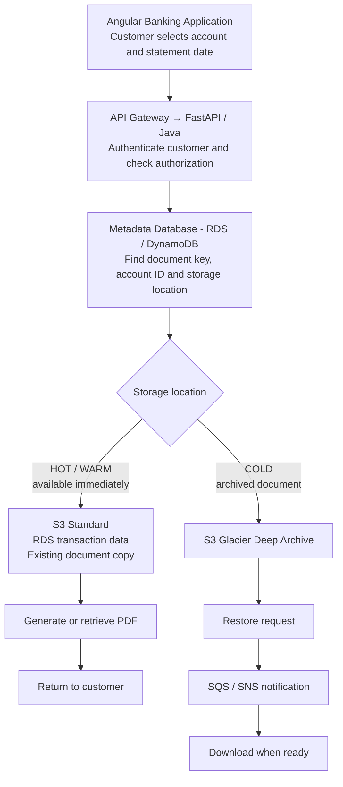

# Why Do Old and New Bank Statements Take the Same Time to Generate?

**Scenario:** A bank saves old data in **S3 Glacier Deep Archive** and new data in **RDS / DynamoDB**, yet both seem to take the same time to generate a PDF bank statement. Why?

The key concept: **PDF generation time and data retrieval time are two different things.**

A bank can take almost the same time to generate a new statement and an old statement, even though the underlying data is stored in completely different storage systems.

> **Condition:** if the old PDF really needs to be retrieved from S3 Glacier Deep Archive, the total customer waiting time should normally be **much longer**.

---

## 1. First, Understand the Difference

Imagine two customers:

- **Customer A** requests a statement for November 2026. Its transaction data is in RDS.
- **Customer B** requests a statement for January 2015. Its PDF is in S3 Glacier Deep Archive.

There are two separate operations:

| Operation | What happens |
|---|---|
| Data retrieval | Fetching the required transaction data or existing PDF |
| PDF generation | Converting transaction information into a formatted PDF |

The PDF generation engine might take 2 seconds in both cases. But retrieving an archived PDF can take hours.

---

## 2. Why Can Both Take the Same Time?

There are four common architectural reasons.

### Reason 1: The bank has already generated and saved the PDF

This is very common for bank statements.

**New statement: November 2026**

1. Fetch transaction records from RDS.
2. Generate PDF using the PDF generation service.
3. Return the PDF to the customer.

**Old statement: January 2015**

1. Restore the previously generated PDF from Glacier (if not already restored).
2. Read the restored PDF from S3.
3. Return the existing PDF to the customer.

For the old statement, the bank does **not** need to generate the PDF again. It already exists.

### Reason 2: The bank has a cached or temporary accessible copy

Suppose a customer requested their 2015 statement yesterday. The bank restored the PDF from Glacier Deep Archive and kept the restored copy available for 7 days.

Today, the same customer requests that statement again. The bank can read the already-restored copy from S3 **without waiting another 12–48 hours**.

AWS supports temporary restored copies for a specified duration.

### Reason 3: The bank is measuring only PDF generation time

| Statement | PDF generation time |
|---|---|
| New statement | 2 sec |
| Old statement (if regenerated from available data) | 2 sec |

The PDF rendering engine takes approximately the same time because rendering a PDF is independent of whether its source data originally came from RDS or another storage system.

However, these 2 seconds do **not** represent the entire retrieval process.

### Reason 4: The bank keeps the original data in an active system

A bank may have this architecture:

- RDS stores current transactions.
- S3 Glacier stores a historical archival copy.
- A separate document repository stores frequently requested statements.

When a customer requests an old statement, the application might retrieve it from the document repository rather than Glacier. In that case, Glacier is used for **long-term retention**, not normal customer retrieval.

---

## 3. Compare the Actual Customer Waiting Time

Assume the bank has already generated the old PDF and has not previously restored it.

### Scenario A: New statement from RDS

| Step | Time |
|---|---|
| Fetch transactions | 300 ms |
| Generate PDF | 2 seconds |
| Return PDF | 300 ms |
| **Illustrative total** | **2.6 sec** |

### Scenario B: Old statement from Glacier Deep Archive

| Step | Time |
|---|---|
| Initiate restore request | – |
| Wait for archive restoration | Typically around 12 hours for Standard retrieval |
| Read the restored PDF | 300 ms |
| Return PDF | 300 ms |
| **Illustrative total** | **12+ hours** |

> Illustrative timings, not an SLA. Deep Archive Standard retrieval typically takes within 12 hours; Bulk typically takes within 48 hours.

---

## 4. How Should a Production Banking Application Handle This?

Build **two different retrieval workflows**.

### Production statement retrieval architecture

The cold-storage workflow should be **asynchronous**:

1. Customer requests an old statement.
2. Backend checks whether a restored copy is already available.
3. If not, backend submits a Glacier restore request.
4. The customer receives a request ID and sees a pending status.
5. AWS sends a restore-completed event through S3 Event Notifications, SNS or SQS.
6. Backend updates the request status.
7. Customer receives a notification and downloads the PDF securely.

---

## 5. The Most Important Architecture Lesson

Never confuse these three measurements:

| Metric | What it measures |
|---|---|
| Data retrieval latency | How long it takes to access source data |
| PDF generation latency | How long the PDF engine takes to create the document |
| End-to-end response time | Total time from customer request until the PDF is available |

So your understanding should be:

- **RDS/DynamoDB** → source data can be queried quickly.
- **Glacier Deep Archive** → archived data requires asynchronous restoration.
- **PDF generation** → can take almost the same time for both if the required data is already available.

---

## Key Takeaway

> Same PDF generation time does **not** mean same customer waiting time. The end-to-end time depends on whether the data or PDF must first be restored from Glacier Deep Archive.

For deeper AWS learning, read the official documentation: *Restoring an archived S3 object*.
