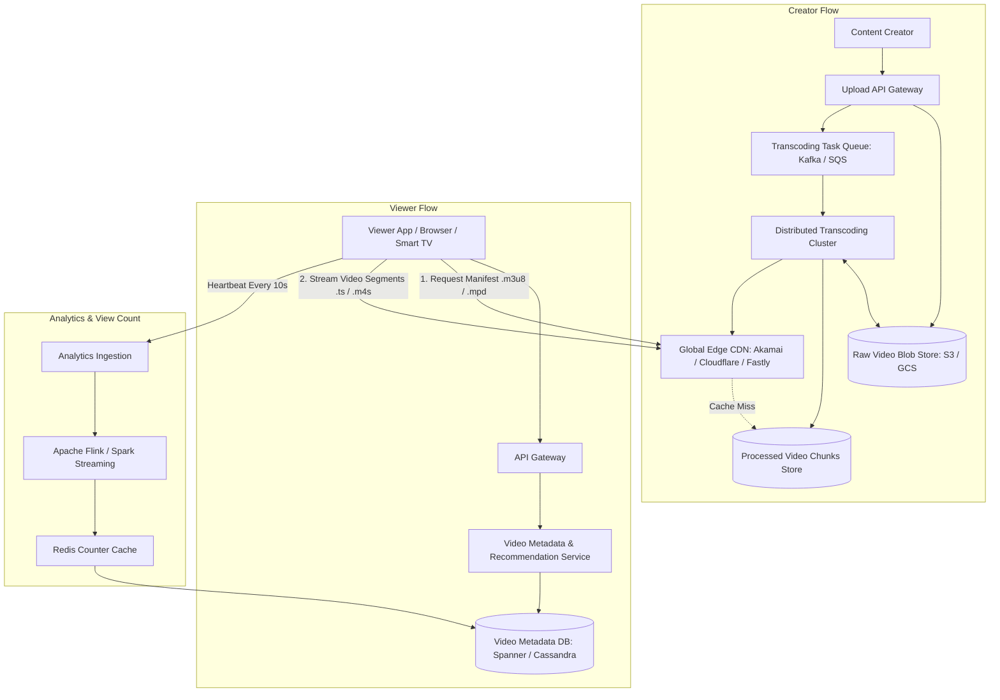
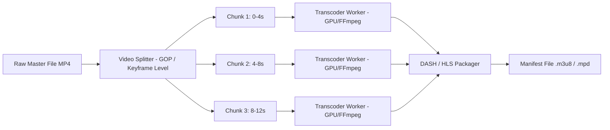

# Video Streaming Platform Architecture (e.g., YouTube, Netflix)

## 1. Overview
A **Video Streaming Platform** allows creators to upload high-definition video content, automatically transcodes it into multiple resolutions and bitrates, and streams it adaptively (ABR) with low latency to hundreds of millions of global viewers concurrently.

---

## 2. Requirements

### Functional Requirements
- **Video Upload**: Creators upload videos of arbitrary format (MP4, MKV, MOV) and size (up to 128 GB).
- **Transcoding / Encoding**: Transcode raw video into multiple resolutions (144p, 360p, 720p, 1080p, 4K) using standard streaming codecs (H.264/AVC, H.265/HEVC, VP9, AV1).
- **Adaptive Bitrate (ABR) Streaming**: Stream video chunks smoothly using HLS (HTTP Live Streaming) or MPEG-DASH depending on client bandwidth.
- **Video Search & Discovery**: Search by title, tags, description; personalized recommendation feed.
- **Engagement**: View count tracking, likes, comments, subscriptions.

### Non-Functional Requirements
- **High Availability**: 99.99% uptime globally.
- **Low Video Playback Latency & Buffering**: Smooth start time (< 500ms initial playback) and minimal buffering.
- **Scalability**: Handle 1+ billion Daily Active Users (DAU), 500+ hours of video uploaded every minute.
- **Durability & Security**: High storage durability (11 9s) and DRM (Digital Rights Management) content protection.

---

## 3. Capacity Estimation

### Assumptions
- **Daily Active Users (DAU)**: 500 Million.
- **Video Uploads**: 500 hours uploaded per minute $\implies 720,000 \text{ hours/day}$.
- **Average Raw Video Bitrate**: 20 Mbps $\implies 9 \text{ GB/hour}$.
- **Daily Upload Storage**: $720,000 \times 9 \text{ GB} \approx 6.48 \text{ PB/day}$.
- **Transcoded Output Expansion**: Storing 5 resolutions + audio tracks adds $\approx 2.5\times \implies \approx 16.2 \text{ PB/day}$.
- **Average Daily View Time**: 30 minutes/user.
- **Daily Video Stream Bandwidth**:
  - $500 \text{M users} \times 0.5 \text{ hrs} = 250 \text{M stream hours/day}$.
  - Average viewing bitrate = 3 Mbps (720p/1080p).
  - Data transfer per day = $250 \times 10^6 \times 3 \text{ Mbps} \times 3600 \text{ s} \approx 337.5 \text{ Petabytes/day}$.
  - Average CDN Egress Bandwidth $\approx 31.25 \text{ Terabits/sec (Tbps)}$.

---

## 4. High-Level Architecture (HLD)



---

## 5. Architectural Deep Dives

### 5.1 Video Transcoding Pipeline
Raw video files are massive and cannot be streamed reliably as a single monolithic file.



1. **GOP (Group of Pictures) Splitting**: Video is sliced at I-Frames (Keyframes) into 2–6 second segments.
2. **Parallel Encoding**: Hundreds of worker nodes transcode segments simultaneously into target ladders:
   - 1080p @ 4.5 Mbps
   - 720p @ 2.5 Mbps
   - 480p @ 1.2 Mbps
   - 360p @ 600 Kbps
3. **Packaging**: Creates segment files (`segment_1080p_001.ts`) and master playlist manifest (`master.m3u8`).

### 5.2 Adaptive Bitrate Streaming (ABR)
- **HLS / MPEG-DASH**:
  - The client media player fetches the `master.m3u8` playlist.
  - Client continuously measures network bandwidth, buffer occupancy, and screen resolution.
  - If bandwidth drops, player requests the next 4-second chunk in 480p; when bandwidth recovers, it switches seamlessly to 1080p without user-perceived buffering.

```
Master Playlist (.m3u8):
#EXTM3U
#EXT-X-STREAM-INF:BANDWIDTH=4500000,RESOLUTION=1920x1080
1080p/index.m3u8
#EXT-X-STREAM-INF:BANDWIDTH=2500000,RESOLUTION=1280x720
720p/index.m3u8
#EXT-X-STREAM-INF:BANDWIDTH=1200000,RESOLUTION=854x480
480p/index.m3u8
```

### 5.3 Global CDN Caching & Edge Optimization
- **Edge PoPs (Points of Presence)**: Video chunks are cached close to viewers.
- **Popularity-Based Tiering**:
  - **Top 20% viral videos**: Cached on edge SSD/RAM across all worldwide PoPs (handles 80%+ of bandwidth).
  - **Long-tail videos**: Evicted to regional storage or fetched on-demand from origin blob storage.
- **Range Requests**: HTTP `Range: bytes=X-Y` allows client to seek instantly to any minute without downloading intervening segments.

### 5.4 Accurate View Counting (Deduplication & Anti-Fraud)
- **Problem**: Millions of viewers watch viral videos concurrently; direct database writes would crush DB.
- **Solution**:
  - Client sends playback heartbeat ping every 10–30s.
  - Heartbeats stream into Apache Kafka.
  - **Apache Flink / Spark Streaming** aggregates counts with a 1-minute tumbling window and enforces anti-fraud checks (validates user watch duration $\ge 30\text{s}$, IP rate-limiting, bot detection).
  - Aggregated view deltas are flushed to Redis counter (`INCRBY`) and lazily persisted to SQL/NoSQL storage.

---

## 6. Database Schema Design

```sql
CREATE TABLE videos (
    video_id VARCHAR(16) PRIMARY KEY, -- Base62 URL short ID (e.g. dQw4w9WgXcQ)
    channel_id UUID NOT NULL,
    title VARCHAR(255) NOT NULL,
    description TEXT,
    duration_seconds INT NOT NULL,
    privacy_status VARCHAR(16) DEFAULT 'PUBLIC', -- PUBLIC, UNLISTED, PRIVATE
    manifest_url VARCHAR(512) NOT NULL,
    thumbnail_url VARCHAR(512) NOT NULL,
    view_count BIGINT DEFAULT 0,
    like_count BIGINT DEFAULT 0,
    created_at TIMESTAMP WITH TIME ZONE DEFAULT NOW()
);

CREATE TABLE video_resolutions (
    video_id VARCHAR(16) NOT NULL,
    resolution VARCHAR(16) NOT NULL, -- 1080p, 720p, etc.
    bitrate_kbps INT NOT NULL,
    playlist_path VARCHAR(512) NOT NULL,
    PRIMARY KEY (video_id, resolution)
);
```

---

## 7. Key Takeaways
- Decouple video upload from transcoding using asynchronous task queues.
- Slice videos at Keyframes for massive parallel distributed transcoding.
- Leverage Adaptive Bitrate Streaming (HLS/DASH) and Edge CDNs to achieve global sub-second playback start time.
